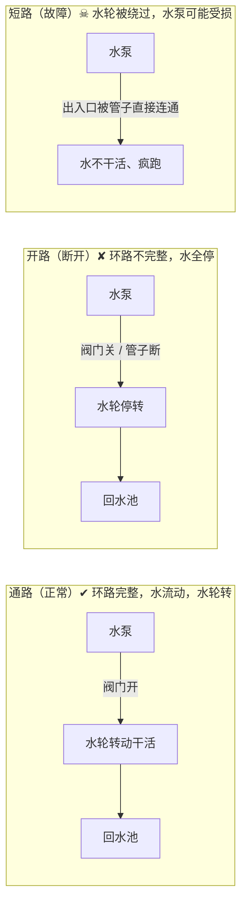

# 第 01 课 · 电学基本概念

> **所属阶段**：阶段一 · 电学、器件与测量基础
> **前置课程**：无
> **本课难度**：⭐

## 🎯 本课目标

学完这一课，你应该能够：

1. 用水流、水位、水泵这些生活类比，向完全外行讲清电流、电压、电阻、功率的区别与联系
2. 熟练换算电学单位：A/mA/μA、V/mV/kV、Ω/kΩ/MΩ、F/μF/nF/pF，看到 100nF、10kΩ、20mA 这类标注能立刻反应出数量级
3. 默写欧姆定律 U = I × R 的三种形态，并独立算出"LED 限流电阻""PCB 走线压降"这类真实问题
4. 用 P = U × I、P = I² × R 计算功率与发热，会估算 5V/1A 充电头的输出电能和手机电池的能量
5. 说清通路、开路、短路三种电路状态，解释短路为什么是 PCB 设计与焊接的头号敌人
6. 建立"地（GND）只是参考点"的意识，能看懂万用表测量和原理图里各种"地"的标法
7. 认识万用表：知道测电压、电流、电阻分别用什么挡位、表笔怎么接

## 📖 正文

这是整套课程的第一课——不碰具体电路、专心打概念地基的"纯电学"课。先说好规矩：这一课假设你的物理已经全还给老师，数学只需要加减乘除和分数。每个概念都从生活画面讲起——拧水龙头、水池放水、水泵抽水——能在脑子里"看见"这些画面，就能学懂电。后面你要认元器件实物（第 04 课）、学 EDA 软件（第 07 课）、亲手画板子（第 09 课），一切的前提是：看到电路里的数字和符号，你知道它在说什么。

学法建议：每节末尾有"停下来检查"，小声说出答案再往下走；说不出来，就是要回头重读的信号。

### 01.1 电是什么：先建立画面，再谈定义

#### 01.1.1 电荷：电的"原材料"

想象一个水池，里面有多少水，我们心里有数。电也一样，是一种"东西"，只是小到看不见。一切物质由原子组成：中心是原子核（带正电），外围是电子（带负电）。平时正负电量相等、互相抵消，物体就"不带电"；一旦电子被搬走或塞进来，平衡被打破，物体就带电了——电子被搬走带正电，被塞进来带负电。

这种"带电的多少"叫电荷（charge），单位是库仑（C）。库仑是个巨大的打包单位——1 库仑约等于 6.24 × 10¹⁸ 个电子电荷量的绝对值。这个数不用记，有感觉就行：电子电量小到夸张，所以人们成堆地数它们，就像用"吨"来数米。两个够用的直觉：

- **同性相斥、异性相吸**：正正互推、正负互拉，电荷间的相互作用是理解许多电现象的基础
- **电荷只转移、不凭空产生**：电荷守恒；金属导线主要由电子导电，半导体和电解液中的载流方式则不同

这在板子上：铜线就是电子跑动的"马路"，焊盘就是"路口"。电没有魔法，只是小颗粒在马路上挪。

#### 01.1.2 导体与绝缘体：谁能"过电"

电子想挪动，还得看"马路"通不通：畅通的宽马路叫**导体**，电子自由跑；三面是墙的死胡同叫**绝缘体**，电子被死死捆住。

| 类别 | 特点 | 常见材料 | 在 PCB 上的角色 |
|---|---|---|---|
| 导体 | 电子能自由移动 | 铜、金、银、铝、焊锡 | 铜箔走线、焊盘、过孔内壁镀铜 |
| 绝缘体 | 电子被束缚，几乎不导电 | 玻璃纤维与树脂组成的 FR-4、塑料、陶瓷、空气 | 基材、阻焊层、导线外皮 |
| 半导体 | 导电能力介于两者之间且可控 | 硅 | 一切芯片的原材料 |

半导体留个印象即可：芯片就是用"可控的导体/绝缘体"堆出来的开关阵列，该通则通、该断则断。二极管、三极管这些半导体器件到第 04 课认实物。这在板子上：一块 PCB 就是"导体+绝缘体"的三明治——中间玻璃纤维（绝缘），两面贴铜箔（导体），蚀刻掉不要的铜，剩下的就是电路。

#### 01.1.3 基本电路与控制：一个水路，一个电路

先看熟悉的水路，再对照电路——两者长得一模一样：

```
   水路系统                        电路系统
 水泵：把水抽到高处   ←对应→   电源：把电荷"抽"到高电位
 水管：水的通道       ←对应→   导线/走线：电荷的通道
 水轮机：被水推着干活 ←对应→   灯/芯片：被电流推着干活
 阀门：控制通断       ←对应→   开关：控制通断
```

一个简单的供电电路需要电源、负载和连接它们的闭合导电路径；开关或保护件常用于控制和保护，但不是形成基本闭合回路的必备元件。这在板子上：PCB 本质上就是把"导线和连接点"批量印刷出来的产品，你以后画的每一根线都是这里的"导线"。

**停下来检查 01.1**

1. 钥匙（金属）和橡胶手套，哪个是导体？
2. 一个简单供电电路需要哪些部分？开关起什么作用？

<details>
<summary>停下来检查：答案</summary>

- 钥匙是导体（金属里电子自由）；橡胶是绝缘体（电子被捆住）
- 电源↔水泵、负载↔水轮机、导电路径↔水管；开关↔阀门，可用来控制通断

</details>

### 01.2 电流（Current）：电的"流量"

#### 01.2.1 什么是电流：先看水龙头

拧开水龙头，水哗哗地流。流得"多不多"，用**流量**描述：每秒流过水管横截面的水量。把画面搬到导线里——每秒流过导线横截面的电荷量，就叫**电流**，符号 I：

**I = ΔQ / Δt**（一段时间内的平均电流；电流恒定时可写 I = Q / t）

逐个字母看：**I** 是电流，单位安培（A），简称安；**Q** 是电荷量（上面说的"带电的多少"），单位库仑（C）；**t** 是时间，单位秒（s）。1A 就是"每秒流过 1 库仑电荷"，电流越大电荷流得越湍急。

- **算例 1**：10 秒流过导线某处 20 库仑电荷，电流多大？I = Q ÷ t = 20 ÷ 10 = 2A
- **算例 2**：电流 0.5A，10 秒流过多少电荷？公式反过来用：Q = I × t = 0.5 × 10 = 5 库仑

#### 01.2.2 单位阶梯：A、mA、μA

安培在很多时候"太大"——点亮一个 LED 只要 0.01A，写小数别扭，于是像"米、毫米、微米"一样分级：


1A = 1000mA（毫安，"毫"= 千分之一）；1mA = 1000μA（微安，"微"= 百万分之一）。口诀：**往小单位走数字变大（×1000），往大单位走数字变小（÷1000）**，相当于小数点一次搬 3 格。完整算例：

- 0.05A 换 mA：0.05 × 1000 = 50，所以 0.05A = 50mA
- 2000mA 换 A：2000 ÷ 1000 = 2，所以 2000mA = 2A
- 20mA 换 μA：20 × 1000 = 20000μA；100μA 换 mA：100 ÷ 1000 = 0.1mA

#### 01.2.3 电流的方向：一个将错就错的约定

电路图上的电流箭头，从电源正极出发、经用电器回负极。尴尬的是：金属里真正在跑的是带负电的电子，实际方向恰好相反。为什么不纠正？因为"惯例方向"定下时大家还不知道电子存在，等发现时全世界的电路图、公式、仪表都已按它造好，改不动了。记住：**看到电流箭头，它指惯例方向，不必纠结电子往哪跑**。

#### 01.2.4 数量级手感

| 场景 | 典型电流（经验值） |
|---|---|
| 芯片休眠、静电漏电 | μA 级 |
| 单片机 IO 点亮低电流 LED | 数 mA 是一种示例；单脚和端口总电流限制按具体芯片手册核对 |
| 手机通话 | 200~300 mA |
| USB 2.0 标准下游端口 | 配置后通常最多 500 mA；设备还须按接口与主机供电条件取电 |
| 电动车快充 | 100 A 以上 |

#### 01.2.5 ❌误解 vs ✅正解：电流会被"用掉"吗？

❌ **误解**：电流从电池流出，经过灯泡时被"用掉一部分"，流回电池的电流变小了。

✅ **正解**：电流像推动水轮的水——水轮被推着转，但**水量一点没少**，进多少出多少。导线里串两颗一样的灯泡，两颗一样亮，电流处处相等。灯泡消耗的不是电流，而是电荷携带的**能量**（01.7 节细算）。记住：**电流是环路里的流量，进去多少出来多少；被消耗的是能量，不是电流。**

这在板子上：铜走线能安全通过的电流有限度——过流发热、烧断。载流能力取决于铜厚、走线长度、允许温升、散热和环境等，不能单靠线宽给出统一电流值。所以"大电流的线要加宽"，第 09 课会变成具体布线规则。

**停下来检查 01.2**

1. 3A = ? mA；0.2A = ? mA。
2. 5000μA = ? mA = ? A。
3. 流入灯泡 100mA，流出多少？

<details>
<summary>停下来检查：答案</summary>

- 3 × 1000 = 3000mA；0.2 × 1000 = 200mA
- 5000 ÷ 1000 = 5mA；再 ÷1000 = 0.005A
- 还是 100mA——电流不被用掉，被消耗的是能量

</details>

### 01.3 电压（Voltage）：电的"水位差"

#### 01.3.1 什么是电压：高水池与低水池

想象高处、低处两个水池，中间接水管。拧开阀门，水自然从高处冲向低处，还能推转一个水轮。水为什么肯流？因为**有高度差**。对应到电：**电压就是电位之间的"高度差"，描述推电荷的"劲"**。符号 U，单位伏特（V），简称伏。


在其他条件相同的简单电阻回路中，电压越大，电流越大；但有电压不一定有电流，实际电流还取决于负载和回路。

#### 01.3.2 ❌误解 vs ✅正解：电压和电流是一回事吗？

❌ **误解**：电压大就是电流大，两个词说的一回事。

✅ **正解**：两码事。**电流是"流量"**（每秒流过多少电荷，回答"多不多"）；**电压是"水位差"**（推电荷的劲，回答"劲大不大"）。用水枪分清：水塔再高，阀门关死也没有水流；同样，电源两端有电压，但电路断开时不一定有电流。电流还取决于回路和负载。

#### 01.3.3 电位与参考点：GND 到底是什么

严格说，电压一定是**两点之间的比较**——就像"高度"要相对某个地面说。平时说"这点电压 3.3V"，省略了半句，全称是"这点**相对于参考点**是 3.3V"。参考点是什么？想想海拔：说珠峰 8848 米，是相对**海平面**——海平面被人为规定为 0 米。电路也一样，先指定一个"海平面"，规定它电位为 0V，这个点就叫**地**，电路图上写作 **GND**（ground 的缩写）。关于 GND，现在建立三条认知：

1. **"地"是人为指定的参考点**，不神秘。电池负极、电源负端常被选作地
2. **同一网络名称的 GND 符号表示同一电气网络**：画图时可用符号代替长导线。不同的隔离地、模拟地或保护地未必相连，必须结合网络名和隔离设计判断
3. **万用表测电压的基本动作**：两支表笔分别接被测的两个点；测某点相对 GND 的直流电压时，通常黑表笔接 GND、红表笔接该点，负读数表示红笔电位较低

❌ **误解**：GND 叫"地线"，是不是真要埋根线进大地？

✅ **正解**：GND 只是**参考点 + 公共回流点**，跟大地没有必然关系——手机主板上也有 GND，手机可没埋进土里。与真正大地（PE，保护接地）的连接是另一码事，涉及安全用电，第 10 课电源模块再讲。

#### 01.3.4 电源是水泵：电动势

高水池的水放完了怎么办？装**水泵**，不停把水抽回高处，维持水位差。电源干的就是这个活：它不"制造电"，而是把电荷从低电位"抽"到高电位，维持电位差。电池靠化学能干这活，充电头靠里面的电路干这活。水泵的"最高扬程"（能抽多高），对应电源的**电动势**，符号 E，单位也是伏特——可粗略理解为：电源空着不接负载时，两端测到的电压。01.4 节马上用它算一笔有意思的账。

#### 01.3.5 常见电压有多大

| 场景 | 电压 |
|---|---|
| 芯片内核供电 | 1.8V、1.2V、0.8V 甚至更低 |
| 常见数字芯片 IO 供电 | 3.3V |
| USB / 5V 逻辑 | 5V |
| 锂电池 | 示例：单节部分锂离子电芯标称 3.7V，充电截止约 4.2V；实际范围依电芯型号和条件而定 |
| 机箱风扇、LED 灯条 | 12V |
| 中国市电（墙上插座） | 220V（这是"有效值"，细节第 03 课展开；初学别碰市电） |

电压换算同样是三级跳：1kV = 1000V，1mV = 千分之一伏。电源纹波、信号噪声这些"细节"都用 mV 计——第 10 课里电源模块的好坏，就体现在几十 mV 的差别上。这在板子上：芯片电源引脚旁常标 3.3V 或 5V，附近的 GND 符号就是那片"海平面"，读取电压时要写清参考点，常见例子是"引脚相对 GND"。

**停下来检查 01.3**

1. 一句话分别说清：电流是什么？电压是什么？
2. 电路图上有 5 个 GND 符号，是 5 个点吗？
3. "这点电压 5V"的"5"是相对谁说的？

<details>
<summary>停下来检查：答案</summary>

- 电流=每秒流过的电荷量（流量）；电压=两点间电位差（推电荷的劲）
- 如果都是同名 GND 网络，它们表示同一电气网络；不同名称或隔离域不能仅凭符号外形判断是否相连
- 相对 GND（参考点），脱离参考点单点电压没有意义

</details>

### 01.4 电源与内阻：没有"完美"的电源

#### 01.4.1 真实电源 = 理想电源 + 藏在里面的电阻

教科书里的"理想电源"：不管抽多大电流，端电压纹丝不动。真实电源做不到——在特定工作点附近，可用理想电压源**串联一个等效电阻**来近似部分电源的直流行为；开关电源、电池和保护电路的动态与非线性行为需要更完整的模型。这个等效电阻称为**内阻**，符号 r，单位欧姆（Ω）。

```svg
<svg xmlns="http://www.w3.org/2000/svg" viewBox="0 0 600 150" width="600" height="150" role="img" aria-label="电源等效模型：理想电压源与内阻串联"><g fill="none" stroke="currentColor" stroke-width="2.5" stroke-linecap="round" stroke-linejoin="round"><circle cx="65" cy="70" r="4"/><path d="M69 70 H160"/><circle cx="195" cy="70" r="35"/><path d="M230 70 H310 L320 60 L330 80 L340 60 L350 80 L360 60 L370 80 L380 70 H525"/><circle cx="529" cy="70" r="4"/></g><g fill="currentColor" font-family="sans-serif" font-size="17" text-anchor="middle"><text x="65" y="47">负端 −</text><text x="175" y="76">−</text><text x="215" y="76">+</text><text x="195" y="128">理想电压源 E</text><text x="350" y="112">内阻 r</text><text x="529" y="47">正端 +</text></g></svg>
```

接上负载后电流 I 流过电源，内阻会"分掉"一部分电压，端子上实际给出的电压：

**U = E − I × r**

逐个字母看：**U** 是端子上实际电压（V）；**E** 是电动势，即空载电压（V）；**I** 是流过电源的电流（A）；**r** 是内阻（Ω）。"−"号读作：内阻越大、电流越大，端电压被"吃掉"越多。

#### 01.4.2 算两笔账：新电池 vs 旧电池

- **算例 1（新电池）**：E = 1.5V，r = 0.1Ω，遥控器电流 I = 0.1A。内阻吃掉的电压：I × r = 0.1 × 0.1 = 0.01V；端电压 U = 1.5 − 0.01 = 1.49V → 几乎没跌，称职
- **算例 2（旧电池）**：空载测还有 E = 1.4V，但内阻老化涨到 r = 10Ω，假设此时负载电流仍为 I = 0.1A。内阻想吃掉：I × r = 0.1 × 10 = 1V；端电压 U = 1.4 − 1 = 0.4V；这是给定电流下的示例，实际电流可能随着端电压变化，需结合负载特性计算

这解释了一种"**测着有电、用着没电**"的情况：万用表空载测到的是 E（旧电池的 E 还在），一接负载，大内阻把电压吃在电源内部。电池容量下降、接触不良或保护动作也可能造成类似现象。经验值：新碱性电池内阻零点几欧；18650 锂电池典型 30~80mΩ——内阻越低能输出的电流越大，是动力电池的关键指标。

#### 01.4.3 PCB 版的"内阻"：压降

把眼光挪到板上：电源到芯片之间的走线、接插件、保险丝全有电阻，合起来就是系统的"外置内阻"。大电流一过，路径上也"吃掉"电压，芯片引脚电压比电源输出低，差值叫**压降**（voltage drop）。

**算例**：电源到芯片路径合计 0.2Ω，芯片电流 1A。压降 U = I × R = 1 × 0.2 = 0.2V；芯片引脚实际得到 3.3 − 0.2 = 3.1V——对 3.3V 供电的芯片已经很伤。这在板子上："电源路径要粗、要短"不是审美是物理：路径电阻小，压降才小。这是第 10 课电源模块的正式课题，根源就在这。

**停下来检查 01.4**

1. 电池空载测 1.4V，接负载就趴窝，最可能什么原因？
2. E = 9V，r = 2Ω，输出电流 1A，端电压多少？

<details>
<summary>停下来检查：答案</summary>

- 内阻增大是可能原因之一；也可能是接触不良、负载异常或保护动作，应在合适条件下测量并区分
- U = 9 − 1×2 = 9 − 2 = 7V

</details>

### 01.5 电阻（Resistance）：电流的"阻力"

#### 01.5.1 什么是电阻：粗水管与细水管

同样大的水位差，接粗水管水流得欢，接又细又长的水管只能滴滴答答。导体对电流的这种阻碍叫**电阻**，符号 R，单位欧姆（Ω）。换算和电流一个套路：


1kΩ = 1000Ω；1MΩ = 1000kΩ = 1,000,000Ω。算例：4.7kΩ = 4.7 × 1000 = 4700Ω；2000Ω = 2000 ÷ 1000 = 2kΩ。

#### 01.5.2 电阻由什么决定：越长越细，阻力越大

电子在导线里跑会不断撞上原子，撞得越频繁越费劲。公式：

**R = ρ × L / S（均匀材料、恒定截面与给定温度下的直流近似）**

逐个字母看：**R** 是电阻（Ω）；**ρ**（希腊字母"罗"）是电阻率，由材料天生决定——铜天生比铁好导电；**L** 是长度，越长电阻越大（水管越长阻力越大）；**S** 是横截面积，越粗电阻越小（水管越粗水越好流）。

不用背 ρ 的数值，记两条正比例关系就够：长度翻倍电阻翻倍；粗细（横截面积）翻倍电阻减半。背景数字：铜电阻率极小是良导体，FR-4 的绝缘性能还与结构、潮湿、污染及测量条件有关，不能用一个电阻数值概括。

**算例（正比例心算走线电阻）**：在约 20℃、铜厚取 35μm、截面近似矩形且不计镀铜变化时，0.25mm 宽、10cm 长铜走线的直流电阻约 0.2Ω。实际温度和铜厚会改变结果。

- 长度变 20cm（翻倍）：0.2 × 2 = 0.4Ω
- 宽度加倍到 0.5mm（横截面积翻倍）：0.2 ÷ 2 = 0.1Ω

0.2Ω 看着小，走 1A 电流就有 0.2V 压降（01.4.3 算过）、0.2W 发热（01.7 节算）——"铜不是免费导线"。这在板子上：PCB 走线电阻通常 mΩ~0.1Ω 量级，小电流无所谓，大电流时它就是 01.4.3 里那个吃电压的"内阻"。

**停下来检查 01.5**

1. 2MΩ = ? kΩ = ? Ω。
2. 导线长度变 3 倍、粗细不变，电阻变几倍？
3. 同样尺寸的铜线和铁线谁电阻小？

<details>
<summary>停下来检查：答案</summary>

- 2 × 1000 = 2000kΩ；2000 × 1000 = 2,000,000Ω
- 3 倍（长度与电阻成正比）
- 铜线——铜的电阻率天生更小

</details>

### 01.6 欧姆定律：全课程最重要的一条公式

> 🔬 **配套仿真**：[欧姆定律演示电路](sim:ohms)——调整电源电压或编辑电阻值，观察电流与功率怎么变

先用水路把三个量连起来：水位差越大（电压越大），水流越急（电流越大）；水管越细（电阻越大），水流越弱（电流越小）。欧姆用实验证明了这件事：**温度等条件不变且导体呈线性时，两端电压和电流成正比，比值就是电阻**：

**U = I × R**

逐个字母看：**U** 是这段导体两端的电压（V）；**I** 是流过的电流（A）；**R** 是这段导体的电阻（Ω）。知道两个就能求第三个，三种形态按"已知什么"选：

| 已知 | 求 | 公式 |
|---|---|---|
| 电流 I、电阻 R | 电压 U | **U = I × R** |
| 电压 U、电阻 R | 电流 I | **I = U / R** |
| 电压 U、电流 I | 电阻 R | **R = U / I** |

- **算例 1（求电压）**：电阻 10Ω、电流 0.5A。U = I × R = 0.5 × 10 = 5V
- **算例 2（求电流）**：120Ω 接在 12V 上。I = U ÷ R = 12 ÷ 120 = 0.1A；换成 mA 好读：0.1 × 1000 = 100mA

**算例 3（求电阻）：给 LED 配"限流电阻"**——硬件工程师的入门第一算。5V 电源点亮红色 LED，LED 导通压降约 2V（器件手册典型值），想要电流 10mA。思路：LED 自己"吃掉"2V，剩下的电压由串联的电阻承担；串联电路电流处处相等（01.2.5 讲过：电流不被用掉）。

- 第一步，电阻两端的电压：5 − 2 = 3V
- 第二步，10mA 换成 A（公式里必须用 A）：10 ÷ 1000 = 0.01A
- 第三步，R = U ÷ I = 3 ÷ 0.01 = 300Ω
- 第四步，选市售标准值 330Ω。验算电流：I = 3 ÷ 330 ≈ 0.009A，0.009 × 1000 = 9mA，比 10mA 略小更安全

这套方法适用于本例中直流电源串联限流电阻的简化计算；其他限流电路需按实际拓扑分析。适用范围提醒：欧姆定律适用于电阻器、金属导体这类"线性元件"（电压翻倍电流老实翻倍）；LED、二极管不守这个规矩（它们有自己的"导通压降"模型），第 04 课讲实物时细说。这在板子上：LED 灯珠旁边那颗黑色小方块，就是这道算例里的电阻——它多大、LED 就多亮，全由 U = I×R 说了算。

**停下来检查 01.6**

1. 6V 加在 3Ω 上，电流多大？
2. 电阻接 5V，测得电流 0.025A，电阻多大？
3. 12V 电源点 2V 压降的 LED，目标 10mA，限流电阻多大？

<details>
<summary>停下来检查：答案</summary>

- I = 6 ÷ 3 = 2A
- R = 5 ÷ 0.025 = 200Ω
- 分压 12 − 2 = 10V；10mA = 0.01A；R = 10 ÷ 0.01 = 1000Ω = 1kΩ

</details>

### 01.7 电功率与电能：电做的"功"

#### 01.7.1 功率：耗电的"速度"

同样搬砖，有人一小时搬 100 块、有人搬 500 块——干活有快慢。电器耗电也有快慢，衡量它的是**电功率**，符号 P，单位瓦特（W），简称瓦。

**P = U × I**

逐个字母看：**P** 是功率（W）；**U** 是电器两端电压（V）；**I** 是流过电器的电流（A）。1W 就是 1V × 1A。

- **算例 1**：充电头输出 5V、1A。P = 5 × 1 = 5W
- **算例 2**：假设某负载两端为 3.3V、流过 20mA：P = 3.3 × 0.02 = 0.066W = 66mW。这是负载获得的电功率，不等于 MCU 引脚内部发热；引脚功耗要根据输出级压降与电流估算，且电流是否允许要查芯片手册

#### 01.7.2 推导与发热：P = I² × R

把欧姆定律 U = I × R 代入 P = U × I：P = (I × R) × I = **I² × R**（I² 就是 I × I，电流自己乘自己）。对理想电阻或可视为纯电阻的负载，三个等价形式可按手头已知量选用；一般直流器件可用 P = U×I，不能随意套用后两个电阻公式：

| 形式 | 适用场景 |
|---|---|
| **P = U × I** | 已知电压和电流——算电器功率首选 |
| **P = I² × R** | 已知电流和电阻——算电阻发热首选 |
| **P = U² / R** | 已知电压和电阻——算电源负载首选 |

为什么强调发热？**电阻上消耗的电功率全部变成热**。电阻会烧黑可用这个公式估算；充电器和 CPU 的发热还包含器件切换等多种损耗，不能整体当作单一电阻。注意 I 是平方：电流翻倍发热变 4 倍，电流变 3 倍发热变 9 倍——"大电流"格外凶猛的数学原因。

- **算例 1**：0.2Ω 走线流过 1A。P = I² × R = 1 × 1 × 0.2 = 0.2W
- **算例 2**：1Ω 电阻流过 0.5A。P = 0.5 × 0.5 × 1 = 0.25W——恰好是"1/4W 小电阻"的极限，工程上要选大一档（如 0.5W）留余量

温升取决于元件封装、板上散热、环境温度及功率分布，不能仅凭功率判断是否烫手；不要用触摸通电器件作为测温方法。

#### 01.7.3 电能：功率乘时间

功率是"速度"，乘时间才是"总量"：

**W = P × t**（功率恒定时；功率变化时需分段计算并累加）

逐个字母看：**W** 是电能，常用单位瓦时（Wh）；**P** 是功率（W）；**t** 是时间（小时 h）。生活里的"1 度电" = 1 千瓦时（kWh）= 1000W 电器连开 1 小时。

- **算例 1**：5W 输出持续 1 小时：输出电能 W = 5 × 1 = 5Wh；换成"度"：5 ÷ 1000 = 0.005 度；按每度 0.6 元计算，输出能量对应 0.3 分钱；实际输入电费还要考虑充电器损耗
- **算例 2**：45W 笔记本适配器满载 2 小时：W = 45 × 2 = 90Wh；90 ÷ 1000 = 0.09 度

#### 01.7.4 电池容量：mAh 与 Wh

买手机、充电宝都看 mAh（毫安时），它到底是什么？**mAh = 电流 × 时间**，表示电池能"以多大电流放多久"。理想估算中，5000mAh 以 500mA 恒流放电约 10 小时（500 × 10 = 5000）；若同一电池侧平均电流为 250mA，可估算 20 小时。实际容量随放电倍率、截止电压、温度和老化变化。

但 mAh 不是能量！真正的能量单位是 **Wh（瓦时）**，换算必须带电压：

**Wh ≈ 标称电压（V） × 容量（Ah）**；电池电压随放电变化，这是估算。实际电能应按放电过程的电压与电流计算。

- **算例 1（手机电池）**：5000mAh、3.7V。第一步 mAh 换 Ah：5000 ÷ 1000 = 5Ah（1Ah = 1000mAh）；第二步：3.7 × 5 = 18.5Wh
- **算例 2（充电宝）**：10000mAh@3.7V。10000 ÷ 1000 = 10Ah；3.7 × 10 = 37Wh——可用 Wh 与航空公司及航线的现行携带规则核对；具体以承运方和监管机构规定为准

❌ **误解**：10000mAh 充电宝给 3000mAh 手机能充 3 次多。

✅ **正解**：不止差一点——除了转换损耗，还有电压折算：如果两者标注基准电压不同，mAh 不能直接相除；即使标注电压相近，升压、充电、温度及老化损耗也会降低充电次数。先统一按 Wh 估算，再考虑实际效率。

这在板子上：板上每个芯片都是"耗电户"，全加起来决定电源选多大功率、电池撑多久、散热铜皮铺多大——账全用 P = U×I 和 Wh 算。

**停下来检查 01.7**

1. 5V/2A 充电头功率多大？9V/2A 呢？
2. 2Ω 电阻流过 2A，发热多大？
3. 3000mAh、3.7V 电池有多少 Wh？

<details>
<summary>停下来检查：答案</summary>

- 5 × 2 = 10W；9 × 2 = 18W（快充更快的数字来源）
- P = 2 × 2 × 2 = 8W（前一个 2×2 是 I²，再乘 R）
- 3000 ÷ 1000 = 3Ah；3.7 × 3 = 11.1Wh

</details>

### 01.8 电路三状态：通路、开路、短路

#### 01.8.1 三种状态：用阀门想



对应到电路：

| 状态 | 特征 | 电流 | PCB 中的典型场景 |
|---|---|---|---|
| 通路 | 电路闭合、正常工作 | 正常值 | 上电正常运行的板子 |
| 开路（open） | 某处断开，电路不成环 | 0 | 焊点虚焊、走线断裂、保险丝熔断、排线接触不良 |
| 短路（short） | 不应相连的节点出现异常低阻通路 | 可能很大，受电源、线路与保护限制 | 焊锡桥连、金属屑搭桥、电容击穿 |

在这个简单单回路中，开路后支路电流为零；但实际电路中其他支路或储能元件仍可能带电。短路也可能造成损坏，下面用简化模型看它的过程。

#### 01.8.2 短路的"慢镜头"：一秒内发生什么

假设一块 3.7V 锂电池的板子上，一颗锡珠把电源线和 GND 连在了一起：

1. **第 0 秒**：电源和地之间只剩"锡珠+走线"那点电阻，假设合计 0.05Ω
2. **第 0 秒起**：若 0.05Ω 已包含电池内阻、连接与故障路径总电阻，且忽略保护动作，估算 I = 3.7 ÷ 0.05 = 74A。实际电流还受电池状态、保护电路及连接阻抗影响
3. **持续期间**：各段按自身电阻和电流产生 I²R 损耗；若故障持续，局部可能过热、走线或器件损坏
4. **进一步发展**：保护电路可能切断电流；若保护失效或能量持续输入，电池和板件可能过热、起火。实际结果与发生时间取决于电池、线路和保护条件

❌ **误解**：短路就是"电压变成 0"，0V 应该无害吧？

✅ **正解**：恰恰相反。短路路径电阻很小时可能出现大电流；各段的功率损耗可按各自电阻及实际电流估算，持续时间决定累积发热。短路可能造成大电流、局部发热或起火；实际电流和热量取决于电源、保护及故障路径。

#### 01.8.3 短路从哪来、怎么防

常见来源：**焊接桥连**（相邻焊盘被多余焊锡连住，新手头号翻车点）、**板面残留**（剪腿飞出的铜丝、锡珠搭在电源和地之间）、**电容击穿**（电解电容老化击穿后电源对地短路，最常见元凶之一）。

防的动作现在记下：板子**通电前**用万用表"蜂鸣档"测电源和地之间是否短路（怎么测见 01.10），响了先别上电、先排查；蜂鸣也可能来自电容充电或低阻电源轨，不能仅凭声音判定短路。这是硬件工程师的保命习惯，第 04 课正式练。这在板子上：你画的每块板都要过"电源对地不短路"这一关——设计时焊盘留够间距、元件腿剪短扫净，都是在给短路设防。

**停下来检查 01.8**

1. 灯不亮且电流为 0，最可能哪种状态？发烫冒烟呢？
2. 为什么短路电流特别大？用公式说话。
3. 理想化模型中，3.7V 等效电源的全部串联电阻合计 0.1Ω，且保护不动作，短路电流多大？

<details>
<summary>停下来检查：答案</summary>

- 零电流可能由开路、供电未开启等原因造成；发热冒烟可能由短路、过载或其他故障造成，均需检查
- I = U ÷ R，短路路径电阻很小时，电流可能很大；实际电流还受电源内阻、线路和保护电路限制
- 若 0.1Ω 已包括电源内阻和全部路径电阻，并假设 3.7V 等效电源恒定且保护不动作，I = 3.7 ÷ 0.1 = 37A；实际是否烧断取决于电流持续时间、走线和保护动作

</details>

### 01.9 工程计数法：工程师的"速记法"

#### 01.9.1 为什么要学

电路世界的数字跨度大到离谱：小电容 pF 级（万亿分之一法拉），绝缘电阻 GΩ 级（十亿欧），相差 21 个数量级。写 0.0000000001 这种数字，写的人疯、看的人晕。工程师的办法：**用词头把零打包**。

| 符号 | 词头名称 | 倍数 | 读法 | 电路例子 |
|---|---|---|---|---|
| G | 吉 | ×10⁹ | 十亿 | 绝缘电阻 GΩ 级、时钟频率 GHz |
| M | 兆 | ×10⁶ | 百万 | 上拉电阻 1MΩ |
| k | 千 | ×10³ | 一千 | 偏置电阻 10kΩ |
| m | 毫 | ×10⁻³ | 千分之一 | 指示电流 20mA |
| μ | 微 | ×10⁻⁶ | 百万分之一 | 芯片休眠 50μA、电容 10μF |
| n | 纳 | ×10⁻⁹ | 十亿分之一 | 去耦电容 100nF |
| p | 皮 | ×10⁻¹² | 万亿分之一 | 晶振负载电容 22pF |

#### 01.9.2 两张阶梯图：换算全靠它

从大单位向小单位换算，数值每格乘 1000；反方向除以 1000：


从基本单位向更小单位换算，数值每格乘 1000：


换算心法：**跨一级，小数点搬 3 格；往大单位搬是 ÷1000，往小单位搬是 ×1000。**示范：

- 2MΩ 换 kΩ：M→k 小单位方向 ×1000，2 × 1000 = 2000kΩ
- 100nF 换 μF：n 比 μ 小一级，往大单位 ÷1000，100 ÷ 1000 = 0.1μF
- 50mV 换 V：÷1000，0.05V；22pF 换 nF：÷1000，0.022nF

#### 01.9.3 PCB 常见量级速查（背下来，看图不慌）

| 场景 | 典型值 |
|---|---|
| 去耦电容 | 100nF（= 0.1μF） |
| 上拉/偏置电阻 | 4.7kΩ、10kΩ |
| LED 限流电阻 | 330Ω~1kΩ（对应几 mA 到十几 mA） |
| 手机整机电流 | 数百 mA |
| PCB 走线电阻 | mΩ~0.1Ω 级 |
| 电源纹波 | 几十 mV |

两个易错点：**相邻词头差 1000 倍不是 100 倍**（100nF 和 100μF 差一千倍，装错后果完全不同）；**工程写法习惯把数字保持在 1~999**（写 4.7kΩ 不写 4700Ω，写 100nF 不写 0.1μF——两者等价，电容标注用前者更多）。这在板子上：元件清单（BOM）和丝印上写的全是这套速记——10k、47μF、22p。不熟它，连买元件都会买错；换算要在练习 A 里练成条件反射，第 19 课专项技能强化还会再压一遍。

**停下来检查 01.9**

1. 3.3kΩ = ? Ω。
2. 0.047μF = ? nF。
3. 2.2MΩ = ? kΩ。

<details>
<summary>停下来检查：答案</summary>

- 3.3 × 1000 = 3300Ω
- μ→n 小单位方向 ×1000：0.047 × 1000 = 47nF
- M→k ×1000：2.2 × 1000 = 2200kΩ

</details>

### 01.10 万用表初识：电学的"尺子"

**万用表**一只表测多种量——电压、电流、电阻都能测，是电子工程师的"体温计+尺子"，几十元就有够用的。它有两支笔：**红表笔**（接正）、**黑表笔**（接负/参考点），中间一个大旋钮选"挡位"。先学四个最常用的挡。

#### 01.10.1 测电压：并联，像"旁观者"

挡位旋到 **V 挡**（直流电压，表盘常标 DCV 或 V⎓）；接法**并联**——黑表笔接 GND，红表笔搭在待测点上，不用断开任何线；量程选比估计值大的（测 3.3V 选 20V 挡；不知道多大就从最大挡试起）。画面：像趴在水管外面看水位——旁观，不打扰水流。

```svg
<svg xmlns="http://www.w3.org/2000/svg" viewBox="0 0 620 250" width="620" height="250" role="img" aria-label="电压表与负载并联"><g fill="none" stroke="currentColor" stroke-width="2.4" stroke-linecap="round" stroke-linejoin="round"><path d="M90 50 H245 M335 50 H500 V185 H90 V145 M90 95 V50"/><circle cx="90" cy="120" r="25"/><rect x="245" y="38" width="90" height="24"/><path d="M210 50 V105 H255 M325 105 H375 V50"/><circle cx="290" cy="105" r="35"/><circle cx="210" cy="50" r="3" fill="currentColor"/><circle cx="375" cy="50" r="3" fill="currentColor"/></g><g fill="currentColor" font-family="sans-serif" font-size="15"><text x="75" y="116">+</text><text x="77" y="138">−</text><text x="277" y="111">V</text><text x="260" y="29">负载</text><text x="30" y="220">电压表跨接在负载两端，主电路保持闭合。</text></g></svg>
```

#### 01.10.2 测电阻：先断电

挡位旋到 **Ω 挡**，两表笔分别搭电阻两端。铁律：**必须断电，确认储能电容已安全放电后测量**；在板测量可能受并联支路影响，必要时拆开一端。通电测电阻可能伤表。

#### 01.10.3 测电流：串联，像"收费员"

断电后按仪表说明把红表笔插到合适的电流插孔，从合适的大量程开始；挡位旋到 **A 或 mA 挡**；接法**串联**——把电路在某处断开，让万用表"站进"电路里，电流从表里穿过去。这是新手最容易接错的一挡：并联进电路等于给电源加了根导线，轻则烧表内保险，重则出事故。画面：像在马路上设收费亭，车流必须穿过收费亭才数得清。

```svg
<svg xmlns="http://www.w3.org/2000/svg" xmlns:xlink="http://www.w3.org/1999/xlink" xml:lang="en" height="152.80000000000004pt" width="345.8pt" viewBox="-38.8 -148.20000000000002 345.8 152.80000000000004"><circle cx="0" cy="-54" r="18" style="stroke:currentColor;fill:none;stroke-width:2.0;stroke-dasharray:-;" /><circle cx="82.8" cy="-108" r="18" style="stroke:currentColor;fill:none;stroke-width:2.0;stroke-dasharray:-;" /><circle cx="219.6" cy="-108" r="18" style="stroke:currentColor;fill:none;stroke-width:2.0;stroke-dasharray:-;" /><path d="M 0.0,-0.0 L 0,-36 L 0,-36 M 0,-72 L 0,-72 L 0,-108" style="stroke:currentColor;fill:none;stroke-width:2.0;stroke-dasharray:-;stroke-linecap:round;stroke-linejoin:round;" /><path d="M 3.600000000000003,-45.0 L -3.6,-45" style="stroke:currentColor;fill:none;stroke-width:2.0;stroke-dasharray:-;stroke-linecap:round;stroke-linejoin:round;" /><path d="M 3.637200993467639e-15,-59.4 L 0,-66.6" style="stroke:currentColor;fill:none;stroke-width:2.0;stroke-dasharray:-;stroke-linecap:round;stroke-linejoin:round;" /><path d="M 3.600000000000004,-63.0 L -3.6,-63" style="stroke:currentColor;fill:none;stroke-width:2.0;stroke-dasharray:-;stroke-linecap:round;stroke-linejoin:round;" /><path d="M 6.613092715395707e-15,-108.0 L 14.4,-108 L 28.8,-108" style="stroke:currentColor;fill:none;stroke-width:2.0;stroke-dasharray:-;stroke-linecap:round;stroke-linejoin:round;" /><path d="M 28.80000000000001,-108.0 L 64.8,-108 L 64.8,-108 M 100.8,-108 L 100.8,-108 L 136.8,-108" style="stroke:currentColor;fill:none;stroke-width:2.0;stroke-dasharray:-;stroke-linecap:round;stroke-linejoin:round;" /><path d="M 136.8,-108.0 L 151.2,-108 L 165.6,-108" style="stroke:currentColor;fill:none;stroke-width:2.0;stroke-dasharray:-;stroke-linecap:round;stroke-linejoin:round;" /><path d="M 165.60000000000002,-108.0 L 201.6,-108 L 201.6,-108 M 237.6,-108 L 237.6,-108 L 273.6,-108" style="stroke:currentColor;fill:none;stroke-width:2.0;stroke-dasharray:-;stroke-linecap:round;stroke-linejoin:round;" /><path d="M 201.60000000000002,-108.0 L 201.756,-108.626 L 201.977,-109.256 L 202.264,-109.884 L 202.617,-110.505 L 203.034,-111.11 L 203.512,-111.696 L 204.051,-112.255 L 204.647,-112.782 L 205.295,-113.272 L 205.993,-113.721 L 206.735,-114.122 L 207.517,-114.473 L 208.332,-114.77 L 209.175,-115.01 L 210.041,-115.19 L 210.922,-115.309 L 211.812,-115.366 L 212.705,-115.359 L 213.594,-115.29 L 214.472,-115.158 L 215.334,-114.966 L 216.172,-114.714 L 216.981,-114.406 L 217.755,-114.045 L 218.488,-113.634 L 219.176,-113.177 L 219.815,-112.678 L 220.399,-112.144 L 220.926,-111.579 L 221.392,-110.989 L 221.796,-110.38 L 222.135,-109.758 L 222.409,-109.128 L 222.617,-108.499 L 222.76,-107.874 L 222.838,-107.262 L 222.853,-106.668 L 222.807,-106.098 L 222.703,-105.558 L 222.544,-105.053 L 222.335,-104.588 L 222.079,-104.168 L 221.783,-103.797 L 221.45,-103.479 L 221.086,-103.217 L 220.699,-103.014 L 220.293,-102.871 L 219.876,-102.79 L 219.453,-102.772 L 219.032,-102.817 L 218.619,-102.925 L 218.221,-103.094 L 217.843,-103.324 L 217.492,-103.61 L 217.174,-103.952 L 216.894,-104.344 L 216.658,-104.784 L 216.47,-105.267 L 216.335,-105.788 L 216.255,-106.341 L 216.236,-106.922 L 216.277,-107.525 L 216.383,-108.143 L 216.554,-108.77 L 216.791,-109.401 L 217.093,-110.028 L 217.46,-110.645 L 217.891,-111.247 L 218.384,-111.827 L 218.936,-112.379 L 219.544,-112.898 L 220.205,-113.379 L 220.913,-113.817 L 221.665,-114.207 L 222.455,-114.546 L 223.277,-114.83 L 224.126,-115.056 L 224.995,-115.223 L 225.879,-115.328 L 226.77,-115.37 L 227.663,-115.349 L 228.55,-115.265 L 229.425,-115.12 L 230.282,-114.913 L 231.114,-114.648 L 231.915,-114.328 L 232.68,-113.955 L 233.404,-113.532 L 234.081,-113.066 L 234.707,-112.559 L 235.278,-112.017 L 235.791,-111.446 L 236.244,-110.851 L 236.633,-110.238 L 236.957,-109.613 L 237.216,-108.983 L 237.409,-108.354 L 237.537,-107.732 L 237.6,-107.124" style="stroke:currentColor;fill:none;stroke-width:2.0;stroke-dasharray:-;stroke-linecap:round;stroke-linejoin:round;" /><path d="M 273.6,-108.0 L 288,-108 L 302.4,-108" style="stroke:currentColor;fill:none;stroke-width:2.0;stroke-dasharray:-;stroke-linecap:round;stroke-linejoin:round;" /><path d="M 302.40000000000003,-108.0 L 302.4,-54 L 302.4,-0" style="stroke:currentColor;fill:none;stroke-width:2.0;stroke-dasharray:-;stroke-linecap:round;stroke-linejoin:round;" /><path d="M 302.40000000000003,-0.0 L 151.2,-0 L 0,-0" style="stroke:currentColor;fill:none;stroke-width:2.0;stroke-dasharray:-;stroke-linecap:round;stroke-linejoin:round;" /><text x="-21.599999999999994" y="-68.0" dominant-baseline="central" fill="currentColor" font-size="14.0" font-family="sans" text-anchor="end"><tspan x="-21.599999999999994" dy="14.0">电池</tspan></text><text x="82.80000000000001" y="-122.0" dominant-baseline="central" fill="currentColor" font-size="14" font-family="sans" text-anchor="middle"><tspan x="82.80000000000001" dy="14">A</tspan></text><text x="82.80000000000001" y="-143.6" dominant-baseline="ideographic" fill="currentColor" font-size="14.0" font-family="sans" text-anchor="middle"><tspan x="82.80000000000001" dy="14.0">万用表·电流档（串联，站进电路里）</tspan></text><text x="219.60000000000002" y="-143.6" dominant-baseline="ideographic" fill="currentColor" font-size="14.0" font-family="sans" text-anchor="middle"><tspan x="219.60000000000002" dy="14.0">灯泡</tspan></text></svg>
```

口诀：**电压并联、电流串联、电阻断电、测前选挡。**

#### 01.10.4 蜂鸣档：查短路的神器

旋到蜂鸣档（图标是声波符号），两表笔搭两点：仪表检测到的阻值低于其蜂鸣阈值时通常会响；不同仪表阈值不同，无声也不能单独证明断路。它适合辅助检查连接，必要时还要看阻值和电路结构。01.8.3 说的"通电前测电源对地是否短路"用的就是它——电容充电或正常的低阻电源轨也可能触发蜂鸣；应断电并结合阻值变化、表笔方向与已知正常板判断。

安全底线：初学阶段**不要用万用表碰市电插座（220V）**，练手用电池、USB、低压电路完全够用。这在板子上：先断电检查电源对地阻值并结合电路判断，再根据器件要求测量供电电压；测完电流记得把红表笔移回电压插孔。万用表是你和板子对话的嘴。

**停下来检查 01.10**

1. 测 3.3V 引脚电压：挡位怎么选？表笔怎么接？
2. 测电流为什么必须断开电路串入？
3. 电阻挡能带电测吗？

<details>
<summary>停下来检查：答案</summary>

- 直流电压挡、量程选比 3.3V 大的（如 20V）；黑表笔接 GND、红表笔接待测点，并联
- 电流表要"串"在路里让电流穿过（收费员站进马路）；并联等于给电流开旁路，相当于短路
- 不能——读数不准且可能损坏万用表，必须先断电

</details>

## 🔧 动手练习

| # | 练习内容 | 完成标准 |
|---|---------|---------|
| 1 | 单位换算 20 题（练习 A） | 全对；错题重做并写出换算链 |
| 2 | 充电头功率计算（练习 B） | 写出额定输出功率及满功率一小时的输出电能（Wh 与"度"） |
| 3 | LED 限流电阻计算（练习 C） | 三步齐全：算分压 → 换算 A → 求电阻 |
| 4 | 读铭牌 | 找家里 3 个充电器/电器，抄下电压电流标称值，算出各自功率 |
| 5 | 数量级默写 | 合上本课，默写"PCB 常见量级速查表"至少 4 行 |
| 6 | 画对比图 | 凭记忆画出"水路 vs 电路"对照图和 A/mA/μA 换算阶梯 |
| 7 | 万用表踩点 | 找到（或打算买）万用表，认出 V 挡、Ω 挡、mA 挡、蜂鸣档的位置 |
| 8 | 讲给别人听 | 用水流类比向家人讲清电流和电压的区别、以及"电流不会被用掉" |

### 练习 A：单位换算 20 题

| # | 题目 | # | 题目 |
|---|------|---|------|
| 1 | 2000mA = ? A | 11 | 0.1μF = ? nF |
| 2 | 0.5A = ? mA | 12 | 100nF = ? μF |
| 3 | 3mA = ? μA | 13 | 22pF = ? nF |
| 4 | 250μA = ? mA | 14 | 4.7μF = ? nF |
| 5 | 2kV = ? V | 15 | 10μF = ? F |
| 6 | 350mV = ? V | 16 | 50mW = ? W |
| 7 | 4.7kΩ = ? Ω | 17 | 2.5kW = ? W |
| 8 | 1MΩ = ? kΩ | 18 | 3Wh = ? mWh |
| 9 | 560kΩ = ? MΩ | 19 | 20ms = ? s |
| 10 | 100Ω = ? kΩ | 20 | 5μs = ? ms |

<details>
<summary>参考答案（点击展开）</summary>

1. 2A（2000÷1000）；2. 500mA（0.5×1000）；3. 3000μA（3×1000）；4. 0.25mA（250÷1000）；5. 2000V（2×1000）
6. 0.35V（350÷1000）；7. 4700Ω（4.7×1000）；8. 1000kΩ（1×1000）；9. 0.56MΩ（560÷1000）；10. 0.1kΩ（100÷1000）
11. 100nF（μ→n ×1000）；12. 0.1μF（n→μ ÷1000）；13. 0.022nF（22÷1000）；14. 4700nF（4.7×1000）；15. 0.00001F（10÷1000 再 ÷1000）
16. 0.05W（50÷1000）；17. 2500W（2.5×1000）；18. 3000mWh（3×1000）；19. 0.02s（20÷1000）；20. 0.005ms（5÷1000）

</details>

### 练习 B：5V/1A 充电头

问题：充电头标称输出 5V⎓1A。求（1）最大输出功率；（2）输出端持续满功率供电 1 小时的输出电能，分别用 Wh 和"度"表示。

<details>
<summary>参考答案（点击展开）</summary>

（1）P = U × I = 5 × 1 = 5W。

（2）W = P × t = 5W × 1h = 5Wh；5Wh ÷ 1000 = 0.005 度。这是输出电能；充电器输入耗电还需考虑转换效率与其他损耗。

再思考：换成 9V/2A 的 PD 快充，功率是多少？（9 × 2 = 18W）

</details>

### 练习 C：LED 限流电阻

问题：12V 电源点亮一颗导通压降 2V 的 LED，目标电流 10mA。求限流电阻，并验算选 1.2kΩ 标准值时实际电流多大。

<details>
<summary>参考答案（点击展开）</summary>

第一步，电阻分压：12 − 2 = 10V。
第二步，单位换算：10mA = 10 ÷ 1000 = 0.01A。
第三步，R = 10 ÷ 0.01 = 1000Ω = 1kΩ。

验算 1.2kΩ：I = 10 ÷ 1200 ≈ 0.0083A，0.0083 × 1000 ≈ 8mA——在假定压降不变时约 8.3mA；实际仍须核对电源、电阻误差和 LED 额定电流。

</details>

## ✅ 自测清单

- [ ] 能用水管类比说出电流的定义和单位（安培）
- [ ] 能独立完成 A→mA、mA→μA 两级换算（含小数情况）
- [ ] 能说出 20mA、300mA、100A 分别对应哪类用电场景
- [ ] 讲得清"电流不会被用掉"，并会用串联两颗灯泡举例
- [ ] 能一句话分清电压（劲多大）和电流（流多少）
- [ ] 能解释"某点电压"为什么不严谨，以及参考点（地）的作用
- [ ] 看到原理图上多个 GND 符号，能按网络名称区分同一参考网络与隔离地
- [ ] 能用 U = E − I×r 解释旧电池"测着有电、用着没电"
- [ ] 能默写欧姆定律三种形态，并说明适用范围（LED 不适用）
- [ ] 能独立完成"电源电压 + LED 压降 + 目标电流 → 限流电阻"计算
- [ ] 能默写直流功率 P = U×I，并说明 P = I²R、P = U²/R 用于电阻时的条件
- [ ] 能算 5V/1A、5V/2A、9V/2A 充电头的功率和手机电池的 Wh
- [ ] 能说出通路/开路/短路的特征，以及短路危害的两个来源（I=U/R 电流巨大、P=I²R 发热集中）
- [ ] 能默写 k/M/G 与 m/μ/n/p 的倍数关系，并完成跨两级换算
- [ ] 能说出万用表测电压、电流、电阻的接法口诀（并联/串联/断电）

## ⚠️ 新手常见坑

1. **把电流想成"会被用掉"**：以为电流流过灯泡后变小。在无分支的串联回路中，稳态电流处处相等，负载转换的是能量。这个观念不纠正，后面串并联、功耗分析全会歪。
2. **把电压当"流量"、电流当"压力"**：类比记反，后面全错。口诀：电流是流量（多少），电压是水位差（劲多大）。
3. **以为"地"必须埋进土里**：电路里的 GND 是人为指定的参考点；与大地（PE）的连接是另一回事，第 10 课再说。
4. **跟电子流动方向较劲**：工程约定正电荷方向为电流方向，原理图全按约定画，跟着约定走即可。
5. **把短路理解成"0V 无害"**：短路是电源或电路节点之间形成异常低阻通路的故障状态，实际电流受电源内阻、限流与线路阻抗约束，各段可能因 I²R 损耗过热，持续时间和保护动作决定后果。
6. **单位换算错一位（差 1000 倍）**：100nF 焊成 100μF、10kΩ 用成 10MΩ，电路行为天差地别。换算完养成"数量级复查"习惯。

## 📚 延伸学习

- B 站搜索关键词："电流电压 通俗"、"欧姆定律 动画"、"电功率 计算"、"短路 危害 实验"
- 经典教材参考：初中物理电学部分（任一版本）快速回顾；邱关源《电路》第一章（只看概念，不必啃习题）
- 仿真工具入门：EveryCircuit（手机 App，拖元件就能看电流流动动画，适合本课全部概念可视化）；LTspice（电脑端，学完第 07 课 EDA 软件入门后可以开始接触）
- 生活观察：读一遍手机充电器、充电宝、笔记本适配器的铭牌，把每个数字都解释给自己听
