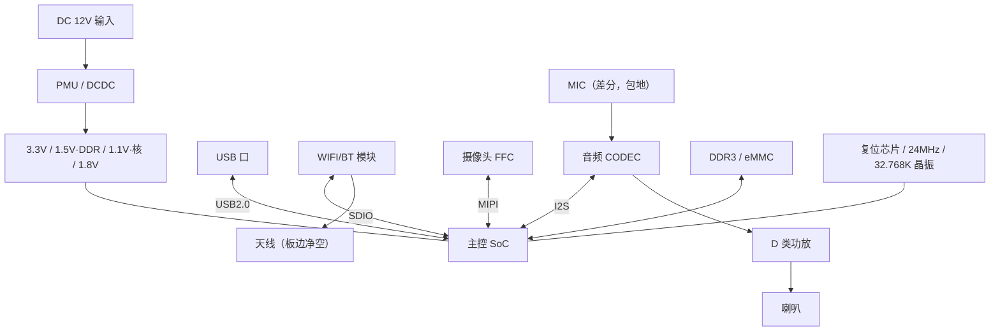

# 第 12 课 · 其他模块与综合案例

> **所属阶段**：阶段二 · EDA、PCB 与基础制作
> **前置课程**：第 05、10 课；时钟与复位先于第 14 课，涉及存储的章节结合第 18 课
> **本课难度**：⭐⭐⭐

本课先学习单片机项目需要的时钟、复位和基础信号调理；射频、摄像头、音频及综合案例可在需要时深入。涉及存储的内容结合第 18 课学习。

## 🎯 本课目标

学完这一课，你应该能够：

1. 说出 50Ω 阻抗、微带线（microstrip）的概念，掌握射频走线"短、直、等宽、无直角"的基本功与 π 型匹配网络的预留方法；
2. 说明天线净空区（keep-out）的含义与尺寸概念，正确处理 WIFI/蓝牙模块的天线、馈线与晶振布局；
3. 掌握 MIPI CSI 摄像头接口的差分 100Ω、按 lane（通道）分组等长规则；
4. 完成音频模块布局：功放/耳机/麦克风走线，并说明模拟地/数字地分割与单点连接的两种流派；
5. 正确设计晶振负载电容、复位电路，并对时钟、复位这两类敏感信号做包地与防护；
6. 独立完成"智能音箱主板"的系统框图、布局分区规划与布线优先级规则表。

## 📖 正文

### 12.1 RF 射频电路

#### 是什么：为什么全世界都说 50Ω

许多射频（RF）系统使用 **50Ω 标称阻抗**；也有 75Ω 或其他阻抗系统，实际须以射频芯片、天线与连接器的规格为准。板内 RF 走线的任务就是**维持这 50Ω 不被打断**——每一处阻抗突变都会产生反射，反射就是损耗、驻波和辐射。

**微带线（microstrip）**：表层走线 + 紧邻的内层完整地平面构成的传输线。特性阻抗由线宽 W、介质厚度 H、介电常数 εr、铜厚共同决定——用阻抗计算工具（Saturn PCB Toolkit、嘉立创阻抗计算器等）按自己板厂的叠层算，**不要抄别人板子的线宽**。内层走线夹在两个平面之间的叫带状线（stripline），本课只要求掌握微带线。

#### 布局要点清单

- [ ] RF 路径按"芯片 → π 型匹配网络 → 天线/连接器"一条直线摆，越短越好；
- [ ] RF 器件的地焊盘**就近打接地过孔**（每个接地焊盘 1~2 个），顶层铺地与内层地紧密相连；
- [ ] **π 型匹配网络预留**：在 RF 线两端预留三个焊盘（两端并联到地、中间串联），初始贴 0Ω + 空/小电容，调试时按网分实测换成 L/C：

```svg
<svg xmlns="http://www.w3.org/2000/svg" xmlns:xlink="http://www.w3.org/1999/xlink" xml:lang="en" height="183.44pt" width="266.984pt" viewBox="-59.704 -47.8 266.984 183.44"><path d="M 0.0,-0.0 L 36,-0 L 39,-9 L 45,9 L 51,-9 L 57,9 L 63,-9 L 69,9 L 72,-0 L 108,-0" style="stroke:currentColor;fill:none;stroke-width:2.0;stroke-dasharray:-;stroke-linecap:round;stroke-linejoin:round;" /><path d="M 108.0,-0.0 L 108,50.76 M 117,50.76 L 99,50.76 M 117,57.24 L 99,57.24 M 108,57.24 L 108,108" style="stroke:currentColor;fill:none;stroke-width:2.0;stroke-dasharray:-;stroke-linecap:round;stroke-linejoin:round;" /><path d="M 107.99999999999999,108.0 L 108,122.4 L 99,122.4 L 117,122.4 M 101.7,126.72 L 114.3,126.72 M 106.2,131.04 L 109.8,131.04" style="stroke:currentColor;fill:none;stroke-width:2.0;stroke-dasharray:-;stroke-linecap:round;stroke-linejoin:round;" /><path d="M 108.0,-0.0 L 111,-9 L 117,9 L 123,-9 L 129,9 L 135,-9 L 141,9 L 144,-0" style="stroke:currentColor;fill:none;stroke-width:2.0;stroke-dasharray:-;stroke-linecap:round;stroke-linejoin:round;" /><path d="M 144.0,-0.0 L 144,50.76 M 153,50.76 L 135,50.76 M 153,57.24 L 135,57.24 M 144,57.24 L 144,108" style="stroke:currentColor;fill:none;stroke-width:2.0;stroke-dasharray:-;stroke-linecap:round;stroke-linejoin:round;" /><path d="M 143.99999999999997,108.0 L 144,122.4 L 135,122.4 L 153,122.4 M 137.7,126.72 L 150.3,126.72 M 142.2,131.04 L 145.8,131.04" style="stroke:currentColor;fill:none;stroke-width:2.0;stroke-dasharray:-;stroke-linecap:round;stroke-linejoin:round;" /><path d="M 144.0,-0.0 L 158.4,-0 L 172.8,-0" style="stroke:currentColor;fill:none;stroke-width:2.0;stroke-dasharray:-;stroke-linecap:round;stroke-linejoin:round;" /><path d="M 172.79999999999998,-0.0 L 172.8,-21.6 L 159.12,-43.2 L 186.48,-43.2 L 172.8,-21.6" style="stroke:currentColor;fill:none;stroke-width:2.0;stroke-dasharray:-;stroke-linecap:round;stroke-linejoin:round;" /><text x="54.0" y="-26.6" dominant-baseline="ideographic" fill="currentColor" font-size="14.0" font-family="sans" text-anchor="middle"><tspan x="54.0" dy="14.0">0Ω / 小电感</tspan></text><text x="120.6" y="40.0" dominant-baseline="central" fill="currentColor" font-size="14.0" font-family="sans" text-anchor="start"><tspan x="120.6" dy="14.0">C</tspan></text><text x="156.6" y="40.0" dominant-baseline="central" fill="currentColor" font-size="14.0" font-family="sans" text-anchor="start"><tspan x="156.6" dy="14.0">C</tspan></text><text x="190.07999999999998" y="-35.599999999999994" dominant-baseline="central" fill="currentColor" font-size="14.0" font-family="sans" text-anchor="start"><tspan x="190.07999999999998" dy="14.0">天线</tspan></text><circle cx="0" cy="-0" r="2.7" style="stroke:currentColor;fill:white;stroke-width:2.0;stroke-dasharray:-;" /><text x="-6.3" y="-14.0" dominant-baseline="central" fill="currentColor" font-size="14.0" font-family="sans" text-anchor="end"><tspan x="-6.3" dy="14.0">芯片 RF 引脚</tspan></text><circle cx="108" cy="-0" r="2.7" style="stroke:currentColor;fill:currentColor;stroke-width:2.0;stroke-dasharray:-;" /><circle cx="144" cy="-0" r="2.7" style="stroke:currentColor;fill:currentColor;stroke-width:2.0;stroke-dasharray:-;" /></svg>
```

- [ ] 需要过认证或噪声敏感的场合，预留**屏蔽罩（shielding can）焊盘框**，沿框密集打**屏蔽地过孔（stitching vias）**（经验间距 ≤ λ/20 或按屏蔽罩规格，密比疏好）。

#### 布线规则表

| 规则项 | 经验值 | 说明 |
|:---|:---|:---|
| 阻抗 | 50Ω 微带线 | 按叠层计算线宽，全程等宽 |
| 路径 | 短、直，一次拐弯不超过 45° | **避免 90° 直角**（拐角寄生电容 + 辐射） |
| 过孔 | 尽量 0 个 | RF 路径上过孔 = 串联电感 |
| 线宽 | 全程一致 | 阻抗连续 |
| 邻近 | 不与任何信号并行、下方参考层完整 | RF 线两侧多留间距（≥3W 起步） |
| 屏蔽 | 屏蔽框 + 接地过孔阵 | 认证/EMI 用 |

### 12.2 WIFI / 蓝牙模块

#### 模块方案 vs 芯片方案

| 维度 | 模块方案（推荐新手/量产中小批量） | 芯片方案（深度定制/超大批量） |
|:---|:---|:---|
| 组成 | 芯片 + RF 电路 + 天线或 IPEX 座，封装好 | 裸芯片 + 自建 RF 前端 + 自配天线 |
| 认证 | 某些模块具有特定地区及条件下的认证；整机、天线和使用条件仍须核对 | 通常需要更多射频设计、测试和整机认证工作 |
| 布线难度 | 只需处理天线净空与 SDIO/UART | 全套 12.1 节 RF 规则 + 天线调试 |
| 成本 | 高 | 低（量大时） |

学习和中小项目可优先比较成熟模块，但成本、天线、认证范围及整机测试仍要结合目标产品判断。本节以模块为例。

#### 天线净空区（keep-out）——本节最重要的一条

天线靠空间电磁场工作，**任何邻近的铜皮、走线、器件都会改变它的辐射方向图与驻波**。规则：

- 按模块或天线手册规定的方向、范围和各层要求设净空；有些天线的下方与周围需要禁铜禁线，不能把一种净空形状套给所有型号；
- 净空范围以模块手册为准（常见 ≥5 mm 量级，不同天线差异大），**宁大勿小**；
- 按厂家推荐的板边、外壳和天线位置摆放；不是所有天线都适合伸出板外，实际还要考虑机械保护和射频性能；
- 板内铺铜与天线的净空之间用一排地过孔把"边界"钉住。

#### 馈线与晶振

- **馈线（feed line）**：模块 ANT 引脚（或 IPEX 座）到天线的走线，**50Ω 微带线，短直、两侧包地过孔**；用 IPEX 外置天线时，馈线就是从模块到 IPEX 座那一段，同样规则；
- **晶振位置**：芯片方案的 32 MHz/32.768 kHz 晶振**远离天线与馈线**（晶振及其谐波是 RF 接收灵敏度的头号杀手）；模块方案自带晶振，选型时确认模块布局说明；
- 模块正下方保持**完整地平面**（模块靠它做镜像地），模块下方不走高速线；
- SDIO/UART 等数字接口按常规数字规则，注意远离音频模拟区（WIFI 突发电流会串进喇叭，就是经典的"滋滋"底噪来源之一）。

### 12.3 摄像头接口（CSI / MIPI）

#### 协议简介

主流摄像头走 MIPI CSI-2 协议、D-PHY 物理层：在常见 D-PHY 实现中使用若干对高速差分数据 lane 和一对时钟 lane；数据通道数、模式及速率依传感器、接收器和 D-PHY 版本而异，差分阻抗常以 100Ω 为设计目标并以芯片指南为准；除高速模式（HS，差分）外还有单端低功耗（LP）状态，但布线上按差分对处理即可。同轴线（coax）与 FFC/FPC 排线连接器（0.5 mm 间距常见）是两种典型物理接口，紧凑产品（运动相机类）用同轴，开发板常用 FFC。

#### 布局要点清单 + 布线规则表

- [ ] 摄像头连接器放**板边**，远离 DCDC 开关节点与 WIFI 天线区；
- [ ] 每个 lane 整对并行走线，整组（含 CLK 对）一起走，不与其他高速线混扎；
- [ ] 换层 ≤1 次/对，各组同步换层，参考层完整。

| 规则项 | 经验值 | 说明 |
|:---|:---|:---|
| 差分阻抗 | 100Ω | D-PHY 高速模式 |
| 对内偏斜 | 按传感器、SoC 和连接器的时序预算 | 应计入 PCB、排线与连接器差异 |
| lane 间等长 | ±50~100 mil 内 | 接收端有弹性，但别放飞，以传感器手册为准 |
| 总长 | 整组接近，计入 FFC 线长 | 排线也是走线的一部分 |
| ESD | 可选低容阵列（<0.5 pF） | 连接器外接摄像头时考虑 |

### 12.4 音频模块

#### 电路组成

- **CODEC（编解码器）**：I²S 数字音频接口进/出主控，I²C 配置寄存器，内部 DAC 出模拟、ADC 进模拟；也可用主控内置 CODEC 省一颗料；
- **功放（PA）**：驱动喇叭。AB 类线性但效率低；**D 类**效率高但输出是 PWM 开关波形，喇叭线和输出走线是辐射源，输出侧常加磁珠 + LC 滤波压 EMI；
- **耳机/喇叭输出**：耳机 L/R 每声道磁珠/电容滤波 + ESD；喇叭走线按**大电流差分**处理；
- **麦克风（MIC）**：驻极体、模拟 MEMS 和数字 MEMS 的供电及接口各异；MICBIAS、滤波、输入接法依据具体麦克风与 CODEC 手册选择。

#### 模拟地/数字地：分割单点连接 vs 统一地分区

两种流派都要懂：

- **完整地平面 + 功能分区**：先使模拟与数字电路及其回流路径合理分区，维持连续参考地；两层板也可以采用这一方法。
- **按器件指南分区连接**：少数电路要求特定地连接或隔离，必须结合器件引脚、回流、电源和安全要求设计；单点连接并不自动消除噪声。
- 新手应先分析回流，避免信号跨越地平面断缝。可参考 [TI 混合信号接地指南](https://www.ti.com/video/6245227303001)。

#### 布局布线要点

- [ ] 音频模拟区整体放**板角**，远离 DCDC、晶振、WIFI 天线、MIPI；
- [ ] 喇叭/功放输出走线**粗（≥30 mil/1A 量级，按电流算）、短、差分紧耦合**，远离麦克风输入（功放输出耦合进 MIC = 啸叫）；
- [ ] 耳机通道按阻抗、噪声、串扰、负载和接口保护要求布局；短板内走线通常不需为了避免增益差而机械等长；
- [ ] MIC 走线**两侧包地 + 地过孔**，尽量短，用屏蔽线/同轴线引到远端麦克风；
- [ ] 功放电源单独走（或磁珠隔离），大电容就近功放；D 类功放输出滤波元件紧贴输出脚。

### 12.5 时钟电路（晶振）

#### 负载电容怎么算

无源晶体（crystal）靠两只负载电容与晶体共同决定振荡频率。晶体规格书给出负载电容 CL（常见 8~20 pF），板上取值：

```
C1 = C2 ≈ 2 ×（CL − Cstray）     对称电容近似；Cstray 为折算到晶体两端的等效寄生电容，需结合芯片、封装和布局估算
例：CL = 12 pF → C1 = C2 ≈ 2 × (12 − 4) = 16 pF → 取 15/18 pF 标称值
```

#### 布局布线要点

- 晶体与负载电容按芯片指南靠近振荡器引脚，缩短回路并避开干扰；接地、包围和参考层处理以晶体与芯片厂商推荐为准，不能额外引入过大寄生电容；
- 晶振区域**远离干扰源**：DCDC 开关节点、USB/HDMI 差分、RF/天线、功放输出；HDMI/以太网的 25 MHz/晶振同理；
- **有源振荡器（XO）**：内部包含振荡电路，其输出接口、电源去耦、负载及是否需要串阻依型号和接收端而定；不应照搬无源晶体的两只负载电容。
- **时钟 buffer**：一路时钟分发多路负载时使用，每路输出按频率决定是否端接/等长（低速可裸走，百兆级需串阻）。

### 12.6 复位电路

#### 三种形态

1. **RC 复位**：在特定复位极性和输入结构下，RC 可形成上电延时，但释放时刻受上电斜率、门限、初值和容差影响；不能保证电源已经稳定，需按手册验证掉电与复位脉宽；
2. **复位芯片（supervisor/reset IC）**：精确电压阈值监控（如 3.3V ±5%），带手动复位（MR#）输入、看门狗可选——**现代设计首选**；
3. **主控内部 POR**：部分芯片提供上电复位，是否还需外部复位电路、上拉或按键应查具体手册。

**去抖（debounce）**：复位按键抖动可能引发多次复位；复位芯片是否对 MR 输入内置去抖要查手册。外部 RC 需验证门限、上升时间和复位脉宽；GPIO 软件去抖适用于普通按键，不应默认处理专用复位脚。

#### 走线防护

- 复位线**短**、两侧**包地**，远离时钟/差分/RF——复位线上耦合一个 2V 毛刺，整板随机重启且极难排查；
- 是否接电容及其容值由复位源的驱动能力、复位输入和所需时序共同决定；不要固定加 0.1μF；
- 复位要分发给多颗芯片时用星型拓扑，长距离分发加施密特触发器 buffer 或 RC 滤波。

### 12.7 传感器电路与信号调理

接下来认识：**传感器（Sensor）**——产品的"五官"。摄像头、麦克风本质也是传感器，本节讲的是更基础的一族：温度、光照、压力这类把物理量变成电信号的器件。它们输出的往往是"不好读"的信号（阻值变化、毫伏级小电压），必须经过**信号调理（Signal Conditioning）**才能喂给 MCU——这也是第 04 课运放真正的用武之地。

#### 传感器分类速览

| 传感器 | 测什么 | 原理一句话 | 典型应用 |
|:---|:---|:---|:---|
| NTC 热敏电阻 | 温度 | 负温度系数：升温阻值下降（10kΩ@25°C 常见） | 板温监测、电池温度保护 |
| PT100 铂电阻 | 温度（精密） | 铂电阻随温度近似线性变化，0°C 时 100Ω | 工业测温、医疗设备 |
| 光敏电阻 / 光电管 | 光照 | 光照越强阻值越低 / 光电流越大 | 感光灯、亮度自适应背光 |
| 湿度传感器 | 湿度 | 湿敏电容介电常数随湿度变化（多集成 I²C 数字输出） | 温湿度计、新风与除湿设备 |
| 压力传感器 | 压力 | 压阻/压电元件受力形变，输出毫伏级信号 | 气压计、血压计、工业压力检测 |
| 霍尔传感器 | 磁场/位置 | 霍尔效应：磁场垂直作用产生电压 | 电机测速、翻盖检测、电流检测 |
| 电流检测 | 电流 | 采样电阻压降 / 霍尔 / 互感器 | 电源监控、电机驱动、BMS |

不同传感器可能输出阻值、电流、模拟电压或数字信号。是否需要分压、放大、滤波或电平转换，由信号类型和接收端要求决定。

#### 信号调理三步法（通用方法论）

针对电阻式或弱模拟信号，可按下列三类功能检查；次序和是否需要每一步因传感器而异，带数字接口或已调理输出的器件不必照搬：

1. **第一步：偏置 / 分压**——把"阻值变化"变成"电压变化"。电阻型传感器（NTC、光敏）配一只固定电阻组成分压（第 02 课的分压在这里落地）：物理量变 → 阻值变 → 分压比变 → 节点电压变；
2. **第二步：滤波**——RC 一阶低通（第 03 课的 τ = RC）滤掉高频噪声与干扰。截止频率 fc = 1/(2πRC)，例如 1 kΩ + 100 nF → fc ≈ 1.6 kHz（信号带宽以内、噪声以外即可）。若用于抗混叠，还须根据采样率、带外干扰和允许误差计算衰减；一阶 RC 只能逐渐衰减，不能假设高于奈奎斯特频率的信号被完全滤除；
3. **第三步：放大 / 跟随**——把毫伏级信号放大到 ADC 量程，或用跟随器做阻抗隔离。

第三步展开两个典型用法：

- **同相放大**（一步不跳地算一遍）：增益 G = 1 + Rf/Rg。取 Rf = 9 kΩ、Rg = 1 kΩ → G = 1 + 9/1 = 10 倍；传感器输出 100 mV → 运放输出 = 100 mV × 10 = 1.0 V，正好落进 3.3V ADC 的舒适区；
- **电压跟随器**（放大倍数 = 1）：不放大电压，只做"接力棒"——传感器分压节点内阻高（几十 kΩ 级），直接接 ADC 会因负载效应拉低读数；合适的跟随器可以降低有效源阻抗，但仍要核对运放稳定性、输出摆幅、负载与 ADC 采样建立时间（第 04 课"扩音机"的另一种用法）；
- **比较器用法**：不需要"读数"、只要"到没到阈值"时（光控开关、过温保护），用比较器把连续信号变成 0/1 开关信号，MCU 一个 GPIO 就够。

#### 完整实例：NTC 测温度，从热到读数

仿真中下臂的 10kΩ 固定电阻代表 NTC 在 25°C 的阻值；更改其阻值可观察节点电压，但模型没有自动计算温度。

```circuitjs
ntc-divider
```

NTC 在下臂，100nF 从 ADC 节点并联到地；阻值随温度变化。

```svg
<svg role="img" aria-label="NTC测温分压，ADC节点并联滤波电容" xmlns="http://www.w3.org/2000/svg" xmlns:xlink="http://www.w3.org/1999/xlink" xml:lang="en" height="197.13999999999996pt" width="214.87399999999994pt" viewBox="-49.56999999999999 -205.49999999999994 214.87399999999994 197.13999999999996"><path d="M 0.0,-180.0 L 0,-162 L 9,-162 L 9,-126 L -9,-126 L -9,-162 L 0,-162 M 0,-126 L 0,-108" style="stroke:currentColor;fill:none;stroke-width:2.0;stroke-dasharray:-;stroke-linecap:round;stroke-linejoin:round;" /><path d="M 0.0,-108.0 L 63,-108 L 126,-108" style="stroke:currentColor;fill:none;stroke-width:2.0;stroke-dasharray:-;stroke-linecap:round;stroke-linejoin:round;" /><path d="M 0.0,-108.0 L 0,-90 L 9,-90 L 9,-54 L -9,-54 L -9,-90 L 0,-90 M 0,-54 L 0,-36" style="stroke:currentColor;fill:none;stroke-width:2.0;stroke-dasharray:-;stroke-linecap:round;stroke-linejoin:round;" /><path d="M 0.0,-36.0 L 0,-21.6 L -9,-21.6 L 9,-21.6 M -6.3,-17.28 L 6.3,-17.28 M -1.8,-12.96 L 1.8,-12.96" style="stroke:currentColor;fill:none;stroke-width:2.0;stroke-dasharray:-;stroke-linecap:round;stroke-linejoin:round;" /><path d="M 72.0,-108.0 L 72,-75.24 M 81,-75.24 L 63,-75.24 M 81,-68.76 L 63,-68.76 M 72,-68.76 L 72,-36" style="stroke:currentColor;fill:none;stroke-width:2.0;stroke-dasharray:-;stroke-linecap:round;stroke-linejoin:round;" /><path d="M 72.0,-36.0 L 72,-21.6 L 63,-21.6 L 81,-21.6 M 65.7,-17.28 L 78.3,-17.28 M 70.2,-12.96 L 73.8,-12.96" style="stroke:currentColor;fill:none;stroke-width:2.0;stroke-dasharray:-;stroke-linecap:round;stroke-linejoin:round;" /><text x="3.6" y="-207.39999999999998" dominant-baseline="central" fill="black" font-size="13" font-family="sans" text-anchor="middle"><tspan x="3.6" dy="13">3.3V</tspan></text><text x="-12.599999999999998" y="-157.0" dominant-baseline="central" fill="black" font-size="13" font-family="sans" text-anchor="end"><tspan x="-12.599999999999998" dy="13">10kΩ</tspan></text><text x="147.6" y="-124.60000000000001" dominant-baseline="central" fill="black" font-size="13" font-family="sans" text-anchor="middle"><tspan x="147.6" dy="13">ADC</tspan></text><text x="-12.599999999999998" y="-85.0" dominant-baseline="central" fill="black" font-size="13" font-family="sans" text-anchor="end"><tspan x="-12.599999999999998" dy="13">NTC</tspan></text><text x="59.400000000000006" y="-85.0" dominant-baseline="central" fill="black" font-size="13" font-family="sans" text-anchor="end"><tspan x="59.400000000000006" dy="13">100nF</tspan></text><circle cx="0" cy="-108" r="2.7" style="stroke:currentColor;fill:currentColor;stroke-width:2.0;stroke-dasharray:-;" /></svg>
```


把适用的信号调理环节串起来：**NTC 分压 → 节点电容滤波 → MCU ADC**；本例没有另加运放。

电路：3.3V — 10 kΩ 固定电阻 — 节点 A（进 ADC，节点对地并 100 nF 滤波）— NTC — GND。25°C、NTC=10kΩ 且忽略源和 ADC 负载时，电容看到的等效电阻约 10kΩ∥10kΩ=5kΩ，理想截止频率约 318Hz；NTC 阻值变化会改变该频率。

以 25°C 为例走一遍换算（一步不跳）：

1. **物理量 → 阻值**：查 NTC 规格表（R-T 表），25°C 时阻值 = 10 kΩ；
2. **阻值 → 电压**（分压，NTC 在下臂）：V_A = 3.3 × 10/(10+10) = **1.65V**；
3. **电压 → ADC 码值**：MCU 12 位 ADC、参考电压 VREF = 3.3V：理想量化码约为 1.65/3.3 × 4096 = **2048**；实际码值、边界和校准方式依 ADC 手册；
4. **读数 → 反推温度**（MCU 里干的活）：由 V_A 反解 NTC 阻值 R_ntc = 10k × V_A/(3.3 − V_A) = 10k × 1.65/1.65 = 10 kΩ，查 R-T 表得 25°C。

体会两点：ADC 的换算基准是 **VREF**。若分压电源与 ADC 参考电压来自同一电源且满足比例测量条件，部分供电波动可能抵消；不同参考、误差和噪声仍需分别分析。NTC 的 R-T 关系是非线性的，产品里常用查表或公式拟合。

#### 传感器输入的保护电路

信号调理除了"处理"，还要"保护"——传感器引线越长、环境越恶劣（工业现场、外接探头），越需要三件套：

- **钳位二极管**：可按设计在信号节点配置到电源和地的钳位路径；压降随电流、温度变化，电流可能向电源轨反灌。必须核验注入电流、掉电状态、电源吸收能力和器件耐压，不能保证所有浪涌下 ADC 不受损；
- **串联限流电阻**：钳位动作时电流骤增，串几百 Ω~几 kΩ 限制它，二极管才不会先烧；
- **RC 滤波**：节点电容与电阻可减弱部分干扰，但不能默认吸收任意静电或浪涌能量；对外接口按目标脉冲、器件额定和系统标准设计专用防护。

#### 嵌入式控制体系一览：主控选型的世界观

传感器调理好了，读它的"大脑"是谁？本课程项目课会轮番登场的主控，其实分五个流派——记住这张表，选型世界观就有了：

| 芯片类型 | 全称 | 擅长什么 | 代表型号 | 在板子上的角色 |
|:---|:---|:---|:---|:---|
| MCU | 微控制器（单片机） | 低功耗实时控制、IO 丰富、裸机或 RTOS | **STM32**、51、ESP32 | 第 14 课 2 层板主控：读传感器、控外设 |
| CPU / SoC | 中央处理器 / 片上系统 | 跑 Linux/Android 等操作系统与多任务应用 | 全志 **H3**、瑞芯微 **RK3576/RK3588** | 第 20～22 课机顶盒/AI 主板/工控板主控 |
| DSP | 数字信号处理器 | 高速乘加运算：音频编码、电机 FOC 算法 | TI C2000、TMS320 系列 | 电机控制板、音频处理板的算法核心 |
| CPLD | 复杂可编程逻辑器件 | 小规模胶水逻辑：地址译码、上电时序、信号粘合 | EPM240、XC9500 系列 | 大板上的"逻辑补丁"，弥补主控接口不足 |
| FPGA | 现场可编程门阵列 | 大规模并行逻辑、高速采集与协议处理 | Artix-7、Cyclone 系列 | 高速数据采集、视频处理、芯片原型验证 |

选型的直觉：任务越"实时、简单、低功耗"越靠近 MCU；越"多任务、上系统"越靠近 SoC；越"并行、硬实时、算法密集"越靠近 DSP/FPGA。真实产品常常是"SoC + MCU"或"CPU + FPGA"的组合——大脑分工，各干各的。

### 12.8 转换电路：ADC 与 DAC——模拟与数字的翻译官

传感器调理链的终点是 ADC，音频/控制的起点常是 DAC——这一节把 12.7 的"读进芯片"补完整，再讲"怎么从芯片输出来"。

#### ADC：模拟 → 数字的三步

模数转换（ADC）永远是三步曲：**采样 → 量化 → 编码**。采样按固定时间间隔"拍照"（采样率，单位 SPS）；量化把每张照片的电压归到最近的刻度（分辨率）；编码把刻度号写成二进制数。

| 参数 | 含义 | 经验直觉 |
|:---|:---|:---|
| 分辨率 | 刻度的数量，N 位 = 2^N 格 | 12 位 = 4096 格；每格 = VREF ÷ 4096（3.3V 时约 0.8mV） |
| 采样率 | 每秒拍多少张 | 至少是信号最高频率的 2 倍以上（奈奎斯特），工程留 5~10 倍 |
| 基准源 VREF | 刻度尺的"1 米"有多长 | VREF 变化会影响量化比例，实际误差及方向要结合信号源、参考配置与换算方法评估——精密场合用专用基准芯片 |
| 输入阻抗/源阻抗 | 信号源"推得动"吗 | SAR 型 ADC 常要求源阻抗 ≤10kΩ 量级（以手册为准），太高读数不准（偏向上一采样通道的值） |

12.7 的 NTC 算例正是完整闭环：分压得 1.65V → 12 位 ADC 量化 = 1.65 ÷ 3.3 × 4096 = **2048**。可在理想未饱和条件下用 V≈码值 ÷ 4096 × 3.3V 近似还原；12 位输出码范围是 0～4095，量化、满量程边界及实际换算以器件手册为准。

#### 多路、差分与"过采样"

一颗 ADC 内部常带**多路开关**（MUX）轮流接多个通道——引脚复用 ADC1_IN1~IN16 就是这个意思；**差分输入**测两点电压差（电流采样电阻两端的标准接法）；在噪声充分随机、样本满足统计假设且信号在平均窗口内近似不变时，**过采样+平均**16 次可使随机噪声标准差约降为 1/4，理想上相当于约 2 位改善；不能消除参考误差、失调、非线性，也不保证任意 ADC 都提高 2 位有效分辨率。

#### DAC：数字 → 模拟

数模转换（DAC）把数字变回电压/电流：**R-2R 梯形网络**是教科书结构（每位开关决定电流流向，运放求和）；音频 CODEC 里就是 DAC+ADC 的组合。板子上更常见的"穷人版 DAC"是 **PWM + RC 滤波**（第 03 课的占空比思想）：理想 0～VCC PWM 的平均值随占空比变化；RC 滤波后仍有纹波和负载效应，需按频率、阻抗与响应时间设计。风扇或背光也常直接由 PWM 驱动，不一定先转换成模拟电压。

#### 这在板子上

- 传感器读数精度 = 分压精度 + 基准稳定度 + ADC 分辨率，三者取短板——堆 16 位 ADC 救不了漂移的 VREF；
- 电流采样（第 15 课故障排查、第 16 课功耗测试）的标准链路：采样电阻 → 差分 ADC → 码值换算电流；
- 音频播放链：数字音频 → CODEC 内 DAC → 功放 → 喇叭（第 12.4 节的下半程）。

### 12.9 综合案例：智能音箱类主板

模块综合演练（学习第 18 课后完成）。板卡构成：**主控 SoC + 电源（PMU/DCDC）+ DDR3 + eMMC + WIFI/BT 模块 + 音频 CODEC 与功放 + USB 接口 + 摄像头接口（CSI）**。这不是让你现在就画完它——可结合第 14 课及后续项目练习——本课只完成三张"图纸"：**系统框图、布局规划图、布线规则表**。

#### ① 系统框图

先画出模块级连接关系（信号流向 + 电源流向）：



画框图时自查三件事：每路电源给谁、每条高速总线两端是谁、天线与音频这两个"敏感区"分别在哪。

#### ② 布局规划（分区 → 流向 → 数模分离）

```svg
<svg xmlns="http://www.w3.org/2000/svg" viewBox="0 0 575 315" width="575" height="315" role="img"><rect class="fp-board" x="6" y="6" width="560" height="300" rx="8"/><rect class="fp-rf" x="20" y="18" width="120" height="44" rx="5"/><text x="80.0" y="37.0" text-anchor="middle" font-size="11">WIFI/BT 模块</text><text x="80.0" y="51.0" text-anchor="middle" font-size="11">（板边）</text><text x="160" y="40" text-anchor="start" font-size="10" class="fp-note">天线伸出板外（全层净空 ≥5mm）</text><rect class="fp-part" x="20" y="76" width="110" height="40" rx="5"/><text x="75.0" y="100.0" text-anchor="middle" font-size="11">USB 口（板边）</text><rect class="fp-core" x="150" y="76" width="130" height="64" rx="5"/><text x="215.0" y="112.0" text-anchor="middle" font-size="11">主控 SoC</text><rect class="fp-part" x="296" y="76" width="70" height="64" rx="5"/><text x="331.0" y="112.0" text-anchor="middle" font-size="11">DDR3</text><rect class="fp-part" x="378" y="76" width="70" height="64" rx="5"/><text x="413.0" y="105.0" text-anchor="middle" font-size="11">eMMC</text><text x="413.0" y="119.0" text-anchor="middle" font-size="11">（贴主控）</text><rect class="fp-part" x="20" y="150" width="110" height="60" rx="5"/><text x="75.0" y="177.0" text-anchor="middle" font-size="11">电源区</text><text x="75.0" y="191.0" text-anchor="middle" font-size="11">DCDC/PMU（板角）</text><text x="140" y="182" text-anchor="start" font-size="9" class="fp-note">（远离音频）</text><rect class="fp-part" x="150" y="156" width="130" height="30" rx="5"/><text x="215.0" y="175.0" text-anchor="middle" font-size="11">摄像头 FFC（板边）</text><rect class="fp-part" x="20" y="226" width="190" height="62" rx="5"/><text x="115.0" y="254.5" text-anchor="middle" font-size="10">音频模拟区（板角）</text><text x="115.0" y="267.5" text-anchor="middle" font-size="10">CODEC/功放 · MIC 包地 · 喇叭粗差分</text><rect class="fp-part" x="230" y="226" width="90" height="62" rx="5"/><text x="275.0" y="254.0" text-anchor="middle" font-size="11">复位芯片</text><text x="275.0" y="268.0" text-anchor="middle" font-size="11">晶振</text><text x="470" y="288" text-anchor="end" font-size="9" class="fp-note">板边</text></svg>
```

三条规划原则逐条对照：

- **按模块分区**：DDR3/eMMC 紧贴主控（第 18 课），电源集中一个板角，音频独占另一个板角，接口一律靠板边（第 11 课）；
- **顺信号流向**：电源入口 → PMU → 主控；USB/CSI 从板边进来直达主控，不横穿全板；
- **数模分离**：音频模拟区与 WIFI 天线、DCDC 开关区、晶振互为"敌人"，两两远离；功放与天线分居对角（功放射频噪声与 WIFI 接收互相伤害）。

#### ③ 布线优先级与规则表

规则表模板（完成后这张表就是你的布线"作战地图"）：

| 优先级 | 信号组 | 阻抗 | 等长/间距 | 参考层 | 备注 |
|:---:|:---|:---|:---|:---|:---|
| 1 | DDR3 数据组（DQ/DQS 按字节组） | 单端 50Ω / DQS 100Ω | DQ-DQS ±25 mil 内、DQS 对内 ±5 mil（以 SoC 手册为准） | 完整 GND | 最优先、最先布 |
| 2 | DDR3 地址/命令/控制 | 单端 50Ω | 点到点可放宽；Fly-by 按补偿表 | 完整 GND | VREF 包地 |
| 3 | MIPI CSI（CLK + lanes） | 差分 100Ω | 对内 ±5 mil，lane 间 ±100 mil 内 | 完整 GND | 整组同层 |
| 4 | USB 2.0 差分 | 差分 90Ω | 对内 ±5 mil | 完整 GND | ESD 紧贴接口 |
| 5 | SDIO（WIFI 模块） | 50Ω | 常规等长（±100 mil 级） | 完整 GND | 远离音频模拟区 |
| 6 | 电源大电流（12V 入口/功放电源） | 按载流 | 压降计算线宽 | — | 粗短，先铺主干 |
| 7 | 音频模拟（喇叭/耳机/MIC） | 不控 | 3W 间距、包地 | — | 差分紧耦合 |
| 8 | I2C/UART/GPIO/其他 | 常规 | 常规 | — | 最后收尾 |

排优先级的心法：**越严的越先布（等长硬的 > 阻抗硬的 > 大电流的 > 常规数字的）**，把最难的信号在最空旷的板面上解决，剩下的自然水到渠成。

> 完成这三张图后，对照实际器件资料检查约束，并在项目中继续练习读图与规划。

## 🔧 动手练习

| # | 练习内容 | 完成标准 |
|:---:|:---|:---|
| 1 | 选定板厂四层叠层，估算 50Ω 微带线宽 | 记录 L1 到参考层的介质厚度、介电常数、铜厚、阻焊及计算依据，再与板厂确认 |
| 2 | 找一个 WIFI 模块手册，画出天线净空区要求图 | 标注净空尺寸、天线位置、馈线路径三要素 |
| 3 | 画"主控 + MIPI 摄像头 FFC"扇出布局 | 指定 SoC 和连接器，按其设计指南记录阻抗、时序及布局依据 |
| 4 | 画"CODEC + D 类功放 + 喇叭 + MIC"原理图与布局草图 | 依据具体芯片手册规划参考地、功能分区和回流路径，并标注依据 |
| 5 | 晶振专项：CL=10 pF 晶体选负载电容，画包地布局 | 电容计算正确、包地过孔画全、远离干扰源清单列出 |
| 6 | **综合案例三张图**：智能音箱主板系统框图、布局分区图、布线规则表 | 框图含全部 8 类模块与电源流向；分区图体现信号流向与数模分离；规则表覆盖 8 个优先级且数值标注出处（以手册为准） |

## ✅ 自测清单

- [ ] 能说出 50Ω 是什么、微带线阻抗由哪些参数决定（线宽/介质厚/介电常数）；
- [ ] 能解释 RF 走线为什么要"短、直、等宽、无直角、少过孔"；
- [ ] 能画出 π 型匹配网络的焊盘预留形式并说明用途；
- [ ] 能根据模块或天线手册指出净空范围、各层要求与安装方向；
- [ ] 能说出 WIFI 馈线按 50Ω、晶振要远离天线的原因；
- [ ] 能说明 MIPI D-PHY 的常见阻抗目标，并按器件指南核对 lane 的偏斜预算；
- [ ] 能解释 AGND/DGND"分割单点连接"与"统一地+分区"两种流派各自的适用场景；
- [ ] 能说出功放输出与 MIC 走线的处理差异（大电流粗差分 vs 包地短走线）；
- [ ] 能用 CL 公式算负载电容（含杂散电容 3~5 pF 估计）；
- [ ] 能按芯片手册说明晶体走线、回流与干扰控制，并区分有源振荡器和晶体；
- [ ] 能说出复位电路三种形态与复位线毛刺的排查思路；
- [ ] 能独立排出 8 个信号组的布线优先级并说明排序逻辑（越严越先布）。
- [ ] 能说明分压/偏置、滤波、放大/跟随的作用及何时不需要，并解释抗混叠滤波的目标；
- [ ] 能走完 NTC 阻值、分压与 ADC 码值的示例，并说明钳位、限流和滤波必须按输入与瞬态条件设计。

- [ ] 我能说出 ADC 三步曲（采样/量化/编码）与分辨率、采样率、基准源各自的含义
- [ ] 我知道 PWM+RC 为什么能当"穷人版 DAC"，以及它的典型应用场景

## ⚠️ 新手常见坑

1. **天线下面铺了地/走了线**：信号"能用但很差"，吞吐量腰斩、距离缩水，还查不出错。解法：布局第一件事先锁定天线净空区并在 EDA 里画 keep-out 禁止区。
2. **RF 线抄别人板子的线宽**：叠层不同，50Ω 宽度完全不同。解法：每块新板用自己的叠层参数现算。
3. **功放输出线细长且贴着 MIC 走**：底噪大、通电啸叫。解法：喇叭输出按电源线对待（粗短差分），MIC 包地并远离功放，必要时换板角。
4. **地平面分割后不检查回流**：跨缝信号可能迫使回流绕行。两层与多层板都应先比较连续地平面和功能分区；特定隔离或分区要求按器件及系统设计验证。
5. **晶振负载电容随手贴 22 pF**：频偏超标，USB/以太网枚举不稳定甚至失败。解法：按 CL 公式计算，别用"祖传值"。
6. **复位网络穿越干扰区**：可能导致误复位。应缩短路径、核对参考地与时序；是否增加电容、缓冲或复位监控器以器件手册和测试为准。

## 📚 延伸学习

- **B 站搜索关键词**：「微带线 阻抗计算」「天线净空区 PCB」「π 型匹配网络」「MIPI CSI 布线」「D 类功放 EMI」「模拟地 数字地 单点连接」「晶振 负载电容 计算」
- **手册阅读指引**：找一份常见 WIFI 模块（如 ESP32 系列、或任意带 PCB 天线的模组）手册的"天线布局"章节，对照 12.2 逐条印证；找一颗 MIPI 传感器（如 OV 系列任意型号）手册的时序与布线章节；音频部分可搜「I2S」「D 类功放 datasheet」读输出滤波推荐电路。
- **模块学习后的自查**：把第 10、11、12、18 课相关内容整理成一份《模块速查手册》——第 14 课起的四个项目实战会反复用到它。
