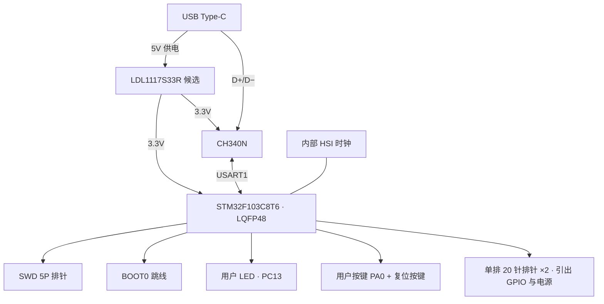

# 第 14 课 · 项目实战 · 2 层板 · STM32 开发板

> **所属阶段**：阶段三 · 单片机与第一块项目板
> **前置课程**：第 09、10 课；第 11 课 USB 基础、第 12 课时钟与复位；第 08 课基础焊接及第 13 课单片机基础
> **本课难度**：⭐⭐⭐

---

## 🎯 本课目标

1. 参考成熟开源设计（Blue Pill / NUCLEO），独立移植出 STM32F103 开发板的完整原理图并逐项自查
2. 完成 2 层板布局：时钟方案、去耦电容、USB 串口、按键/LED、SWD、排针分区摆放，会用「飞线引导布局法」
3. 完成布线与双面铺铜，DRC（设计规则检查）全部清零
4. 输出完整生产文件（Gerber / 钻孔 / 贴片坐标 / BOM），并在打样平台正确选择下单参数
5. 手工焊接整板：掌握 LQFP 拖焊、桥连处理与上电前短路检查
6. 用 SWD 下载 LED 闪烁程序并验证串口通信，完成人生第一次「设计→打样→焊接→调试」闭环

> **给从第 13 课走过来的你**：你已经接触电源、USB、晶振和复位等模块的基本原理，也知道各自的布局布线要点——但可能还没把一块板子从头做到尾、亲手焊出来点亮。本课新增的挑战不是某个新模块，而是**完整闭环**：打样下单的每一个参数、烙铁下的每一个焊盘、上电瞬间的每一次心跳。后面的 SoC 与 DDR 项目还需要额外的参考资料、工艺和验证能力。

---

## 📖 正文

项目原理图草稿中的用户 LED 支路如下。PC13 拉低时预期点亮；器件选型与实板效果仍待验证。

```svg
<svg role="img" aria-label="STM32教学板LED从3.3伏经R6和LED连接到PC13" xmlns="http://www.w3.org/2000/svg" xmlns:xlink="http://www.w3.org/1999/xlink" xml:lang="en" height="90.30999999999997pt" width="260.32399999999996pt" viewBox="-34.378 -176.40999999999997 260.32399999999996 90.30999999999997"><polygon points="101.7,-145.8 114.3,-136.8 101.7,-127.8 " style="stroke:currentColor;fill:none;stroke-width:2.0;stroke-dasharray:-;stroke-linecap:round;stroke-linejoin:round;" /><path d="M 0.0,-136.79999999999998 L 18,-136.8 L 18,-145.8 L 54,-145.8 L 54,-127.8 L 18,-127.8 L 18,-136.8 M 54,-136.8 L 72,-136.8" style="stroke:currentColor;fill:none;stroke-width:2.0;stroke-dasharray:-;stroke-linecap:round;stroke-linejoin:round;" /><path d="M 72.0,-136.79999999999998 L 101.7,-136.8 M 114.3,-145.8 L 114.3,-127.8 M 114.3,-136.8 L 144,-136.8" style="stroke:currentColor;fill:none;stroke-width:2.0;stroke-dasharray:-;stroke-linecap:round;stroke-linejoin:round;" /><path d="M 110.7,-150.29999999999998 L 116.128,-159.799" style="stroke:currentColor;fill:none;stroke-width:2.0;stroke-dasharray:-;stroke-linecap:round;stroke-linejoin:round;" /><path d="M 118.708 -164.314 L 118.628 -158.37 L 113.627 -161.228 Z" style="stroke:currentColor;fill:currentColor;stroke-linecap:butt;stroke-linejoin:miter;" /><path d="M 102.60000000000001,-150.29999999999998 L 108.028,-159.799" style="stroke:currentColor;fill:none;stroke-width:2.0;stroke-dasharray:-;stroke-linecap:round;stroke-linejoin:round;" /><path d="M 110.608 -164.314 L 110.528 -158.37 L 105.527 -161.228 Z" style="stroke:currentColor;fill:currentColor;stroke-linecap:butt;stroke-linejoin:miter;" /><path d="M 144.0,-136.79999999999998 L 162,-136.8 L 180,-136.8" style="stroke:currentColor;fill:none;stroke-width:2.0;stroke-dasharray:-;stroke-linecap:round;stroke-linejoin:round;" /><text x="-18.0" y="-153.4" dominant-baseline="central" fill="black" font-size="13" font-family="sans" text-anchor="middle"><tspan x="-18.0" dy="13">3V3</tspan></text><text x="36.0" y="-162.39999999999998" dominant-baseline="ideographic" fill="black" font-size="13" font-family="sans" text-anchor="middle"><tspan x="36.0" dy="13">R6 4.7kΩ</tspan></text><text x="108.0" y="-137.2" dominant-baseline="hanging" fill="black" font-size="13" font-family="sans" text-anchor="middle"><tspan x="108.0" dy="13">D1 LED</tspan></text><text x="205.2" y="-153.4" dominant-baseline="central" fill="black" font-size="13" font-family="sans" text-anchor="middle"><tspan x="205.2" dy="13">PC13</tspan></text><text x="111.60000000000001" y="-110.2" dominant-baseline="central" fill="black" font-size="13" font-family="sans" text-anchor="middle"><tspan x="111.60000000000001" dy="13">PC13 输出低电平时灌电流</tspan></text></svg>
```


### 14.1 项目方案与系统框图

**项目定位**：一块类似「Blue Pill」的 STM32F103 核心板，但**不要追求极限小**——配套摆件草稿暂定 80mm × 60mm；最终尺寸还要根据连接器、排针和外壳核对。它包含你未来面试时最常被问到的元素：最小系统、USB 串口、调试口、IO 引出。

**系统框图**（文字版，画原理图前先在纸上画一遍）：



**模块清单表**：

| # | 模块 | 选型建议 | 数量 | 说明 |
|:--:|:--|:--|:--:|:--|
| 1 | 主控 | STM32F103C8T6（LQFP48） | 1 | Cortex-M3，最高 72MHz；配套固件目前使用 HSI 标称 8MHz |
| 2 | 电源 | LDL1117S33R 候选 | 1 | USB 5V→3.3V；可用负载由 USB 取电、压差、热条件和电容共同决定 |
| 3 | USB 串口 | CH340N（SOP-8） | 1 | 内置时钟；3.3V 供电，接 USART1（PA9/PA10） |
| 4 | USB 座 | Type-C 母座 16P | 1 | 供电+数据；CC1/CC2 各接 5.1kΩ 下拉 |
| 5 | HSE 晶振 | 8MHz 无源晶体（选做） | 0 或 1 | 当前草稿和固件使用内部 HSI；选装须补电路与封装，并按负载及寄生参数计算电容 |
| 6 | RTC 晶振 | 32.768kHz（选做） | 0 或 1 | 当前未装；需要 LSE 时按芯片和晶体手册补充电路 |
| 7 | 按键 | 6×6mm 轻触开关 | 2 | 复位（NRST）+ 用户键（PA0） |
| 8 | LED | 0805 LED + 4.7kΩ 候选电阻 | 1 组 | PC13 用户 LED，低电平亮；具体 LED、电流及亮度须核验 |
| 9 | SWD 口 | 2.54mm 排针 5P | 1 | VREF / SWDIO / SWCLK / GND / NRST；针序须与调试器核对 |
| 10 | IO 引出 | 2.54mm 单排 20 针排针 | 2 | 引出 GPIO 与电源，注意与 SWD、串口及板载功能复用 |
| 11 | 启动选择 | 跳线 + 排针 | 1 组 | BOOT0 使用候选 10kΩ 下拉并通过跳线选择 |
| 12 | 电容 | 100nF ×7、1µF ×1、10µF ×2 | 10 | 涵盖供电去耦、LDO 输入输出与复位；完整料号及有效值待核验 |
| 13 | 数据线保护 | USBLC6-2SC6 候选 | 1 | D+/D− ESD 保护；VBUS 和 CC 的完整保护方案另行核验 |

**选型理由**：
- F103C8T6：资料较丰富，LQFP48 适合练习细间距焊接；使用前核对器件来源、封装和参数。
- CH340N：内置振荡器；本例使用 3.3V 供电，VCC 与 V3 连接，按手册配置去耦；替换成 CH340C 前必须重新核对封装和引脚。
- Type-C：现在最通用的接口，但要记住**设备端必须给 CC1、CC2 各接一个 5.1kΩ 下拉电阻**，否则很多线不供电。
- 功耗预算：MCU 电流随时钟与工作状态变化，CH340、指示灯和外接负载也要计入。按各器件手册和最大负载建立预算，并核对 USB 取电能力、LDO 压差和散热；不能仅凭 LDO 标称电流判定足够。

**制作准备**：根据实际板厂报价、起订量、运费和器件来源核算成本；易损耗的小件可留出余量。等待制作期间可先完成固件编译并规划测试；收到板后再按实际接线、供电和固件条件验证。

**原理图自查清单**（画完逐条打勾）：
- [ ] 不接后备电池时，VBAT 接 3V3 并配置就近的 100nF 对地去耦；配套草稿对应 C10
- [ ] NRST 有 100nF 对地电容（内部有弱上拉，外部 10kΩ 上拉可选）
- [ ] BOOT0 有 10kΩ 下拉，跳线可选 3V3
- [ ] VDDA 接 3V3，附近按 ST 指南配置 1µF + 100nF；如需磁珠或 0Ω 隔离，应结合模拟精度和回流重新设计。配套草稿为直接连接
- [ ] 每个 VDD 脚附近都有一颗 100nF
- [ ] Type-C 的 CC1、CC2 各接独立 5.1kΩ 下拉；按连接器手册连接两组 USB2.0 D+、D−触点，核对正反插；VBUS 可加合适的保护器件
- [ ] CH340N 采用 3.3V 供电，VCC 与 V3 接 3.3V 并按器件手册去耦；TXD→PA10、RXD←PA9，共地，UD+、UD−连接对应 USB 数据网络；保护器件按所选型号的引脚定义接入
- [ ] PB2/BOOT1 和 BOOT0 按选定启动方式配置；SWD 接口的目标电压检测脚不默认作为板载电源输出，避免与板载供电互相倒灌
- [ ] 评估 USB D+/D− 的 ESD 防护：配套草稿选用 USBLC6-2SC6 候选，其数据端分别接 D+/D−，VBUS 脚接接口 5V，GND 脚接地；器件靠近接口并缩短接地回路。CC、VBUS 及过流保护仍需另行设计和验证

**原理图核对基线（STM32F103C8T6，LQFP48）**：本段用于核查器件连接，并非已经完成或验证的原理图。

| MCU 引脚 | 连接或用途 | 核对重点 |
|---|---|---|
| 1 VBAT；8 VSSA；9 VDDA | VBAT 接 3V3，C10 就近对地；VSSA 接地；VDDA 接模拟电源 | 不接后备电池时按手册供电；按 ST 指南去耦 |
| 23/24、35/36、47/48 | VSS/VDD 成对供电与去耦 | 三对数字供电脚均连接；电容就近布置 |
| 7 NRST；44 BOOT0；20 PB2/BOOT1 | 复位、启动选择 | NRST 按 ST 指南设置；BOOT0/BOOT1 组合决定启动源 |
| 30 PA9；31 PA10 | USART1 TX、RX | 分别接 CH340N RXD、TXD，确认电平与共地 |
| 34 PA13；37 PA14 | SWDIO、SWCLK | 调试器与目标板共地；确认目标电压检测端用途 |
| 2 PC13；10 PA0 | 用户 LED、用户按键 | 受 PC13 驱动能力限制，按数据手册核对 LED 电流；软件与接线保持一致 |
| 5/6 PD0/PD1 | HSE 晶体输入/输出 | 按晶体 CL、引脚/板级寄生计算两颗负载电容；ST 的 STM32F1 指南对此有说明 |

依据：[STM32F103x8/xB 数据手册 DS5319 Rev 20](https://www.st.com/resource/en/datasheet/stm32f103c8.pdf)、[ST AN2586 Rev 8](https://www.st.com/resource/en/application_note/an2586-getting-started-with-stm32f10xxx-hardware-development-stmicroelectronics.pdf)、[WCH CH340 手册下载页](https://www.wch-ic.com/downloads/CH340DS1_PDF.html)。本课设计草稿提出 ST LDL1117S33R 作为候选；仍须确定输入/输出电容的完整料号、有效容值和 ESR，不能将不同 AMS1117 兼容型号视为自动互换；板上外接负载应纳入电流与热预算。

> **尚缺的项目文件**：本课新增 KiCad 原理图草稿并完成 ERC 与部分网络核对；另有未布线的 PCB 摆件草稿；已加入 USB 数据线 ESD 保护候选，接口其他保护仍待设计，DRC 仍有孔间距错误；完整物料、PCB 布线、打样和实板测试数据仍未完成。示例固件（LED 与串口回显）已用 Clang 和 ARM GNU 两种路径完成编译、链接及镜像结构检查；尚未下载或实板验证。设计前应先完成器件与连接核查并逐项复核，再开展制作；不要把这里的框图当成经过验证的工程。

**本课程的固件起点**：示例固件使用 HSI；草稿没有外部晶体及其焊盘，需启用 HSE 时应补充完整电路，验证状态与使用边界见课程说明。

**测试程序的公开起点**：ST 提供 [STM32CubeF1 GPIO 翻转示例](https://github.com/STMicroelectronics/STM32CubeF1/tree/master/Projects/STM32F103RB-Nucleo/Examples/GPIO/GPIO_IOToggle)与 [UART 示例目录](https://github.com/STMicroelectronics/STM32CubeF1/tree/master/Projects/STM32F103RB-Nucleo/Examples/UART)。这些例程面向 NUCLEO-F103RB，不能直接视为本板程序：移植时需选择 F103C8 目标与存储容量，按实际 LED 和串口引脚修改板级配置，核对时钟、串口波特率、启动文件与链接配置，再编译并记录测试结果。资源许可依各文件附带说明核对。

### 14.2 叠层设计

| 层号 | 名称 | 用途 | 厚度参考 |
|:--:|:--|:--|:--|
| L1 | TOP | 元件 + 信号 | 1oz 铜（35µm） |
| — | FR-4 芯板 | 介质 | 1.6mm |
| L2 | BOTTOM | 信号 + **整层铺铜当「地平面」** | 1oz 铜（35µm） |

2 层板的叠层没有选择余地，但有纪律：
1. **BOTTOM 整层铺地不割**，它就是这块板的「地平面」。TOP 信号换层到底面时，在过孔旁边补一个伴随地孔（stitching via），给回流电流（return current）留近路。
2. **阻抗设计**：USB 全速的走线约束仍应参考具体芯片、连接器与板厂叠层；保持差分对紧凑、参考连续，长度并非仅凭 25mm 就能保证合规。
3. 电源没有平面，3.3V 主干走粗线（见 14.4 规则表），按实际电流、孔壁铜厚、长度和允许温升核算过孔。

**两个常见认知误区**：
- 误区一：「2 层板一面走电源一面走地」——BOTTOM 上有信号，就没有「整面电源」可言。正确做法：BOTTOM 信号间隙整层铺地，电源走 TOP 粗线。
- 误区二：「铺铜是美化步骤，可有可无」——不铺铜的 2 层板信号回流路径乱窜，稳定性与 EMC 都差。「双面铺铜 + 缝合地孔」就是 2 层板的地平面平替方案，必须做。

### 14.3 布局规划

**布局分区图**（先画在纸上，再往 EDA 里摆）：

```svg
<svg xmlns="http://www.w3.org/2000/svg" viewBox="0 0 555 255" width="555" height="255" role="img"><rect class="fp-board" x="6" y="6" width="540" height="240" rx="8"/><text x="20" y="26" text-anchor="start" font-size="10" class="fp-strong">上区：供电 + 串口（同一短链路）</text><rect class="fp-part" x="24" y="36" width="100" height="34" rx="5"/><text x="74.0" y="57.0" text-anchor="middle" font-size="11">USB Type-C</text><rect class="fp-part" x="140" y="36" width="90" height="34" rx="5"/><text x="185.0" y="57.0" text-anchor="middle" font-size="11">CH340N</text><rect class="fp-part" x="246" y="36" width="130" height="34" rx="5"/><text x="311.0" y="57.0" text-anchor="middle" font-size="11">LDL1117 + 电容</text><rect class="fp-part" x="392" y="36" width="80" height="34" rx="5"/><text x="432.0" y="57.0" text-anchor="middle" font-size="11">接口保护</text><line class="wv-dash" x1="16" y1="84" x2="536" y2="84" stroke="var(--line)"/><text x="20" y="104" text-anchor="start" font-size="10" class="fp-strong">中区：主控 + 时钟 + 调试口</text><rect class="fp-part" x="24" y="114" width="66" height="34" rx="5"/><text x="57.0" y="135.0" text-anchor="middle" font-size="11">排针</text><rect class="fp-part" x="104" y="114" width="92" height="34" rx="5"/><text x="150.0" y="129.0" text-anchor="middle" font-size="9">HSI 时钟</text><text x="150.0" y="141.0" text-anchor="middle" font-size="9">晶振选做</text><rect class="fp-core" x="208" y="108" width="160" height="46" rx="5"/><text x="288.0" y="135.0" text-anchor="middle" font-size="11">STM32F103C8T6</text><rect class="fp-part" x="380" y="114" width="90" height="34" rx="5"/><text x="425.0" y="135.0" text-anchor="middle" font-size="11">SWD 调试口</text><rect class="fp-part" x="482" y="114" width="50" height="34" rx="5"/><text x="507.0" y="135.0" text-anchor="middle" font-size="11">排针</text><line class="wv-dash" x1="16" y1="162" x2="536" y2="162" stroke="var(--line)"/><text x="20" y="182" text-anchor="start" font-size="10" class="fp-strong">下区：人机交互，全靠板边</text><rect class="fp-part" x="24" y="192" width="110" height="34" rx="5"/><text x="79.0" y="213.0" text-anchor="middle" font-size="11">复位按键</text><rect class="fp-part" x="150" y="192" width="120" height="34" rx="5"/><text x="210.0" y="213.0" text-anchor="middle" font-size="11">BOOT0 跳线</text><rect class="fp-part" x="286" y="192" width="140" height="34" rx="5"/><text x="356.0" y="213.0" text-anchor="middle" font-size="11">用户 LED / 按键</text></svg>
```

**摆放理由**：
- 若选装晶振，晶体及负载电容靠近 MCU，按器件与晶体指南控制回路、参考地和周围信号；本例的 HSI 无需外部晶振。
- 去耦电容**先于布线摆放**：每颗 100nF 对应一个 VDD 脚，贴着脚放，GND 端就近打孔到底面地铜。
- CH340 与 USB 座同一分区，让 D+/D− 天然就短。
- 排针贴板边（距边 3~5mm），把 MCU「包」在中间，IO 飞线呈放射状出去，最顺。
- SWD 口放板边一端，插杜邦线不挡手；按键放拇指容易够到的板边。

**飞线引导布局法**（本课要练成的习惯）：
1. 按分区图把模块「整块拖」进对应区域；
2. 打开飞线（ratline）显示，观察：模块内飞线是否短？模块间是否大面积交叉？
3. 旋转、镜像、对调同类器件（例如两颗 DDR、几个电容的位置），让飞线变短、变顺；
4. 验收标准：**没有横穿整板的长飞线，USB/晶振/复位相关飞线都很短，整体呈「放射+局部簇」状**。

**布局验收清单**（布局冻结、进入布线前逐项打勾）：
- [ ] 元件 100% 入板，无重叠、无出界
- [ ] 飞线无横穿整板的交叉长线
- [ ] 如使用外部晶振，按器件指南检查晶体、负载电容与回流；当前 HSI 方案无需此项
- [ ] 每颗去耦电容距对应电源脚 ≤5mm
- [ ] USB 座→CH340→MCU 一条顺直短链路
- [ ] SWD、按键、LED、排针全部贴边、可插可按
- [ ] 板边留 ≥3mm 无件区（便于夹持与后期装壳）
- [ ] 丝印位号粗查无遮挡（铺铜后再细查一遍）

### 14.4 布线与重点难点

**线宽 / 间距规则表**（2 层板，单位 mil，1mil ≈ 0.025mm）：

| 对象 | 线宽 | 间距 | 说明 |
|:--|:--:|:--:|:--|
| 一般信号 | 8（0.2mm） | ≥8 | 空间充裕，别抠线宽，粗线良率高 |
| USB D+/D− | 10 | 对内 6~8 | 并行走线、少打孔；25mm 仅为布局练习示例，实际按接口指南与叠层核验 |
| 晶振走线（选做） | 按器件指南 | 按器件指南 | 两条连接分别尽量短，避免相互耦合；保护地和回流按具体指南设计 |
| 复位线 | 8 | ≥15 | 远离 USB 和晶振，可选包地 |
| 3.3V 主干 | ≥30（0.76mm） | — | LDO 到各去耦电容的主干道 |
| 电源支线 | 10~12 | — | 到电容再到芯片电源脚，短而粗 |
| 过孔 | 0.3mm 孔 / 0.6mm 盘 | — | 常规工艺最便宜档；电源过孔加倍 |

**推荐布线顺序**（以后每个项目都按这个节奏）：
1. 先确定供电、去耦和回流路径及必要的电源主干 → 2. 如有晶振，优先处理振荡回路 → 3. USB 数据线 → 4. 复位 / BOOT 与其他信号 → 5. 完成地铜并检查回流。布局和布线需迭代，不以这份顺序代替具体约束。

**本板三个难点**：
- **晶振（选做）**：晶体和负载电容靠近引脚，两条连接分别保持短而避免互相耦合；局部保护地及其连接参照 [ST AN2867](https://www.st.com/resource/en/application_note/an2867-guidelines-for-oscillator-design-on-stm8afals-and-stm32-mcusmpus-stmicroelectronics.pdf) 和目标器件指南。不要以固定线长、等长或过孔数量代替起振裕量验证。
- **USB 差分**：把它当成一条「双绞的线」看待——尽量并排、同层、保持间距和连续参考，绕开排针区；需要换层或扇出时按器件和叠层设计。3mm 线长差仅为练习示例，实际以所选器件和设计约束核对。
- **电源树**：从 LDO 出来先到「大电容」，再分叉去各路；先粗后细，避免「先细后粗」的瓶颈。

**布线自查清单**（交给 DRC 之后、导出 Gerber 之前过一遍）：
- [ ] DRC 零错误、飞线零残留
- [ ] USB 对内长度差和总长按所选器件指南核对；3mm / 25mm 仅为练习示例
- [ ] 如使用外部晶振，核对晶体、负载电容、走线、保护地和起振裕量；HSI 方案不适用
- [ ] 每颗去耦电容的 GND 过孔距焊盘 ≤2mm
- [ ] 3.3V 主干全程无细于 30mil 的瓶颈段
- [ ] 长走线换层处有伴随地孔（重点查排针长线）
- [ ] 全板无直角走线（用 45° 或圆弧）
- [ ] 双面铺铜连通、无孤岛残留

### 14.5 铺铜、地平面与电源处理

1. **双面铺铜，网络选 GND**：BOTTOM 整层，TOP 在信号间隙铺；两层地铜用过孔缝合，间距 10~15mm 一个，晶振/USB/排针区加密。
2. 铺铜边缘离板边 ≥20mil（0.5mm），防止板边毛刺短路。
3. 铺铜后执行「移除孤岛（dead copper）」：与主地不连通的孤铜要么删掉、要么补孔接地——浮空的铜皮是天线，是噪声源。
4. 检查铺铜与焊盘的最小间距 ≥8mil，避免阻焊桥做不出来。
5. 电源处理要点：LDO 输入/输出电容紧贴 LDO 引脚；3V3 主干一路「粗到底」，任何一段不细于 30mil。

### 14.6 DRC 检查与生产文件输出

**DRC 设置与执行**：最小线宽 8mil、最小间距 8mil、过孔 0.3/0.6mm → 运行 DRC → **错误清零、未连接飞线数 = 0** 才算完。

**输出文件清单**（以 Gerber RS-274X 格式为例）：

| 文件 | 内容 | 用途 |
|:--|:--|:--|
| 顶层铜层 | GTL | 顶层走线 |
| 底层铜层 | GBL | 底层走线 + 铺铜 |
| 顶层阻焊 | GTS | 阻焊（solder mask）开窗 |
| 底层阻焊 | GBS | 同上 |
| 顶层丝印 | GTO | 元件位号（silkscreen） |
| 底层丝印 | GBO | — |
| 钻孔文件 | Excellon（DRL/TXT） | 所有孔位孔径 |
| 板边层 | GKO / Outline | 板子外形 |

导出后**必须**在 CAM 预览器（打样平台下单助手的预览、或独立 Gerber 查看器）里逐层检查：阻焊窗是否对准焊盘、丝印是否压焊盘（会被拒单或警告）、孔是否都在、板边是否闭合。

**打样下单参数表**（新手照抄即可）：

| 参数 | 选择 | 说明 |
|:--|:--|:--|
| 板层 / 板厚 | 2 层 / 1.6mm | — |
| 数量 | 5 片（最低档） | 打样重在验证，不在量 |
| 表面处理（surface finish） | 有铅喷锡 HASL | 最便宜；本板无 0.5mm 以下细间距器件，够用 |
| 阻焊颜色 | 绿色 | 便宜、对比度好，焊接检查方便 |
| 最小线宽/间距 | **如实填写**（本板 8/8mil） | 填低不填高；低于免费档位会加价，别隐瞒 |
| 过孔工艺 | **过孔盖油（tenting）** | 防手工焊时过孔漏锡造成短路，必勾 |
| 铜厚 | 1oz | — |
| 工艺边 | 不需要 | 手焊/手工贴片不用 |
| 备注 | 无特殊要求 | — |

**BOM 与坐标**：BOM 导出含位号、参数、封装、（若用立创商城则带商品编号，采购省事）；贴片坐标文件（CPL）本板可选——手焊为主，但导出一份存档，养成习惯。

**下单流程时间线**（第一次走一遍，以后形成肌肉记忆）：
1. 导出 Gerber 全套文件并压缩；
2. 上传打样平台，用在线预览再核一遍层数与板形；
3. 核对系统自动识别的层数 / 板厚 / 最小线宽间距是否与设计一致；
4. 填参数表（14.6），勾选**过孔盖油**；
5. 提交审核：一般 1 个工作日内出结果；被拒的常见原因是丝印压焊盘、阻焊开窗异常、参数填报与文件不符——按意见回 EDA 修改后重传，**不要硬下**；
6. 付款排产（常规 2~4 天）→ 发货 → 收板开箱检查：板厚、颜色、板边、孔位、丝印逐一目检，有问题当场拍照留证。

### 14.7 本课核心技能专项：打样下单与焊接调试

如果第 09 课已完成简单板，这里将制作经验应用到 STM32 项目；按以下步骤检查。

**A. 等板期间：备料**
- 按 BOM 采购元件 + 排针 + 一小段焊锡丝损耗余量；
- 工具清单：T12 恒温烙铁、0.6mm 焊锡丝（有铅 63/37 更好上手）、**助焊剂（必买，拖焊的灵魂）**、弯头镊子、吸锡带、放大镜或显微镜、万用表。

**B. 焊接顺序：先低后高，先小后大**
1. 电阻电容（0805 尺寸，新手友好）→ 2. LQFP48 主控 → 3. CH340 → 4. LDO → 5. Type-C 座 → 6. 按键/跳线 → 7. **排针最后焊**（高件先焊会挡烙铁，这是新手最常见的顺序错误）。

**C. LQFP48 拖焊五步法**：
1. 对角线两个引脚定位、校正芯片摆正；
2. 一侧引脚堆满锡，烙铁头带锡**从一端平拖到另一端**；
3. 桥连（solder bridging）了别慌：吸锡带吸锡带轻压平拖一遍；
4. 放大镜逐脚检查焊点；
5. 万用表蜂鸣档测相邻引脚确认无短路。

**D. 上电前三查（每次上电前都做，形成肌肉记忆）**：
1. 蜂鸣档测 3V3–GND、5V–GND 之间**无短路**；
2. 目检 USB 座、Type-C 四焊点、LQFP 四边；
3. 确认有极性器件方向（LED、CH340、LDO）没反。

**E. 上电与点检**：
- 用电脑 USB 口或带限流保护的 Hub 供电（别第一次就用大电流电源）；
- 测 LDO 输出与实际供电、电压容差和器件手册核对；记录空载电流并与设计预算和同版本良板比较，不能把固定电流范围当作全部板子的验收标准；
- LDO 温度异常时立即断电，待冷却后结合负载、电压、功耗和焊接情况逐段排查；不要凭烫手直接认定短路。

**F. SWD 点亮**：
- ST-Link 接 SWDIO、SWCLK、GND 和目标板 3.3V 检测端；确认具体调试器的电压检测端不直接给板供电，避免与 USB 电源相互倒灌。可增加 NRST 连接以便连接复位；使用已准备的工程在 IDE 中编译并下载 LED 闪烁程序；
- 下载失败先查：供电、参考电压、SWD 线序、目标芯片是否响应；程序占用调试脚时可按调试器说明尝试连接复位。BOOT0 配置会影响启动源，但拉高本身不等于 SWD 必然连接失败；
- 串口验证：串口助手发字符经 CH340→PA10→PA9 回环（写个 echo 程序），收发一致则 USB 串口链路全通。

**G. 常见上电故障排查表**（第一次上电十有八九不完美，对着这张表查）：

| 症状 | 高概率原因 | 排查动作 |
|:--|:--|:--|
| 插 USB 无反应、无电流 | Type-C CC 电阻缺失/虚焊 | 蜂鸣档量 CC 对地约 5.1kΩ；补焊 |
| 电流明显异常或电源保护 | 短路、过载、启动浪涌或设置不当等 | 断电检查，结合电路资料和正常板分段定位；不要只凭电流值认定短路 |
| 3V3 电压偏低（<3.0V） | LDO 焊接不良 / 后级过载 | 量 LDO 输入是否 5V；割开负载对比电流 |
| LDO 温度异常 | 功耗过大、散热不足、过载或焊接错误等 | 断电冷却，核对功耗、负载、电源及器件方向，再定位 |
| ST-Link 连不上 | SWD 线序、目标参考电压、供电或固件配置异常 | 核对调试器引脚与目标 3V3；必要时连接 NRST 并尝试连接复位 |
| 下载成功但不运行 | 启动配置、固件或时钟等原因 | 复查启动状态和固件；本例使用 HSI，不依赖外部晶体。需要测晶体时优先用芯片时钟输出或低负载测量方法 |
| 串口乱码 | 波特率错 / TX RX 接反 | 交换 TX/RX 试；核对 115200-8-N-1 |

**H. 项目复盘（错题本第一次开张）**：
- 记录三类问题：打样审核/拒单原因、焊接翻车点、调试排查路径；
- 每条按「现象 → 根因 → 下次如何在设计阶段避免」三段式书写；
- 第 20 课开课前重读一遍——项目课难度是叠加的，教训也应该叠加。这一课的结束动作不是「灯亮了」，而是「错题本写完了」。

**本课术语速查**：

| 术语 | 英文 | 一句话解释 |
|:--|:--|:--|
| 飞线 | ratline | 布局阶段表示网络连接关系的预拉线 |
| 铺铜 | copper pour | 大面积覆铜，常用作地 |
| 阻焊 | solder mask | 绿油层，控制上锡区域 |
| 丝印 | silkscreen | 白色字符层（位号、参数） |
| 过孔盖油 | via tenting | 用阻焊层把过孔盖住 |
| 拖焊 | drag soldering | 烙铁带锡拖焊细间距引脚的手法 |
| 桥连 | solder bridging | 相邻焊盘被焊锡连住的缺陷 |
| 表面处理 | surface finish | 喷锡/沉金等焊盘涂层工艺 |
| 贴片坐标文件 | CPL / pick & place file | 元件坐标，供贴片机使用 |
| 物料清单 | BOM（Bill of Materials） | 采购与焊接对照表 |

### 14.8 参考开源工程（对照学习）

| 工程 | 获取 | 对照看点 |
|:---|:---|:---|
| Arduino Uno Rev3 | [官方硬件页](https://docs.arduino.cc/hardware/uno-rev3/)（原理图 + EAGLE 源文件） | 同为 2 层入门板：电源合流与防倒灌、USB 转串口方案（16U2 vs 你的 CH340）、排针丝印规范 |
| 正点原子/野火 STM32 开发板 | 官网资料中心免费下载原理图 PDF | 中文标注最全的 STM32 最小系统：下载电路、排针引出、电源 |
| 立创·梁山派 GD32F470 开发板 | [oshwhub.com](https://oshwhub.com) 搜"梁山派" | 立创官方全套视频+文档的国产开源开发板，可在线看源文件 |
| Phil's Lab STM32 板 | [phils-lab.io](https://phils-lab.io/) 项目页（KiCad 源文件） | STM32+Buck 的视频级教学，电源布局讲解全网最佳 |

> 📖 系统的解读方法见第 17 课"经典开源工程解读实战"（解读五步法 + 临摹任务）。

---

## 🔧 动手练习

| # | 练习内容 | 完成标准 |
|:--:|:--|:--|
| 1 | 移植原理图：按 14.1 模块清单分模块绘制，参考 Blue Pill / NUCLEO 原理图 | ERC 无错，14.1 自查清单逐项打勾 |
| 2 | 布局：按 14.3 分区图摆放全部元件 | 飞线尽量短且少交叉；选装晶振时按器件指南布局，去耦电容靠近对应引脚 |
| 3 | 布线：按 14.4 顺序与规则完成 | 100% 连通，DRC 清零；USB 约束按器件指南及具体叠层核对 |
| 4 | 铺铜：双面 GND 铺铜 + 缝合孔 | 清除无用途孤岛；检查回流路径，缝合孔与板边间距按设计及板厂工艺确定 |
| 5 | 输出生产文件四件套 | CAM 预览逐层检查通过，无丝印压盘 |
| 6 | 打样下单 | 按 14.6 参数表完成下单，收到板子拍照记录 |
| 7 | 手工焊接整板 | 万用表查电源轨无短路，焊点放大镜检查合格 |
| 8 | 调试点亮 | SWD 下载 LED 闪烁成功 + 串口回环收发正常 |

## ✅ 自测清单

- [ ] 能说清 2 层板为什么必须把 BOTTOM 整层铺地吗？
- [ ] 选用外部晶振时，如何控制连线长度、耦合和保护地？为什么还要验证起振裕量？
- [ ] Type-C 的 CC 脚不接 5.1kΩ 下拉会发生什么？
- [ ] BOOT0 悬空或拉高分别是什么后果？
- [ ] 去耦电容为什么必须紧贴电源脚，摆远了有什么症状？
- [ ] USB D+/D− 布线的三个要点（并排/同层/少孔）能复述吗？
- [ ] 上电前必查的三项是什么？
- [ ] 怎样建立空载电流参考？LDO 温度异常时应如何检查？
- [ ] Gerber 输出包含哪几类文件？哪一层漏了会「开不出孔」？
- [ ] 过孔盖油解决什么问题？喷锡和沉金怎么选？
- [ ] LQFP 桥连后用什么工具、怎么处理？
- [ ] 不看讲义，能独立重走一遍「下单→焊接→点亮」全流程吗？

## ⚠️ 新手常见坑

1. **Type-C 不供电**：CC1 和 CC2 **两个脚都要**各接 5.1kΩ 下拉，只接一个，遇到某些线序就断电——原理图阶段就要检查。
2. **BOOT0 悬空**：电平不定，出现「下载成功但不运行」的灵异现象。BOOT0 必须 10kΩ 下拉 + 跳线选择。
3. **去耦电容摆太远**：板子能跑，但 USB 枚举偶发失败、ADC 跳变——这类「软故障」最难查，返工改板才知道疼。
4. **晶振负载电容随手抓**：不按晶振 CL 计算匹配，常温起振、低温停振。按规格书来，别用「别人板上是 22pF」当依据。
5. **Gerber 漏导钻孔层或板边层**：板厂开不出孔或无法报价，白等一周。导出清单按 14.6 表格逐项打勾。
6. **焊接顺序错（先焊排针）**：高件挡住烙铁，小件没法焊，只能拆了重来。记住口诀：**先低后高、先小后大、排针最后**。

## 📚 延伸学习

- **意法半导体（ST）官网**：STM32F103 数据手册、参考手册 RM0008、应用笔记 AN2586《STM32 硬件开发入门》（Getting started with STM32 hardware development）——最小系统的官方标准答案。
- **ST 官方 NUCLEO-F103RB 原理图**：官网免费下载，对照学习官方去耦与复位电路画法。
- **立创开源硬件平台**：搜「STM32F103 最小系统」「Blue Pill」，对比 3 个开源工程的布局差异，思考别人为什么那样摆。
- **沁恒（WCH）官网**：CH340 数据手册，重点核对 CH340N 的引脚、USB 信号和供电电容；Type-C 连接器引脚另查所选连接器图纸。
- **打样平台工艺参数页**（嘉立创 / 捷配等）：下单前通读「工艺参数」与常见拒单原因。
- **B 站实操视频**：搜「LQFP 拖焊」「0803 贴片焊接入门」，焊接前看两遍再动手。
