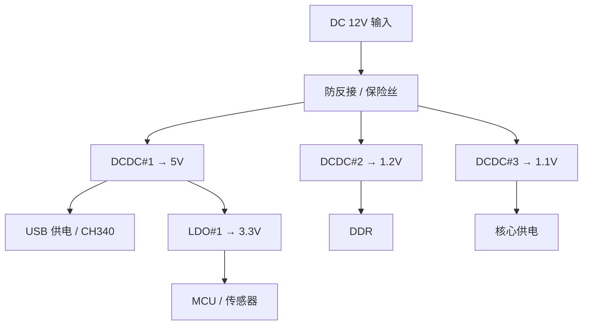

# 第 15 课 · 工程实践补充

> **所属阶段**：阶段三 · 单片机与第一块项目板
> **前置课程**：第 07、09 课；生产文件与首次上电部分配合首板，量产部分按项目深入
> **本课难度**：⭐⭐⭐⭐

这一课配合首板与后续项目，解决"交得出、造得出、算得清"：从设计文件到工厂能用的光绘（Gerber），从拿到陌生原理图到快速看懂，从"照 BOM 买料"到自己选型比价，从打样下单到小批量贴片，再到量产的成本账。这些是公司里每天都要用的工程流程，面试官问"你们怎么打样的"时，你要能像流水一样答出来。

## 🎯 本课目标

学完这一课，你应该能够：

1. 独立输出一套完整的打样文件（各层 Gerber + 钻孔 + 边框），并用 CAM 检查工具完成输出前自检。
2. 拿到一份陌生原理图，按"电源树→主控→模块化→网络标号"的流程在 1~2 小时内看懂主体结构。
3. 读元器件关键参数（容值/耐压/精度/封装/温度等级），完成 LDO/DCDC/MOS 的选型对比与替代料分析。
4. 正确填写打样下单参数（板厚/铜厚/阻焊色/表面工艺等），说出 HASL 与 ENIG 的适用场景。
5. 描述小批量 SMT 的完整流程（钢网→锡膏→贴片→回流焊）以及 BGA 焊接为什么要 X-Ray 检测。
6. 用 DFM 审查清单和降本手段（层数/工艺/器件替代/拼板）评估一块板的可制造性与成本。

## 📖 正文

### 15.1 光绘输出：把设计翻译成工厂的语言

**是什么**：PCB 工厂的机器不认识你的 `.PcbDoc` 或工程文件，只认识**光绘（Gerber）文件**和**钻孔文件**。输出光绘（也叫 CAM 输出）是每个项目的"交卷"动作，也是新手最容易翻车的环节——图画得再好，层选错/漏输出一样报废。

**一套完整的生产文件长什么样**（文件后缀以 Altium/常见约定为例，不同 EDA 命名不同）：

| 文件 | 后缀（常见） | 内容 |
|:---|:---:|:---|
| 顶层铜箔 | GTL | 顶层走线与铺铜 |
| 底层铜箔 | GBL | 底层走线与铺铜 |
| 内层信号/电源 | G1/G2… | 各内层（内电层注意正负片设置） |
| 顶层阻焊 | GTS | 阻焊开窗（露焊盘的地方） |
| 底层阻焊 | GBS | 同上 |
| 顶层丝印 | GTO | 顶层文字/图形 |
| 底层丝印 | GBO | 底层文字/图形 |
| 钻孔文件 | DRL（Excellon 格式） | 孔位与刀径 |
| 板边框 | GKO / Outline | 板子外形 |
| 顶层贴片 | GTP | 钢网开孔（SMT 用） |
| 底层贴片 | GBP | 同上 |
| 坐标/装配文件 | TXT/CSV | 贴片机取料坐标（SMT 用） |

**格式常识**：Gerber 主流格式为 RS-274X（扩展 Gerber，图形信息自带，单文件即可用），老旧的 RS-274D 需要配套光圈表、易出错，基本淘汰；钻孔文件用 Excellon 格式；输出时注意**单位（公制 mm/英制 inch）与精度（如 2:4、2:3）要前后统一**。部分大厂接受 ODB++ 或 IPC-2581 这类智能格式，能携带更多工艺信息。

**输出前检查（照着做一遍）**：

1. 层叠对应：导出的层顺序、层数与叠构一致，内电层的正片/负片（Negative）极性正确——负片层极性反了就是"该留的铜全被蚀刻掉"；
2. 阻焊层检查：所有需要焊接的焊盘都开了窗（包括手焊的通孔、测试点）；不想露铜的地方没有误开窗；
3. 丝印检查：没有压焊盘、没有超出板框、字符方向统一（贴片面从左到右、从下到上阅读）；
4. 钻孔检查：孔径分档齐全，过孔与焊盘一一对齐，没有"忘了输出的孤立孔"；
5. 板框：闭合、单一、无多余断线。

**CAM 检查**：用 CAM350、GerbTool、KiCad 自带 Gerber 查看器，或打样平台的上传预览/DFM 分析工具（如嘉立创下单助手的预览）打开你导出的文件逐层看：

- 各层叠起来对不对齐（对着钻孔层看偏移）；
- 用网表比对功能（部分工具支持导入 IPC-D-356 网表）核对连通性与设计一致；
- 3D 预览最后过一眼整体效果。

**归档习惯**：文件打包命名"项目名_版本_层数_日期"，连同 BOM、坐标文件、层叠说明一起存档。版本管理从打样这一步就要养成——工厂是按你上次的文件返单的，版本一乱就是批量事故。

**输出参数设置与三起常见"翻车事故"**：

- 事故一：钻孔文件单位英制、Gerber 公制，孔整体偏移对不上焊盘 → 统一单位与精度；
- 事故二：内电层没按负片（Negative）输出，电源层铜箔被全部蚀刻掉 → 输出前逐层预览确认极性；
- 事故三：忘了输出边框层，工厂不知道板子多大，工程询问来回耽误一周 → 输出模板里固定包含边框与钻孔。

对策：在 EDA 里建一套固定的输出模板（含全部层与钻孔），每次只做微调；收到板厂的工程确认问题（EQ）时逐条书面回复，不要口头。

### 15.2 原理图解读：拿到别人的图怎么快速看懂

工作中你收到的大多是别人画的原理图（芯片原厂参考设计改的、离职同事留下的）。目标是**快速建立框架，按需下钻细节**，不要从左上角逐个元器件硬啃。

**推荐流程（六步法）**：

1. **看图纸信息**：标题栏、版本号、修改记录、页码——先知道这是什么板、改过几版、哪页是什么。
2. **先找电源树**：从电源输入端开始追——输入（USB/适配器/电池）→ 保护（保险丝/防反接）→ 变换（DCDC/LDO 各路输出）→ 分配到各用电模块。**自己动手画一张电源树图**（哪路电压、多大胆流、给谁用），这是看懂任何板子的第一把钥匙。
3. **再找主控**：定位 CPU/MCU，把它的引脚按功能分组看——电源、时钟（晶振）、复位、调试（JTAG/SWD/UART）、存储、各接口。主控一通，全图皆活。
4. **模块化阅读**：按接口单元逐块看——USB、网口、显示、音频、传感器……每块对照第 10、11、18、12 课学过的模块套路，九成电路都是老面孔。
5. **网络标号追踪**：同名网络（Net Label）在图上是连通的；全局网络（如 VCC/GND）跨页相连。顺着标号"跳页"追信号，不要被分页吓住。
6. **看细节做批注**：去耦有没有、防护有没有、测试点有没有、没用的引脚（NC/DNU）处理是否合规；边看边在图上做笔记，形成你自己的问题清单。

**经验心法**：80% 的时间花在电源树和主控上，20% 扫模块；看不懂的局部先标问号，配合芯片 Datasheet 的引脚定义与典型应用电路对照，别跟一个电阻死磕。读得多了你会形成"模块模板库"，新图扫一眼就知道哪里是套路、哪里是自定义。

**电源树画法示例**（看图时随手就能画出这种结构）：

有了这棵树，布局时电源模块该放哪、铜宽该多少、哪路电流大，全都一目了然。

### 15.3 元器件选型：参数、生命周期与成本

**看懂关键参数（以三大件为例）**：

- **电阻**：阻值、精度（常用 1%/5%）、封装（0201/0402/0603/0805…）、额定功率随封装升级（0402 常见 1/16W 量级，以规格书为准）、特殊用途看温漂与材质（采样电阻看低阻值/大功率/合金）。
- **电容**：容值、耐压（留裕量，经验至少 1.5~2 倍于工作电压）、精度、介质（X5R/X7R 用于去耦耦合，C0G/NP0 用于定时/滤波/射频等稳定场合——容值随温度电压漂移小）、温度等级。
- **电感/磁珠**：感量、饱和电流（Isat，超了感量跳水）、温升电流（Irms）、直流电阻 DCR；磁珠看阻抗@100MHz 与直流电阻，单位是欧姆不是亨利。

**温度等级（影响价格与可靠性）**：商业级（经验 0~70°C）、工业级（经验 −40~85°C）、车规级（经验 −40~125°C 起，且需 AEC-Q 系列认证）——以器件规格书为准。消费电子用商业级省钱，工控/车载按需求升级，别无脑上高等级浪费成本。

**生命周期管理（Lifecycle）**：

1. 选型时查器件状态：量产中（Active）、不推荐新设计（NRND）、停产公告（EOL）；NRND/EOL 的料再便宜也别上新项目。
2. 关注 PCN（Product Change Notice，产品变更通知）——供应商改工艺/换厂可能影响你的设计。
3. **替代料（Second Source）**：关键器件准备 Pin-to-Pin 兼容的备选，封装相同、关键参数覆盖；国产替代是当前主旋律，电源类、接口类、MCU 类国产料的成熟度已相当高。

**LDO vs DCDC vs MOS 选型对比（高频面试题）**：

| 维度 | LDO（线性稳压） | DCDC（开关稳压，以 BUCK 为例） | MOS（功率开关管） |
|:---|:---|:---|:---|
| 效率 | 低，约 Vout/Vin | 高（经验 85%~95%，以规格书为准） | 取决于 Rds(on) 与驱动损耗 |
| 噪声/纹波 | 极低，干净 | 有开关纹波与 EMI，需滤波 | 开关应用有损耗与 EMI |
| 压差 | 受 Dropout 限制 | 可升/降压 | — |
| 外围 | 简单（进出电容） | 电感、二极管/MOS、补偿 | 栅极驱动电路 |
| 成本 | 低 | 中 | 看电流/耐压等级 |
| 适用 | 小电流、射频/模拟供电、对噪声敏感处 | 大电流、大压差、效率敏感处 | 电源开关、电机驱动、负载开关 |

MOS 选型：耐压留裕量；在实际栅源驱动电压下核对规定的 Rds(on)，并据此计算导通损耗；Vgs(th) 是规定小电流下的阈值，不代表 MOS 已充分导通。还要核对电流、封装热条件、开关损耗与栅极电荷 Qg。

**选型自查清单（每次新料入库前过一遍）**：

- [ ] 电气参数覆盖工作点：电压留 1.5~2 倍裕量、电流留裕量（经验起点，按可靠性要求降额）
- [ ] 封装与功耗：功率损耗 × 热阻 = 温升，是否在允许范围
- [ ] 温度等级匹配应用场景（商业/工业/车规）
- [ ] 生命周期状态为量产中（Active），且库存/交期可接受
- [ ] 有替代料（最好 Pin-to-Pin），价格在数量阶梯下可接受
- [ ] 关键料已读 Datasheet 的推荐应用与 Layout 章节

**成本意识**：询价看数量阶梯（Price Break，1k 与 10k 单价差很多）；封装别追小（0201 省板面积但贴装成本与不良率上升）；优先选"通用量产料"而不是冷门料；设计时就把 BOM 成本表列出来，养成"每加一个器件都问一句为什么"的习惯。

**数据手册阅读与选型记录**

1. 确认制造商、完整订货号、文档版本、封装和引脚；同系列不同后缀可能不同。
2. 先区分绝对最大额定值与推荐工作条件，后者才是设计工作点的基本依据；再按温度、负载、电压和时序查电气特性。
3. 核对参考电路与测试条件：外围元件、容差、稳定性、布局和启动条件不能脱离原应用。
4. 建立候选表，记录最坏条件、功耗、封装、供货状态和未决项。替代件即使同封装，也要逐项比较引脚、电气和实际工作条件。
5. 用第 14 课 LDL1117、电容、USB 连接器做一次练习；当前项目中电容有效值、USB 电流预算和制造条件尚未核准。

可参考 [嘉立创元器件与选型资料](https://wiki.lceda.cn/zh-hans/contest/e-contests/basic-training/electron-component.html)，最终以具体器件厂商的数据手册和相关应用资料为准。

### 15.4 PCB 打样与焊接：从下单到手上亮板子

**打样下单参数详解**（以常见打样平台的下单页为参照，界面以平台实际为准）：

| 参数 | 常见选项 | 怎么选 |
|:---|:---|:---|
| 板厚 | 0.6/0.8/1.0/1.2/**1.6**/2.0mm | 常规默认 1.6mm；阻抗板要配合层叠计算 |
| 层数 | 2/4/6… | 按设计，层数与成本强相关 |
| 铜厚 | 0.5oz/**1oz**/2oz（约 17/35/70µm） | 大电流电源用 2oz 并加宽走线 |
| 最小线宽/孔径 | 按板厂能力 | 留裕量，别顶格画 |
| 阻焊色 | 绿/蓝/红/黄/黑/白/紫 | 绿色工艺最成熟；黑/白丝印对比度注意 |
| 字符色 | 白/黑/黄 | 与阻焊色搭配保证可读 |
| 表面工艺 | HASL / ENIG / 沉银 / OSP | 见下文 |
| 过孔处理 | 盖油/开窗 | 批量默认盖油防连锡短路 |
| 特殊工艺 | 阻抗控制/喷锡厚度等 | 高速板选阻抗控制，板厂按你的层叠做阻抗 |

**表面工艺（Surface Finish）对比**：

- **HASL（喷锡，热风整平）**：便宜、可焊性好，但表面平整度一般，细间距/BGA 器件慎用；分有铅/无铅（RoHS 合规选无铅）。
- **ENIG（沉金）**：平整、耐用、适合 BGA 与细间距、保质期长；价格更高，工艺不良时有"黑盘"风险。
- **沉银**：平整、成本居中，注意硫污染变色。
- **OSP（有机保焊膜）**：最便宜、平整，但可焊性随时间衰减、返工次数受限。

经验选择：练习板/无 BGA 用 HASL 省钱；有 BGA 或 0.4mm 以下细间距用 ENIG。

**小批量 SMT 流程（做 10~100 片时的标准动线）**：

1. **备料**：BOM 采购、来料检验、湿敏器件（MSD）按等级烘干拆包管理；
2. **钢网（Stencil）**：激光钢网对应贴片层开孔，常用厚度 0.1~0.12mm 量级（以锡珠/器件间距与锡膏规格书推荐为准）；
3. **印刷锡膏**：锡膏印刷机（小批量手工刮也行），印刷后检查少锡/连锡；
4. **贴片（Pick & Place）**：贴片机按坐标文件贴装；小批量手工贴片用镊子+放大镜/显微镜；
5. **回流焊（Reflow）**：按温度曲线（Profile）走"预热—恒温—回流—冷却"四区；无铅工艺峰值温度常见约 245~250°C 量级、有铅约 225~235°C（**以所用锡膏规格书的推荐曲线为准**）；
6. **检查**：AOI 或目检贴件极性、偏移、连锡；ICT/FCT 测试；
7. **通孔件**：小批量手工焊或选择波峰焊；压接件不能焊。

**BGA 焊接与 X-Ray**：BGA 焊球在封装底部，目视完全看不到——可根据质量要求使用 **X-Ray** 检查空洞、桥连和偏移；检测能力及验收标准依设备和工艺要求确定；返修要用返修站（BGA Rework Station）局部加热拆焊重植球。设计端的配合：BGA 周边留出返修操作空间、扇出走线别把测试点埋在正下方死角。

**打样回来之后**：先目检（阻焊/丝印/孔），万用表量电源对地阻抗（防止焊接短路再上电烧板），上电测各路电压，再按"电源→时钟→复位→最小系统→外设"的顺序调试。

**手工焊接实操要点（贴片返修与样板必会）**：

1. 烙铁温度：无铅焊料常用 350~380°C 区间、有铅可低一些（经验值，以焊锡丝规格书与烙铁手册推荐为准）；温度不是越高越好，过高加速焊盘脱落与烙铁头氧化；
2. 贴片件手法：先给一个焊盘上锡 → 镊子夹件对位焊一脚 → 再焊另一脚； CHIP 件两端加热要均衡，否则"立碑"；
3. 拆件用热风枪：从外围小件练起，注意保护周边塑料连接器与相邻器件（锡箔纸遮挡）；
4. 焊接顺序：低矮小件 → 大件 → 连接器 → 怕热器件最后；同批次多板流水作业；
5. 质量自检标准参考 IPC-A-610 的合格焊点形态描述：焊料润湿、轮廓完好、无桥连无针孔。

### 15.5 量产工艺规范与成本控制

**从打样到量产，多出来的事**：

1. **拼板效率**：把小板拼成大板提高原材料利用率——拼板尺寸尽量贴合格料尺寸（按板厂大料规格）、板间留工艺边（经验 5mm 量级，以产线要求为准）；分板方式：直线用 V-CUT（成本低但应力大）、异形或应力敏感用邮票孔（Mouse Bites）加挖槽。
2. **测试**：ICT（In-Circuit Test，在线测试，针床/飞针逐网络测器件与连接，要求设计留测试点）、FCT（Functional Test，功能测试，治具+测试程序模拟真实工作）、边界扫描（JTAG）覆盖难测的 BGA 网络。
3. **直通率（FPY，First Pass Yield）**：一次通过不返修的比例，是产线核心指标——设计质量直接体现在 FPY 上：焊盘设计不规范→立碑、偏移；丝印不清→极性贴反；测试点缺失→只能人工补测。
4. **典型焊接不良与设计对策**：立碑（元件一头翘起，片式件两端焊盘受热不均/不对称）、桥连（间距过近/锡量过多）、虚焊（焊盘氧化/温度曲线不当）、偏移（Mark 点/封装库精度）。

**典型不良与设计端对策表**：

| 不良 | 机理 | 设计对策 |
|:---|:---|:---|
| 立碑（墓碑） | 片式件两端受热不均，焊料表面张力把元件拉起 | 两端焊盘对称、尺寸符合封装规范、热容量均衡 |
| 桥连 | 间距过近或锡量过多 | 放宽间距、钢网开孔缩比、保住阻焊桥 |
| 虚焊/冷焊 | 焊盘氧化、温度曲线不当 | 焊盘可焊性设计（表面工艺选择）、回流曲线验证 |
| 偏移 | 贴片精度/封装库误差 | Mark 点设计规范、封装库严格按 IPC-7351 类规范建 |

**DFM 审查清单（量产前自查）**：

- [ ] 线宽/间距/孔径/环形宽度未顶板厂能力上限
- [ ] 密集焊盘间阻焊桥可制造，丝印不压焊盘
- [ ] 拼板方式、工艺边、定位孔、Mark 点已按产线要求设计
- [ ] 测试点覆盖关键网络（每网络可测是 ICT 的理想状态，实际按优先级取舍）
- [ ] BGA 可 X-Ray 检查、可返修
- [ ] 极性/一脚/方向丝印齐全清晰
- [ ] 散热器件与安装件（螺丝孔/保持足够间距）不冲突

**降本手段（按效果排序的思路）**：

1. **板层数**：6 层改 4 层是最大单项降幅之一，条件允许时通过重排信号层压缩；
2. **工艺退档**：线宽/孔径放宽到主流工艺档位，HDI 换通孔工艺；
3. **器件替代**：进口料换国产 Pin-to-Pin、高精度换常规精度（评估容差）、分立方案换集成度更高的芯片（减少 BOM 行数与贴片点数）；
4. **板尺寸**：布局紧凑化缩小面积、拼板排布优化利用率；
5. **表面工艺/材料**：非 BGA 板 ENIG 换 HASL、高频板材按需分区使用混压。

注意：降本永远和可靠性做交易——每砍一项都要评估对性能、良率、EMC 的影响，"省了五毛钱、返修一百块"是量产最常见的笑话。

### 15.6 测试仪器与电路调试方法论（Bring-Up）

板子从工厂回来那一刻，才是硬件工程师真正的考试——行业里把这个过程叫 **Bring-Up（点亮）**。国际社区（Phil's Lab、EEVblog 等）反复强调：**会设计只是半个工程师，会把不工作的板子调好，才是完整的工程师**。这一节补上仪器与调试方法这块拼图。

#### 15.6.1 调试台三件套

| 仪器 | 核心用途 | 必会操作 | 新手要点 |
|:---|:---|:---|:---|
| 万用表 | 电压/通断/对地阻抗 | 通断档查短路、电压档测各电源轨 | 在路测电阻受并联支路影响，读数仅作参考 |
| 直流稳压电源（带限流） | 给板子安全供电 | **上电前先设置限流**；结合启动浪涌、负载和电源能力确定数值 | 限流有助于限制故障能量，但不能保证器件不损坏；按设备启动电流、故障能量和电源动态特性设置并监测 |
| 示波器 | 看波形：时钟、复位、纹波、通信 | 探头补偿校准、垂直/水平档位、边沿触发 | 带宽按被测信号最高频率的 3~5 倍选（经验值）；测电源纹波用 20MHz 带宽限制 + 短地弹簧 |

进阶仪器（知道干什么用即可）：逻辑分析仪（抓 I2C/SPI/UART 协议波形）、JTAG/SWD 调试器（配合固件单步调试）、电子负载（测电源带载能力）、热成像仪（找发热点与短路点）。

#### 15.6.2 首板点亮七步法（Bring-Up 标准流程）

1. **目检（IPC）**：放大镜/显微镜对照 BOM 与丝印查方向、错料、连锡、虚焊——一半的"不工作"是焊接问题
2. **断电测对地阻抗**：万用表通断/电阻档，测每路电源对 GND 的阻抗，与正常参考值对比（无参考时凭经验：3.3V 轨对地通常几十~几百 Ω，接近 0Ω 必有短路）
3. **限流上电**：电源限流设为预期电流的 1.5 倍左右，从 0V 缓慢抬高，盯电流——一抬电压电流就顶满 = 还有短路，立即断电
4. **测电压轨**：按电源树逐路测：输入→各 DCDC 输出→LDO 输出→主核/IO/DDR 各轨，顺序对了才能进下一步
5. **查时钟与复位**：示波器测晶振起振（幅度、频率）、复位脚释放时序（上电后应保持复位低电平一段时间后拉高）
6. **最小系统验证**：接调试器，看能否识别目标芯片（SWD/JTAG 能连上 = 最小系统活了），抓 UART 启动日志
7. **逐个外设点亮**：一次只启用一个外设，LED→串口→存储→显示→无线，谁出问题查谁，不要一上来全开

#### 15.6.3 调试方法论：四板斧

- **二分法**：信号链路从中间断开测，确定问题在前半段还是后半段，逐步缩小包围圈
- **对比法**：好板 vs 坏板同一点对测（打样多打几块的意义之一）；没有好板就和参考设计比
- **替换法**：怀疑的元件/模块换掉验证（先换便宜的、好焊的）
- **最小系统剥离**：把外设全部断开只留最小系统，逐个加回，锁定引入问题的外设

记录习惯：每次调试把现象、测量值、改动、结论记进错题本——三天后你会感谢这份记录。

#### 15.6.4 高频"点不亮"故障速查表

| 现象 | 首查方向 |
|:---|:---|
| 限流上电电流顶满 | 电源对地短路：电容连锡、芯片焊盘桥连、BGA 焊球短路 |
| 某电压轨无输出 | 使能脚电平、FB 分压阻值、软启动脚、电感焊点 |
| 电压对但芯片不工作 | 复位脚被拉住、晶振不起振、boot 启动配置脚电平错误 |
| 随机死机/重启 | 电源纹波过大、复位阈值设置、看门狗、焊接虚焊（断电后检查焊接，必要时采用受控方法复现） |
| 通信时好时坏 | 波特率/上拉电阻/信号完整性、共地是否连接 |
| 芯片烫手 | 输出短路、芯片接反/丝印方向看错、电源轨接错 |

### 15.7 设计评审（Design Review）：出厂前的最后一道关

**是什么**：设计评审（Design Review）是图纸或板子投产前，由多人从不同视角系统性检查设计的流程——本质是**团队互查**，用集体的眼睛补个人的盲区，而不是领导签字走过场。行业共识：自己查自己的图，漏检率天然高（你不知道自己不知道什么）；评审是成本最低的排雷手段——评审时改一行原理图只要一分钟，打样回来再改就是两周一版。

**四级评审流程**：

| 级别 | 谁来审 | 审什么 | 产出 |
|:---|:---|:---|:---|
| ① 自审 | 自己 | 按检查表逐项自查，先消灭低级错误 | 自查记录 |
| ② 交叉审 | 水平相近的同事 | 用"陌生人的眼睛"重走一遍设计逻辑 | 问题清单 |
| ③ 专家审 | 资深工程师/主管 | 叠层、阻抗、EMC、电源架构等高风险决策 | 风险决议 |
| ④ 设计冻结 | 项目组 | 确认问题全部闭环、锁定版本，才允许投板 | 冻结版本号 |

顺序不能乱：自己没过一遍就拿去交叉审，等于浪费同事的时间在"忘放的去耦电容"这种低级问题上——先自审清场，再借别人的眼睛。

**三张精简检查表**：

原理图审查：

- [ ] 电源树完整：每路电压/电流/给谁用，功率余量是否够
- [ ] 每个芯片供电脚就近有去耦；关键信号有上拉/下拉处理
- [ ] 冗余与预留：测试点、NC 脚处理、0Ω 选焊的兼容位
- [ ] 位号连续无重复，极性/一脚标注齐全

PCB 审查：

- [ ] DRC 零报错；阻抗与等长按规则表复核（第 11、19 课的速查表）
- [ ] 敷铜检查：地平面完整无分割、孤岛消除、散热铜量足够
- [ ] 安装检查：孔位/外壳/元件高度冲突、高频插拔区应力加固（第 11 课）

DFM 审查：直接复用 15.5 的 DFM 审查清单，逐项打勾。

**评审会议怎么开**：

1. **对事不对人**：审的是"这块板的风险"，不是"谁画得差"——被指出问题是设计受益，不是面子受损；
2. **问题分级**：Must（必须改，不改不投板）/ Nice（建议改，记录在案下版处理）；
3. **记录与闭环**：每个问题记入评审记录表（问题描述/位置/级别/责任人/期限），改完逐条销项——没有闭环的评审等于没开。

**新人如何参与评审**：先旁听 + 记录，把评审里的高频问题记进错题本；提问要带数据、带句式——不问"这里对不对"，问"这根线的回流路径在哪""这路电源的峰值电流按多少算的"。带着具体数据的提问，一次顶十次。

**与 15.5 DFM 审查的关系**：DFM 是评审的一个维度——三张检查表里的一张。评审的视野更宽：除了"造得出"（DFM），还管"用得对"（原理审查）、"走得通"（PCB 审查）、"修得了"（测试点与返修空间）。

> 🎬 **视频推荐**：B 站搜索 [嘉立创 PCB 制造流程](https://search.bilibili.com/all?keyword=%E5%98%89%E7%AB%8B%E5%88%9B%20PCB%20%E5%88%B6%E9%80%A0%E6%B5%81%E7%A8%8B)——配合本课光绘与打样章节，理解工厂端的 SMT 与制板工艺。

## 🔧 动手练习

| # | 练习内容 | 完成标准 |
|---|---------|---------|
| 1 | 给你的 6 层板项目输出完整光绘（含钢网/坐标），用 CAM 工具逐层检查 | 文件齐全无缺层，CAM 检查截图留档 |
| 2 | 找一份网上的开源项目原理图（如 STM32 最小系统扩展板），按六步法解读 | 产出手绘电源树 + 一页模块清单批注 |
| 3 | 为同一个需求（5V 转 3.3V/1A）分别选一款 LDO 和一款 DCDC，列参数对比表并给出结论 | 对比表含效率、成本、纹波、外围器件数 |
| 4 | 完成一次真实打样下单：自己决定所有参数并说明理由 | 下单参数截图 + 每项选择理由 |
| 5 | 把打样回来的板子完成焊接与上电调试（可只贴电源+最小系统） | 上电各路电压正常，记录调试过程到错题本 |
| 6 | 给你的板子写一份量产 DFM 审查报告 + 三条降本建议 | 报告含清单逐项结论与整改项 |
| 7 | 查 BOM 中两个关键器件的生命周期状态（Active/NRND/EOL），为其中一个找替代料 | 状态查询截图 + 替代料参数对比表 |
| 8 | 练一次"安全上电"：电源限流设为预估 1.5 倍，按器件要求设置电压和限流，采用允许的上电斜率并记录电流电压曲线 | 记录表含每一步电流读数与判断依据 |
| 9 | 用示波器测一块能工作的板子：晶振波形 + 任一电源轨纹波（20MHz 带宽限制） | 截图标注幅度/频率/纹波峰峰值 |

## ✅ 自测清单

- [ ] 我能说出 Gerber 各层文件的含义与后缀对应关系，并知道 RS-274X/Excellon 分别是什么格式
- [ ] 我知道输出光绘前要检查哪五类问题（层叠/阻焊/丝印/钻孔/板框）
- [ ] 我能背出原理图解读六步法（图纸信息→电源树→主控→模块→标号→批注）
- [ ] 我能读电容的耐压/精度/介质/温度等级并说出 X7R 与 C0G 的适用场景，也知道 NRND/EOL/PCN 与替代料的处理
- [ ] 我能对比 HASL/ENIG/沉银/OSP 四种表面工艺的优缺点与适用场景
- [ ] 我能按顺序描述 SMT 小批量流程（备料→钢网→印刷→贴片→回流→检查→插件）
- [ ] 我知道 BGA X-Ray 能检查哪些 BGA 缺陷及有哪些局限，以及无铅回流峰值温度的常见量级（以锡膏规格书为准）
- [ ] 我能说出 ICT 与 FCT 的区别，以及测试点的设计要求
- [ ] 我能解释直通率 FPY 的含义，并列出至少 4 条设计端影响 FPY 的因素
- [ ] 我能给出至少 4 条降本手段并说明各自的风险
- [ ] 我能解释片式件"立碑"的机理与焊盘设计对策，并知道湿敏器件（MSD）要按等级管理开封时间
- [ ] 我知道上电前为什么必须设电源限流，限流值一般设多少
- [ ] 我能背出首板点亮七步法的顺序（目检→对地阻抗→限流上电→电压轨→时钟复位→最小系统→逐外设）
- [ ] 我能说出调试四板斧（二分法/对比法/替换法/最小系统剥离）各自的适用场景
- [ ] 我能说出四级评审流程（自审→交叉审→专家审→设计冻结）与问题分级 Must/Nice 的含义
- [ ] 我能解释设计评审与 DFM 审查的关系（DFM 是评审的一个维度），以及评审问题为什么必须"记录—整改—销项"闭环

## ⚠️ 新手常见坑

1. **光绘漏层/极性错**：忘了输出钻孔或某内层、内电层负片没勾——板厂照做出来才发现。对策：输出后必须用 CAM 工具逐层预览，建立自己的输出模板（Layer Set）。
2. **单位/精度不统一**：Gerber 用 2:4、钻孔用 2:3，工厂解析出错孔位漂移。对策：输出设置里统一单位与精度，下单后核对工厂反馈的工程确认（EQ）问题。
3. **只看单价不看阶梯与库存**：选了个便宜料，量产时缺货交期三个月。对策：选型时同时看库存、生命周期状态和多家供应渠道。
4. **打样参数照抄默认**：大电流板用默认 1oz 铜厚打样，上电走线发热。对策：先算载流（参考 IPC-2152 类降额思路），再定铜厚与线宽。
5. **BGA 板选 HASL**：表面不平整导致焊球虚焊，X-Ray 一片空洞。对策：细间距/BGA 根据平整度、组装、可靠性和成本选择表面工艺。
6. **不做来料与 MSD 管理**：拆封的湿敏芯片直接过回流焊，水汽膨胀导致分层开裂。对策：按湿敏等级（MSL）管理开封时间，超时的先烘烤（条件以器件规格书为准）。

## 📚 延伸学习

- 书籍：一本《SMT 工艺基础》或《电子组装工艺》类教材，重点看锡膏印刷与回流曲线章节
- 标准：IPC-A-610（电子组装件外观验收）、IPC-7351（焊盘图形设计）、IPC-2152（载流能力）
- 手册：常用 DCDC 芯片 Datasheet 的 Layout Guidelines 章节逐字读两遍
- 工具：CAM350 / KiCad Gerber Viewer / 打样平台 DFM 预览功能，各跑一遍真实文件
- 搜索关键词：`Gerber 输出 检查`、`Excellon 钻孔文件`、`HASL ENIG OSP 对比`、`回流焊 温度曲线 无铅`、`BGA X-Ray 检测 空洞`、`拼板 V-CUT 邮票孔`、`ICT FCT 区别`
