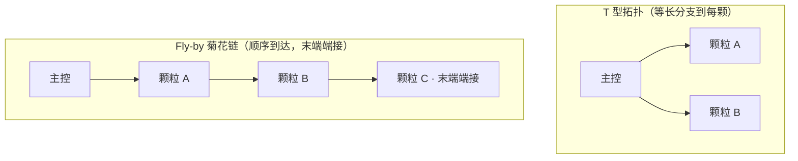

# 第 18 课 · 存储模块

> **所属阶段**：阶段四 · 多层板与专项进阶
> **前置课程**：第 11 课 · 接口模块
> **本课难度**：⭐⭐⭐⭐

存储模块是"看懂主流开发板"的最后一道门槛，也是新手与合格工程师的分水岭：**DDR 走线是整块板子上规则最多、最容易翻车的区域**。这一课我们把 SDRAM 到 DDR4 的演进讲清楚，把 DDR 布局布线的核心规则一条条落到可执行的数字上，最后学会"看懂"任何一块开发板的 DDR 区域。

## 🎯 本课目标

学完这一课，你应该能够：

1. 说出 SDRAM → DDR → DDR2 → DDR3 → DDR4 每一代的电压、速率与关键新特性，以及为什么布线难度逐代递增；
2. 解释时钟（CK/CK#）、数据选通（DQS）、地址/命令/数据总线、ODT、端接这几个 DDR 核心概念各自的作用；
3. 区分 T 型、菊链、Fly-by、点到点四种拓扑（topology）结构，说明各自适用场景；
4. 按"地址/命令/控制一组、DQ/DQS 按字节组"的分组方式制定 DDR 等长规则表，并给出经验误差值；
5. 说明 VTT、VREF 电源的处理方式与 VREF 走线防护要点；
6. 拿到一块主流开发板，能通过观察颗粒摆位、VTT 电阻和蛇形走线，判断它的 DDR 拓扑与分组策略。

## 📖 正文

### 18.1 存储器演进概览与关键概念

#### 从 SDRAM 到 DDR4：一张表看懂

| 代际 | 核心电压 | 预取（prefetch） | 典型数据率 | 关键新特性 | 布线难度 |
|:---|:---:|:---:|:---|:---|:---:|
| SDRAM | 3.3V | 1n | 66~166 MT/s | 同步接口，单倍速率 | ⭐⭐ |
| DDR | 2.5V | 2n | 200~400 MT/s | 时钟上下沿都传数据（Double Data Rate） | ⭐⭐⭐ |
| DDR2 | 1.8V | 4n | 400~800 MT/s | 引入 **ODT 片上端接**、CAS 更低 | ⭐⭐⭐ |
| DDR3 | 1.5V | 8n | 800~2133 MT/s | **Fly-by 拓扑 + 写平衡（write leveling）** | ⭐⭐⭐⭐ |
| DDR4 | 1.2V | 8n | 1600~3200 MT/s | Bank Group、更严时序、CA 训练 | ⭐⭐⭐⭐⭐ |

规律很直观：**速率每翻一倍，时序余量（timing margin）就砍一半，布线等长与阻抗要求就严一档**。SDRAM 时代 2 层板随手布；DDR3 单颗点到点 4 层板能做；DDR4 基本就是 6~8 层板的专业活。

#### 必须先弄懂的几个概念

读任何 DDR 布线指南之前，这几个词必须过关（中英对照）：

- **时钟（Clock，CK/CK#）**：差分时钟，全总线的时序基准。时钟是地址/命令等时序关系的重要参考；数据通常以各自字节组的 DQS 为基准，具体按芯片指南；
- **数据选通（DQS，Data Strobe）**：与数据（DQ）**成对出现的源同步（source synchronous）选通信号**，接收方靠 DQS 的边沿来采样 DQ。每 8 位 DQ（一个字节组 byte lane）配一对 DQS（DDR3 起为差分 DQS/DQS#）。**DQS 与 DQ 的偏移 = 采样窗口的直接损失**，所以它们是全总线等长要求最严的一组；
- **地址/命令/控制总线（Address/Command/Control）**：RAS/CAS/WE/CS/CKE/ACT 加地址线，**多颗颗粒共享一条总线**（都挂在同样的地址上），因此诞生了 T 型、Fly-by 等拓扑问题；而 DQ/DQS 是每颗独享的点到点连接；
- **ODT（On-Die Termination，片上端接）**：颗粒芯片内部集成的可编程端接电阻，用于吸收数据线上的反射，DDR2 起引入，DDR3 广泛依赖——**数据线端接靠 ODT，地址线端接靠外部 VTT**（见 18.2）；
- **端接（Termination）**：高速信号到达总线末端后防止反射的措施。常见两种：串联源端（发送端串阻）、并联端接（末端电阻拉到 VTT）。端接方式由存储器规格书（如 JEDEC SSTL）与主控手册共同决定；
- **写平衡（Write Leveling）**：DDR3 与 Fly-by 拓扑配套的训练机制——因为 Fly-by 让各颗颗粒收到时钟的时间天然不同，主控在上电训练阶段逐颗补偿延迟差。**这就是 Fly-by 敢"不等长"的底气**。

### 18.2 DDR 布局布线核心规则

这是本课的重头戏。按"布局 → 拓扑 → 分组等长 → 阻抗 → 参考层 → 电源"的顺序展开。

#### 18.2.1 布局：先摆好位，布线就成功了一半

- **颗粒紧贴主控**：DDR 颗粒与主控内存控制器引脚的距离经验值控制在 500~1000 mil（12~25 mm）量级，越近时序余量越大；
- 单颗颗粒放主控同侧最近处；两颗放主控两侧对称或后方并排——**怎么摆由拓扑决定，先定拓扑再摆件**；
- **利用引脚交换（pin swapping）**：部分主控和存储器允许特定范围内的交换，必须同时核对控制器、颗粒、训练及软件配置；地址线不能默认可交换，巧妙交换能把交叉走线变成顺直走线，这是 DDR 布局最大的"合法外挂"；
- 去耦电容每颗电源引脚一颗 0.1 μF 就近摆放 + 整体 10 μF 一颗，电容置于颗粒背面正对引脚处（BGA 背面扇出）。

**4 层板 DDR3 单颗叠层示例**（经验参考，以板厂加工能力为准）：

| 层 | 用途 | 说明 |
|:---|:---|:---|
| L1 TOP | 主控/DDR 元件 + 大部分信号 | 数据组优先走本层 |
| L2 GND | 完整地平面 | 全板不分割、不打无谓的孔阵 |
| L3 PWR | 电源平面（1.5V/3.3V 分区） | 电源分区只在这层做 |
| L4 BOTTOM | 换层信号 + 背面去耦电容 | 数据组可少量换到本层（换层点加地过孔） |

#### 18.2.2 拓扑结构：四种形态

| 拓扑 | 结构 | 特点与适用 | 等长要求 |
|:---|:---|:---|:---|
| **T 型（星型）** | 地址/命令从主控出发，等长分支到每颗颗粒 | DDR2、低频 DDR3 两颗场景；分支等长要求苛刻 | 分支必须严格等长，否则反射叠加 |
| **菊链（Daisy-chain）** | 信号依次经过每颗颗粒 | 概念上是 Fly-by 的总称 | — |
| **Fly-by（DDR3 标配）** | 地址/命令/时钟按菊花链顺序"顺访"每颗颗粒，末端端接 | DDR3/DDR4 多颗首选，减少分支反射；靠写平衡补偿天然时差 | **允许不等长**，但要按主控手册给出的各颗延迟补偿范围控制总量 |
| **点到点（Point-to-Point）** | 单颗颗粒直连 | 单颗 DDR3 最常见（主流开发板、嵌入式 SoC），最简单 | 无拓扑问题，只剩分组等长 |

> 数据线（DQ/DQS）永远是**点到点**的（每颗独享），拓扑之争只发生在**地址/命令/控制**总线上——理解了这一点，四种拓扑就不用死记了。

#### 18.2.3 等长分组：DDR 规则表的核心

**先弄懂"为什么要等长"——时序余量（timing margin）**：DDR 是源同步系统，接收方在 DQS 边沿对应位置采样 DQ。采样裕量应从发送端可用的数据有效区间出发，扣除接收端要求的建立/保持时间、走线偏斜（skew）、抖动（jitter）等；tDS/tDH 是对采样边沿的输入时间要求，不是可直接拿来减的窗口总宽。速率越高窗口越窄——DDR3-1600 的数据传输率为 1600 MT/s，理想每位时间为 1/(1.6×10⁹ 次传输/秒) = 625 ps；实际可用采样窗口还要扣除器件建立/保持、抖动、封装与通道误差，不能将它固定成统一的 375 ps；FR4 板上 1 mil 走线差大约对应 0.15~0.18 ps（经验值），据此可以反推"±25 mil ≈ ±4 ps"的量级概念。所以等长 mil 数不是玄学，而是**时序预算（timing budget）的减法**：窗口是芯片给的，偏斜是布线花掉的，你只能控制后者。

**分组原则**（务必背下来）：

- **第 1 组：地址/命令/控制 + 时钟**——它们共享总线、在同一时钟域，作为一组整体匹配；
- **第 2~N 组：DQ/DQS 按字节组（byte lane）**——DQ[7:0]+DQS0±+DM0 为一组，DQ[15:8]+DQS1±+DM1 为一组，以此类推。**组内等长严，组间可放宽**，因为每个字节组是独立的源同步采样单元。

**等长误差经验值表**（不同主控/颗粒差异很大，**最终以主控官方 Layout Guide 为准**，下表用于建立量级概念）：

| 匹配对象 | 经验值 | 说明 |
|:---|:---|:---|
| DQS 差分对内（DQS 与 DQS#） | ±2~5 mil | 全总线最严的一档 |
| DQ 相对本字节组 DQS | **±10~25 mil** | 字节组内最核心的指标 |
| 同字节组 DQ 之间 | ±10~25 mil | 组内对齐 |
| 字节组之间（group to group） | ±25~50 mil | 可放宽，独立采样单元 |
| T 型下地址/命令对时钟 | ±50~100 mil | 分支等长要求高 |
| Fly-by 地址线 | 允许不等长 | 按主控手册补偿表控制，末端端接电阻务必保留 |

蛇形绕线（serpentine）三要素：绕线段间距 ≥3W（3 倍线宽，防自耦合）、锯齿单段长度别太短、绕线放在走线末端靠近颗粒处。**先布通、再分组、最后统一绕等长**，顺序别反。

#### 18.2.4 阻抗与参考层

| 项目 | 经验值 | 说明 |
|:---|:---|:---|
| 单端阻抗 | 50Ω（地址/命令/控制/DQ） | 部分手册给 45~60Ω 区间，以手册为准 |
| 差分阻抗 | 100Ω（DQS±、CK±） | 紧耦合设计 |
| 参考层 | **DDR 区下方地平面必须完整** | 数据线、地址线各自整段不跨分割；一个过孔都不跨 |
| 换层 | 每条线 ≤1~2 次，换层点旁加地过孔 | 数据组整组同步换层 |
| 层分配 | 4 层板：TOP（元件+走线）/GND/PWR/BOTTOM（走线） | DDR 信号优先 TOP 与 BOTTOM，参考同一 GND |

#### 18.2.5 电源三兄弟：VDD、VTT、VREF

DDR3 为例（1.5V 系统），三路电源各司其职：

- **VDD/VDDQ（1.5V）**：主电源，主控与颗粒同源同压，按第 10 课电源模块的常规去耦设计；电流按颗粒数量估算（每颗几百 mA 级），走线宽度留余量；
- **VTT（0.75V，= VDDQ 的一半）**：**只给地址/命令/控制总线的并联端接电阻供电**（数据线靠颗粒 ODT）。端接电流大且动态，必须用专用 VTT 稳压器（如 TPS51200 类双路 LDO），**不能**用电阻从 1.5V 分压糊弄；VTT 电阻排靠近总线末端（Fly-by 链尾）摆放，VTT 就近密集去耦（0.1 μF 多颗 + 10 μF）。注意：**单颗点到点、走线短的 DDR3 常可省略外部 VTT 端接**（反射可控），省不省以主控手册/仿真为准；
- **VREF（0.75V 基准）**：差分接收器的判决门限基准，电流极小但**噪声敏感度极高**。处理要点：
  - 走线宽度 ≥15~20 mil，单独拉到主控与颗粒的 VREF 引脚；
  - **两侧包地（guard trace）+ 沿线地过孔**，远离 DQS/DQ/时钟等噪声源，绝不与数据线平行长距离走线；
  - 每个 VREF 引脚就近 0.1 μF，电源端 1~10 μF；
  - VREF 由 VTT 稳压器第二路输出提供（与 VTT 同源同步变化，这是 TPS51200 这类"VTT+VREF 双输出"芯片存在的原因）。

> 一句话总结：**VDD 喂饱、VTT 吸收反射、VREF 提供判决基准**——三者角色不同，谁都不能凑合。

### 18.3 NAND FLASH

#### 是什么、怎么工作

NAND FLASH 是最经典的裸闪存：**I/O0~I/O7 八根线复用传输命令、地址、数据**，靠控制引脚区分当前 I/O 上是什么：

| 引脚 | 名称 | 作用 |
|:---|:---|:---|
| I/O0~7 | 数据/地址/命令复用总线 | 三种内容分时复用 |
| CLE | Command Latch Enable | 高电平 = I/O 上是命令 |
| ALE | Address Latch Enable | 高电平 = I/O 上是地址 |
| WE# / RE# | 写/读使能 | 上升沿锁存/输出数据 |
| CE# | 片选 | |
| WP# | 写保护 | |
| R/B# | Ready/Busy | 颗粒忙闲状态输出，需上拉 |

读写时序一句话：主控先拉高 CLE（或 ALE）标注 I/O 上的内容类型，再给 WE# 上升沿锁存——命令、地址、数据就这样分批送进颗粒。异步接口速率一般 ≤100 MHz，SLC/MLC/TLC 颗粒密度与寿命不同，但对外接口一样。

#### 布局布线要点（相对宽松）

- **没有硬性等长要求**：异步接口、单端信号，普通规则走线即可（常规模式总长控制在几十~上百 mm 量级、走线整体短，以主控手册为准）；
- 重点是**串扰控制与防挂总线**：I/O 总线并排整齐走线，时钟/WE#/RE# 远离敏感模拟区；
- R/B# 上拉电阻靠近主控；CE# 每颗独立，方便以后做多启动；
- TSOP48 封装焊盘常规扇出即可；注意 NAND 与 eMMC 不同，**需要主控自带 ECC 校验和 FLASH 控制器（或软件管理坏块）**，原理图阶段就要确认主控支持。

| 规则项 | 经验值 | 说明 |
|:---|:---|:---|
| 等长 | 无硬性要求 | 异步接口，无源同步选通 |
| 走线长度 | 尽量短（几十 mm 量级） | 以主控手册为准 |
| 阻抗 | 50Ω 单端 | 常规数字线 |
| 串扰控制 | I/O 总线并排整齐走，WE#/RE#/CLE/ALE 与 I/O 保持间距 | 控制线边沿耦合进数据线是常见翻车点 |
| 上拉 | R/B# 上拉电阻靠近主控 | 开漏输出，无上拉读不到状态 |

### 18.4 eMMC

#### 是什么

eMMC = NAND 颗粒 + 控制器（管坏块/ECC/磨损均衡）封装成一颗 BGA，主控只管发标准命令，省心得多，是当前嵌入式主板的主力存储。封装常见 **BGA153（11.5×13 mm，0.5 mm 间距）与 BGA169**，以及更薄的 **WLBGA（晶圆级封装）**——WLBGA 没有基板、更薄更便宜，但底部焊球直接承载应力，**不能放板边、下方避免刚度突变区**，扇出过孔要规划好（通常 0.3 mm 及以下钻孔）。

#### 信号与电路

| 信号 | 说明 |
|:---|:---|
| CLK | 时钟，传统模式 52 MHz，HS200 200 MHz，HS400 双倍速率 |
| CMD | 命令/响应，双向，需上拉 |
| DAT0~7 | 8 位数据（也支持 1/4 位模式），需上拉 |
| RST# | 复位 |
| VCC / VCCQ | 3.3V（核心）/ 1.8V 或 3.3V（IO），两路都要好去耦 |

电源去耦经验：VCC 就近 4.7 μF + 0.1 μF×2，VCCQ 就近 10 μF + 0.1 μF×2；eMMC 是写脉冲电流负载，去耦摆在 BGA 背面正对电源球。

#### 布局布线要点

- 颗粒靠近主控（总长经验值 ≤75~100 mm，HS200/HS400 收紧，以主控手册为准）；
- **分组等长**：CLK 最长做基准，DAT/CMD 向 CLK 看齐。经验值：传统 52 MHz 模式宽松（±300 mil 内常能工作）；**HS200 需收紧到 ±50~100 mil 级**，HS400 更严并要求 CMD/DAT 采样时序复核——都以所用 SoC 的 eMMC Layout Guide 为准；
- CLK 靠近主控端串 22~33 Ω（源端匹配），DAT 可选串阻；
- BGA 扇出两行过孔、保持整组同层走线，参考层完整。

| 规则项 | 传统 52 MHz 模式 | HS200（200 MHz） | 说明 |
|:---|:---|:---|:---|
| 等长（DAT/CMD 对 CLK） | ±300 mil 内常可工作 | **±50~100 mil 级** | HS400 更严，均以 SoC 手册为准 |
| 阻抗 | 50Ω 单端 | 50Ω 单端 | 参考层完整、不跨分割 |
| 串阻 | CLK 22~33Ω 靠主控端 | 同左，DAT 可加 | 源端匹配抑制反射 |
| 总长 | ≤100 mm 量级 | 尽量短 | 长走线 + 高速率 = 眼图闭合 |
| 电源 | VCC 4.7μF+0.1μF×2；VCCQ 10μF+0.1μF×2 | 同左，更靠近引脚 | 写脉冲电流负载 |

### 18.5 各代 DDR 难度递进与"看懂开发板 DDR 区"

#### 难度递进表

| 代际 | 典型叠层 | 等长量级 | 端接 | 拓扑 | 新手可达性 |
|:---|:---:|:---|:---|:---|:---|
| SDRAM | 2 层 | 无严格要求 | 无 | 随意 | 阶段二水平即可 |
| DDR2 | 4 层 | ±50~100 mil | 常需 VTT | T 型 | 认真学可做 |
| DDR3 单颗 | 4 层 | ±10~25 mil（组内） | ODT，VTT 常可省 | 点到点 | 本课目标，4 层板可做 |
| DDR3 两颗 | 4~6 层 | 同上 + Fly-by 补偿 | VTT + ODT | Fly-by | 进阶 |
| DDR4 | 6~8 层 | 更严 + 分 bank group 走线 | ODT + CA 端接训练 | 点到点/多颗堆叠 | 阶段四后再战 |

#### 看板三步法（拿来任何开发板都能用）

1. **看摆位判拓扑**：单颗贴主控 = 点到点；两颗在两侧/后方对称 = T 型或 Fly-by；顺着地址线走线看是"对称分支"还是"依次串过去"，即可区分 T 型与 Fly-by；
2. **找 VTT 和 VREF**：找 0.75V 稳压器（或双输出 VTT/VREF 芯片）和一排端接电阻——有端接电阻排 = 地址总线并联端接，没有 = 靠 ODT/短线省略；再找那根"又宽又包地、孤零零走"的线，就是 VREF；
3. **顺一组 DQ 验证分组**：从颗粒某个字节组引脚反查到主控，观察蛇形绕线段——绕线集中出现在靠近颗粒处、按 8 根一组扎堆，就是"字节组等长"的实物证据。

三步做完，这块板的 DDR 设计策略就被你"逆向"出来了。**能做到这一点，本课的核心目标就达成了**——看懂主流开发板（如 H3/RK3399/RK3588 类）的 DDR 区域不再有神秘感，只剩规则松紧的差别。

## 🔧 动手练习

| # | 练习内容 | 完成标准 |
|:---:|:---|:---|
| 1 | 找一份 DDR3 颗粒手册 + 一份 SoC 内存接口 Layout Guide | 摘抄出 VDDQ/VTT/VREF 电压、等长分组表、阻抗要求，整理成笔记 |
| 2 | 在 EDA 中为单颗 DDR3 点到点方案建等长规则类（地址组 + 各字节组） | 规则类建组正确，误差值按 18.2.3 表设置并注明出处 |
| 3 | 摆一个"主控 + 单颗 DDR3 + 去耦"的布局，完成 DQ/DQS 扇出与分组走线 | 组内 DQ 对 DQS ±25 mil 内、DQS 对内 ±5 mil 内、参考层零跨分割 |
| 4 | 给上述设计补 VTT/VREF 电路（含稳压器、端接电阻、包地） | VREF 走线 ≥15 mil 且两侧包地带过孔，VTT 去耦到位 |
| 5 | 找一款主流开发板的 DDR 区高清图（开源项目或实板拍照） | 用"看板三步法"写出 300 字分析：拓扑、端接、分组策略各说一条证据 |
| 6 | 画 eMMC（BGA153）原理图并完成布局布线 | CLK 串阻、DAT/CMD 上拉、HS200 档等长规则（±100 mil 内）全部落实 |

## ✅ 自测清单

- [ ] 能说出 DDR 每代的核心电压（3.3/2.5/1.8/1.5/1.2V）与 DDR3 引入的两大布线相关特性（Fly-by、写平衡）；
- [ ] 能解释 DQS 是什么、为什么 DQ 与 DQS 的等长要求最严（源同步采样窗口）；
- [ ] 能说出地址/命令/控制为什么是一组（共享总线、同时钟域）而 DQ/DQS 按字节组分组（独立采样单元）；
- [ ] 能默写核心等长经验值：DQ 对 DQS ±10~25 mil、DQS 对内 ±2~5 mil、字节组间 ±25~50 mil，并知道"以主控手册为准"；
- [ ] 能画草图区分 T 型、菊链、Fly-by、点到点，并各举一个适用场景；
- [ ] 能说出数据线端接靠 ODT、地址线端接靠外部 VTT 电阻；
- [ ] 能说出 VTT 的电压（DDR3 为 0.75V）、供电对象（地址/命令端接）与电流特点（大且动态）；
- [ ] 能说出 VREF 走线三要点（加宽、包地、远离噪声源）；
- [ ] 能说出 NAND 的 CLE/ALE 作用（标注 I/O 总线上当前是命令/地址）与"无硬性等长"的原因；
- [ ] 能说出 eMMC 的 VCC/VCCQ 区分与 HS200 档的等长收紧方向（±50~100 mil 级，以手册为准）；
- [ ] 能用"看板三步法"（摆位→VTT/VREF→字节组蛇形）分析一块陌生开发板。

## ⚠️ 新手常见坑

1. **不查主控手册就抄别人的等长值**：不同 SoC 的控制器训练能力差异巨大，A 板 ±25 mil 能跑，B 板可能要 ±10 mil。解法：每换一颗主控，先读它的 Layout Guide，把它的等长表抄进工程规则。
2. **数据组与地址组混扎走线**：为了"布通"让 DQ 和地址线互相穿插，等长绕线时全线缠死。解法：布局阶段就给每组划出走线通道（数据组走主控与颗粒之间的直达区，地址组绕外侧），先分区再动手。
3. **DDR 区下方地平面被信号孔或分割切断**：4 层板为了电源分区把 GND 层切了一刀，正好横穿 DDR——参考层断裂，阻抗与串扰双爆。解法：GND 层永远保持完整，电源分区放在 PWR 层做。
4. **用电阻分压生成 VTT/VREF**：VTT 端接电流动态变化，分压电阻撑不住电压跌落，VREF 跟着抖，内存"偶发死机"查不出原因。解法：VTT/VREF 用专用稳压器（双路输出那种），成本几块钱换稳定性。
5. **忘记 pin swap 这个外挂**：硬按引脚自然顺序布线，交叉严重、绕线爆炸。解法：查主控手册的 DQ/地址交换许可表，布局前先规划交换方案。
6. **eMMC 按 NAND 的宽松标准走线**：传统 52 MHz 模式下能跑，升到 HS200 就枚举失败。解法：一开始就按目标速率档（HS200/HS400）的等长规则设计，预留收紧余量。

## 📚 延伸学习

- **B 站搜索关键词**：「DDR3 布线 等长」「DDR fly-by 拓扑」「VTT VREF PCB」「DDR3 四层板」「eMMC HS200 布线」「write leveling 是什么」
- **手册阅读指引**：任选一颗主流 SoC（如全志 H3/H616、瑞芯微 RK33xx 系列）的 Datasheet 或 Hardware Design Guide，找到 DDR 布局布线章节，重点读三张表——**等长分组表、阻抗控制表、电源去耦推荐表**，与本章 18.2 逐条对照印证；再找一颗 DDR3 颗粒手册（如三星/镁光任意型号）读 "VREF noise" 与端接章节。
- **进阶主题**：搜索「源同步时序」「蛇形线 3W 间距」「DDR3 点到点 省略 VTT」——理解"经验值为什么是这个数"，是从抄规则到懂规则的一步。
