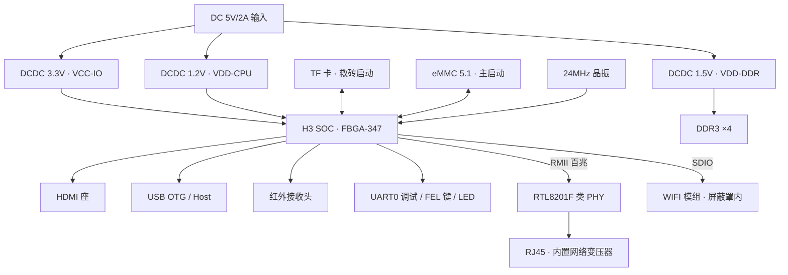

# 第 20 课 · 项目实战 · 4 层板 · H3 机顶盒

> **所属阶段**：阶段四 · 多层板与专项进阶
> **前置课程**：第 14 课；第 11、18 课相关接口与存储；第 19 课 SI/PI、回流与 DFM 基础
> **本课难度**：⭐⭐⭐⭐

---

## 🎯 本课目标

> **项目状态与使用边界**：本课是设计学习与参考工程分析材料；示意参数不是已验证的目标板约束。动手前须落实具体芯片与参考设计版本、完整原理图/BOM、封装、存储和启动资料，以及板厂工艺。相关参数按对应手册、计算和验证结果确定；资料不齐时先做分析练习，不按经验表直接投板。

1. 完成全志 H3 机顶盒整板方案理解与原理图移植：SOC + DDR3 ×4 + eMMC + 百兆网口 + HDMI + USB + WIFI
2. 掌握 4 层板叠层（TOP / GND / PWR / BOTTOM）设计方法与内层平面的分工
3. **完成第一次 BGA 扇出（fanout）**：狗骨式（dogbone）扇出、BGA 区域 4/4mil 级线宽间距规则、过孔选择
4. 完成 DDR3 分组等长布线，理解 3W 规则（3W rule）并应用到 DDR/USB/HDMI 区域
5. 完成 WIFI 区屏蔽罩（shield can）焊盘设计、RMII 网口与网络变压器（magnetics）处理、三路 DCDC 电源平面分割
6. 输出 4 层板生产文件并按 BGA 工艺要求下单

> **做完第 14 课的你现在具备了**：完整闭环经验、规范的布局分区习惯、双面铺铜的纪律。**本课新增挑战**：第一次面对 BGA——焊盘在芯片肚皮下，线必须「扇出」才能逃逸；第一次拥有真正的地平面和电源平面；第一次做分组等长。从这课起，「能不能连上」升级为「连得好不好」。

---

## 📖 正文

### 20.1 项目方案与系统框图

**项目定位**：复刻一台入门 TVBOX（网络机顶盒）主板，板尺寸约 100mm × 80mm。主控全志 H3（四核 Cortex-A7，FBGA-347 封装、0.8mm 球距、15×15mm——**具体球数、球距、焊盘尺寸以官方数据手册封装章节为准**）。H3 内置百兆 EPHY 可直连网口；本课刻意选 RMII 外挂 PHY 方案，便于对照第 11 课练习经典架构。

**系统框图**：



**模块清单表**：

| # | 模块 | 选型建议 | 数量 | 说明 |
|:--:|:--|:--|:--:|:--|
| 1 | 主控 SOC | 全志 H3（FBGA-347） | 1 | 本课主角，BGA 首秀 |
| 2 | 内存 | DDR3 8bit 颗粒（512Mb 级，1.5V；选 DDR3L 则 1.35V，需与电源表同步） | 4 | 组成 32bit 总线，贴 H3 两侧或同侧 |
| 3 | 大容量存储 | eMMC 5.1（153 球 / 11.5×13mm） | 1 | 8bit 总线，紧贴 H3 |
| 4 | 启动介质 | 自弹 TF 卡座 | 1 | 官方系统可从 TF 启动，救砖用 |
| 5 | 网口 | RTL8201F / IP101G 类 PHY + RJ45（内置变压器，如 HR911105A） | 1 | RMII 百兆 |
| 6 | USB | Micro-USB（OTG）+ Type-A（Host） | 2 | OTG 兼做 FEL 烧录口 |
| 7 | 显示 | HDMI Type-A 母座 + ESD 阵列 | 1 | H3 内置 HDMI PHY，外围极简 |
| 8 | 红外 | HS0038 / VS838 接收头 | 1 | 遥控器接收，远离板边噪声 |
| 9 | WIFI | SDIO 模组（XR818 / RTL8189 类）+ 板载天线 | 1 | 屏蔽罩练习的载体（强烈建议做） |
| 10 | 电源 | DC005 座 + 三路 DCDC（2~3A 级同步整流，CPU 路取 3A） | 1 | 见下方电源表 |
| 11 | 时钟 | 24MHz 无源晶振 | 1 | 紧贴 H3，包地 |
| 12 | 调试 | UART0 排针 + FEL 按键 + 系统 LED | — | 留测试点，量产板思维 |

**电源树与电流估算**（轨名、电压以 H3 数据手册电源章节为准，下表为机顶盒方案典型值）：

| 电源轨 | 电压 | 电流估算 | 方案 | PCB 载体 |
|:--|:--:|:--:|:--|:--|
| 5V 输入 | 5V | 峰值 ≥2A | DC005 直进 | ≥40mil 主干 + 4 过孔 |
| VCC_IO（IO/eMMC/HDMI） | 3.3V | ~1.5A | DCDC#1 | L3 平面岛 |
| VDD_DDR（DDR3 电源） | 1.5V | ~0.8A | DCDC#2 | L3 岛 → 星形到 4 颗 DDR |
| VDD_CPU（内核，DVFS 动态调压） | 1.2V（0.9~1.3V） | 峰值 ~2A | DCDC#3（3A 级） | L3 独立大岛 |

**启动与调试链路说明**（画原理图时就要留好）：
- H3 支持 TF 卡 / eMMC / SPI NOR 多种启动介质，本板用 eMMC 主启动 + TF 备份；
- **FEL 模式**是全志的 USB 下载模式：OTG 口接电脑 + 按住 FEL 键上电，即可用烧录工具（如 sunxi-fel / PhoenixSuit）写入系统——这是救砖的命根子，FEL 键必须画、必须好按；
- UART0 调试串口（115200bps）排针必须保留：能上电就看到启动日志（BootLog），黑屏排查全靠它；
- IR 接收头与系统 LED 是「人机确认」：LED 呼吸 = 系统活着，遥控有反应 = IR 链路通。

**资料获取指引**：H3 数据手册从全志官网或代理商、方案商渠道获取；**立创开源硬件平台**搜「H3」「OrangePi Zero」有大量开源原理图可对照；香橙派 OrangePi Zero 官网公开原理图 PDF，是本课最好的参考设计。

### 20.2 叠层设计

| 层号 | 名称 | 用途 | 厚度参考 |
|:--:|:--|:--|:--|
| L1 | TOP | 元件 + 信号 + BGA 外环出线 | 1oz 铜（35µm） |
| — | 半固化片（prepreg） | L1–L2 介质 | ~0.2mm（7628 类） |
| L2 | GND02 | **完整地平面，不许分割** | 35µm |
| — | 芯板（core） | L2–L3 介质 | ~1.0mm |
| L3 | PWR03 | 电源平面（按电压轨分割成岛） | 35µm |
| — | 半固化片 | L3–L4 介质 | ~0.2mm |
| L4 | BOTTOM | 元件 + 信号 + 铺铜 | 35µm |

设计纪律：
1. **L2 是全板的「大地」**，任何理由都不要割它——TOP 信号的第一参考层就是它。
2. **L3 按电源轨分割成岛**：3.3V / 1.5V / 1.2V 各一岛，岛界沿着「不重要的区域」划。
3. **注意：BOTTOM 信号参考的是 L3（电源平面）**。BOTTOM 上走高速线前，先看它下方 L3 是不是完整对应轨的岛——跨岛就是跨分割（split plane），回流路径断裂。底线：**BOTTOM 高速线下方保持同轨完整铜；跨不过去就改走 TOP**。
4. 阻抗说明：低成本 4 层打样通常不做控阻（板厂按标准叠层生产）；若要控阻（如 HDMI 100Ω 差分），下单时勾选阻抗要求并按板厂返回的叠层微调线宽。经验值：TOP 到 L2 介质 ~0.2mm 时，50Ω 微带线宽约 0.33~0.38mm，100Ω 差分约 0.15~0.2mm 线宽 / 0.18~0.25mm 间距——**以板厂阻抗模板为准**。

### 20.3 布局规划

**布局分区图**（H3 居中，高速模块贴身，低速与接口沿边）：

```svg
<svg xmlns="http://www.w3.org/2000/svg" viewBox="0 0 575 345" width="575" height="345" role="img"><rect class="fp-board" x="6" y="6" width="560" height="330" rx="8"/><text x="20" y="26" text-anchor="start" font-size="10" class="fp-strong">电源区（板角，远离天线/音频）</text><rect class="fp-part" x="24" y="36" width="130" height="44" rx="5"/><text x="89.0" y="62.0" text-anchor="middle" font-size="11">DCDC ×3</text><text x="160" y="60" text-anchor="start" font-size="10" class="fp-note">DC005 5V 入口</text><rect class="fp-part" x="320" y="36" width="80" height="44" rx="5"/><text x="360.0" y="62.0" text-anchor="middle" font-size="11">eMMC</text><rect class="fp-part" x="416" y="36" width="90" height="44" rx="5"/><text x="461.0" y="62.0" text-anchor="middle" font-size="11">DDR3 ×2</text><line class="wv-dash" x1="16" y1="94" x2="556" y2="94" stroke="var(--line)"/><rect class="fp-part" x="24" y="108" width="110" height="40" rx="5"/><text x="79.0" y="125.0" text-anchor="middle" font-size="11">RJ45</text><text x="79.0" y="139.0" text-anchor="middle" font-size="11">（内置变压器·板边）</text><rect class="fp-part" x="150" y="108" width="70" height="40" rx="5"/><text x="185.0" y="125.0" text-anchor="middle" font-size="11">PHY</text><text x="185.0" y="139.0" text-anchor="middle" font-size="11">（百兆）</text><rect class="fp-core" x="240" y="104" width="130" height="76" rx="5"/><text x="305.0" y="139.0" text-anchor="middle" font-size="11">H3 BGA</text><text x="305.0" y="153.0" text-anchor="middle" font-size="11">+ 24MHz 晶振</text><rect class="fp-part" x="388" y="104" width="90" height="44" rx="5"/><text x="433.0" y="130.0" text-anchor="middle" font-size="11">DDR3 ×2</text><rect class="fp-part" x="388" y="158" width="90" height="30" rx="5"/><text x="433.0" y="177.0" text-anchor="middle" font-size="11">HDMI 座</text><rect class="fp-part" x="24" y="162" width="110" height="40" rx="5"/><text x="79.0" y="186.0" text-anchor="middle" font-size="11">TF 卡座</text><line class="wv-dash" x1="16" y1="214" x2="556" y2="214" stroke="var(--line)"/><rect class="fp-part" x="24" y="228" width="100" height="34" rx="5"/><text x="74.0" y="243.0" text-anchor="middle" font-size="9">Micro-USB</text><text x="74.0" y="255.0" text-anchor="middle" font-size="9">OTG</text><rect class="fp-part" x="138" y="228" width="86" height="34" rx="5"/><text x="181.0" y="243.0" text-anchor="middle" font-size="9">Type-A</text><text x="181.0" y="255.0" text-anchor="middle" font-size="9">Host</text><rect class="fp-part" x="238" y="228" width="44" height="34" rx="5"/><text x="260.0" y="249.0" text-anchor="middle" font-size="11">IR</text><rect class="fp-part" x="296" y="228" width="120" height="34" rx="5"/><text x="356.0" y="249.0" text-anchor="middle" font-size="9">UART0/FEL 调试区</text><rect class="fp-rf" x="430" y="222" width="120" height="56" rx="5"/><text x="490.0" y="248.0" text-anchor="middle" font-size="9">WIFI + 屏蔽罩</text><text x="490.0" y="260.0" text-anchor="middle" font-size="9">板载天线 → 板边豁口</text></svg>
```

**摆放理由**：
- **DDR3 与 H3 的距离是本板成败关键**：4 颗分组就近摆放（见本课布局图：H3 上侧与右侧各一组），让每组数据线「就近出线」，总线长天然短且对称；地址线走 H3 一侧共享。
- eMMC、PHY、HDMI、WIFI 分占 H3 四个方向，互不打架——**BGA 板布局的本质是给每个方向分配一个「出口」**。
- 24MHz 晶振贴 H3 晶振脚 ≤10mm，包地；H3 本体下方 L2 保持完整地。
- RJ45 与 PHY 同侧直连；网络变压器已集成在 RJ45 内（选「内置变压器」型号省一大堆外围）。
- WIFI 模组放板角，**天线朝板外**，屏蔽罩一侧留天线豁口；天线方向远离 DDR 与电源。
- 电源区占一角，三路 DCDC 排成一列，散热与 EMI 集中处理；功率环路（输入电容→电感→输出电容）面积最小化。

**飞线引导**：先只显示 DDR 相关飞线 → 摆好 DDR 颗粒 → 再显示 eMMC/PHY/HDMI 分组微调 → 最后全板看交叉。BGA 板布局要**分组切换显示**，一次看全所有飞线只会眼花。

**布局验收清单**（进入扇出与布线前逐项打勾）：
- [ ] DDR3 颗粒距 H3 ≤25mm，各字节组就近、方向对准扇出环
- [ ] eMMC 距 H3 ≤25mm，8bit 走线不与 DDR 抢同一出口方向
- [ ] 24MHz 晶振贴片 ≤10mm 且包地区域完整
- [ ] PHY 与 RJ45 同侧直连，MDI 线短
- [ ] 三路 DCDC 集中一角，功率环路（输入电容→电感→输出电容）肉眼可见地小
- [ ] WIFI 模组天线朝外、净空区无铜无件（所有层）
- [ ] UART0/FEL/测试点全部可达，不被屏蔽罩、高件遮挡
- [ ] 全板飞线分组抽查无整板交叉

### 20.4 布线与重点难点

**线宽 / 间距规则表**：

| 对象 | 线宽/间距 | 说明 |
|:--|:--|:--|
| 一般信号 | 5/5mil | 4 层板空间紧张，全局 5mil |
| **BGA 区域内** | **4/4mil（或 3.5/3.5mil）** | 常规工艺上限，下单如实填写并选对应工艺档 |
| DDR3 单端线 | 5mil | 组内并行，间距满足 3W（见 20.7） |
| DDR3 差分（DQS/CK） | 5mil 线宽，对内间距 5mil | 尽量并行走线 |
| HDMI TMDS ×4 对 | 5mil，对内 6~7mil | 差分对，远离板边 ≥20mil |
| USB D+/D− | 5mil，对内 5mil | 并行短走线 |
| 电源主干（外层） | ≥40mil / 约 2A | 经验：外层 1oz、10℃ 温升下 1A 约 0.25~0.3mm 线宽，用板厂线宽计算器复核 |

**布线顺序**：① BGA 扇出 → ② DDR3 分组布线与等长 → ③ HDMI/USB/RMII → ④ 电源平面与电源主干 → ⑤ 其余信号 → ⑥ 铺铜。

**难点一：H3 BGA 扇出六步法**（详细方法论见 20.7）：
1. 查封装：确认焊盘外径、球距（以官方封装为准）；
2. 在 BGA 投影区建区域规则（Room/规则区）：线宽 4mil、间距 4mil、过孔 0.15mm 孔 / 0.30mm 盘；
3. 电源/地焊盘先行：每个地焊盘打 1 孔（可两焊盘共享），电源焊盘 2~4 孔并联直下 L2/L3 平面；
4. 信号焊盘狗骨扇出：过孔打在相邻 4 焊盘正方形中心，焊盘到过孔短走线；
5. 环形逃逸：最内 1~2 环信号从 TOP 过孔间隙直接走出，其余经通孔下到 BOTTOM，在 BGA 投影区内展开引出；
6. 逐环 DRC + 目检，确认无焊盘-过孔、过孔-过孔间距违例。

**难点二：DDR3 分组等长**（第 18 课知识首次实战）：

| 组名 | 包含信号 | 组内误差（经验值） | 备注 |
|:--|:--|:--:|:--|
| 数据组 0 | DQ0~7 + DQS0± + DQM0 | ≤ ±25mil（0.64mm） | DQS 差分对内 ≤5mil |
| 数据组 1~3 | 其余三个字节组 | 各 ≤ ±25mil | 32bit 共 4 组 |
| 地址/命令组 | ADDR/BA/CAS/RAS/WE/CS/CKE/ODT | ≤ ±100mil（2.5mm） | 以 CLK 为基准 |
| 时钟 CLK± | 差分对 | 对内 ≤5mil，与各组 DQS 组间 ≤50mil | — |

> 以上为通用 DDR3 设计经验值，**最终以全志 H3 数据手册 / 硬件设计指南给出的等长表为准**。等长绕线放在组内「最长的线」定标后统一补偿，蛇形线间距 ≥2 倍线宽。

**DDR3 布线三条补充纪律**：
1. **数据组「各自为政」**：每个字节组（8 根 DQ + DQS + DQM）走向自己那一侧的颗粒，不同组之间不交叉、不共用通道；地址组才走「总线共享」；
2. **善用引脚交换（pin swap）**：为让走线顺畅，同一字节组内的 DQ 位序通常可交换（软件可配置），但 **DQS/DQM/CK/控制类引脚绝不允许交换**——交换前查 H3 数据手册的 MIO/引脚复用说明；
3. **参考地完整**：DDR 走线所在层（TOP/BOTTOM）下方的 L2/L3 必须连续；BOTTOM 的 DDR 线要逐根检查下方 L3 是否为对应电源轨连续区。

**难点三：RMII 网口**：
- REF_CLK（50MHz）是命脉：PHY 与 MAC 之间尽量短（≤100mm 级），两侧包地，地孔伴随；
- TX/RX 各 4 根 + MDIO/MDC，按「一组」并行走线，组内不严格要求等长（百兆宽松），但别绕远；
- RJ45 侧 MDI 两对差分（100M 只用 2 对），变压器已内置；PHY 侧按所选 PHY 手册配 RBIAS 电阻（1% 精度）。

**难点四：电源通道**：1.2V CPU 岛是最大电流路径，DCDC 输出到岛用粗线 + 多孔「灌」进去；电感下方及其正下方内层禁止走任何信号线；SW 开关节点铺铜克制够载流即可（面积越大 EMI 越差）。

### 20.5 铺铜、地平面与电源处理

1. **L2 绝对完整**：H3 下方的地焊盘过孔阵就是全板回流枢纽；若某电源必须借 L2，只允许「窄缝借道」且缝两侧补地孔桥接。
2. **L3 分割三原则**：① 岛界避开 BOTTOM 高速线投影；② 每岛进出电源 ≥2 过孔；③ 岛与岛间隙 ≥20mil。
3. TOP/BOTTOM 铺铜接 GND，与 L2 用地孔缝合：BGA 区、DDR 区、晶振区、接口区每 5mm 一个。
4. **每个 BGA 电源焊盘环**配 2~3 颗 100nF（0402/0201 视封装间距塞入）+ DCDC 输出处 22µF 级大电容。
5. HDMI/USB 座外壳脚、RJ45 外壳：经 TVS 或直接接机壳地（chassis/GND 策略按参考设计），接口金属壳就近打孔接地。
6. WIFI 天线净空区（keepout）：天线正下方及外侧 5mm 内所有层禁止铺铜与走线。

### 20.6 DRC 检查与生产文件输出

- **DRC 规则**：全局 5/5mil、BGA 区 4/4mil、过孔 0.15/0.30mm → 错误清零 + 飞线清零；另外手工专项检查：BGA 焊盘-过孔间距、等长报告（输出长度表核对 20.4 表格）。
- **Gerber 输出**：铜层 ×4 + 阻焊 ×2 + 丝印 ×2 + 钻孔 + 板边；CAM 预览逐层检查，重点看 BGA 区阻焊桥是否可制作（板厂标准工艺即可，无需特殊要求）。
- **打样下单参数**（与 2 层板的差异点加粗）：

| 参数 | 选择 | 说明 |
|:--|:--|:--|
| 板层 / 板厚 | **4 层** / 1.6mm | 叠层选 TOP/GND/PWR/BOTTOM 标准结构 |
| 最小线宽/间距 | **如实填 4/4 或 3.5/3.5mil** | 低于免费档位会有少量加价，别谎报 |
| 过孔 | 0.2mm 孔（0.8mm 球距的常规档；0.15mm 小钻针档留给更密 BGA） | 按实际工艺档勾选 |
| 表面处理 | **沉金 ENIG**（推荐） | BGA 焊盘平整度要求高，喷锡会偏锡 |
| 过孔处理 | 过孔盖油 | — |
| 数量 | 5~10 片 | — |
| 阻抗（可选） | 如需控阻则勾选并填要求 | 板厂会返回调整后的线宽 |

- **BOM + CPL 必须导出**：BGA 与 0402 电容**强烈建议委托板厂 SMT 贴片**（钢网 + 回流焊），手工焊 BGA 成功率极低；若坚持手焊，须有热风枪/加热台 + 大量助焊剂，并接受较高报废率。
- 下单备注栏写明：BGA 区域最小线宽/间距数值、过孔最小孔径，方便厂内审核。

**回板验收清单**（开箱即查，别急着上电）：
- [ ] 层数/板厚/颜色与下单一致，板边平整无毛刺
- [ ] BGA 焊盘阻焊完好、无破孔偏孔（放大镜看 BGA 区）
- [ ] 沉金面平整光亮，无氧化发黑
- [ ] 孔位抽检：排针孔、USB 座孔对位准确
- [ ] 丝印位号清晰、无偏移压盘
- [ ] 拿万用表蜂鸣档抽测：GND 各点连通、电源轨之间无短路

**贴片策略选择**（BGA 板第一课）：
- 全委托 SMT：提供 BOM + CPL，板厂代购物料并贴装，贵但稳；适合主控、LPDDR 这类高价值器件；
- 混合模式：BGA 与 0402 委托贴片，连接器、排针自己手焊——性价比之选；
- 无论哪种，**首件（前 1 片）先做目检 + X 光检查 BGA 焊点**（板厂可代做），结合 X 光能力、电气测试与其他检查确认后再批量处理；X 光不能保证识别所有空焊。

### 20.7 本课核心技能专项：BGA 出线 / 屏蔽罩 / 3W 规则详解

**A. BGA 出线通用方法（背下来，以后所有 BGA 板通用）**

球距决定工艺，先背这张表：

| BGA 球距 | 难度 | 推荐过孔（孔/盘） | 线宽/间距 | 每通道线数 | 备注 |
|:--:|:--:|:--|:--|:--:|:--|
| ≥1.0mm | ★ | 0.3/0.6mm | 5/5mil | 2 | 常规免费工艺 |
| 0.8mm | ★★ | 0.2/0.4mm | 4/4mil | 1 | 常规工艺上限内 |
| 0.65mm | ★★★ | 0.15/0.30mm | 3.5~4/3.5~4mil | 1 | 需小钻针工艺，下单注明 |
| 0.5mm | ★★★★ | 0.1/0.30mm 激光盲孔 | 3/3mil | 1 | HDI 工艺，成本明显上升 |
| ≤0.4mm | ★★★★★ | 盲埋孔/堆叠孔 | — | — | 多阶 HDI，量产板常见 |

两种扇出方式：
- **狗骨式（dogbone）**：过孔打在 4 个焊盘的正方形中心，焊盘引短线上过孔——**常规首选**，本课用这种；
- **盘中孔（via in pad）**：过孔直接打在焊盘上，出线最省空间，但必须做树脂塞孔 + 电镀封帽（POFV），打样加价，0.65mm 球距通常用不着。

操作细节：
1. 扇出方向**统一**（建议全部朝一个方向斜打），出线通道才整齐；
2. 先扇出电源/地（数量最多的内环球），再扇出信号，DDR 相关信号**优先分配到 TOP 好逃逸的环位**；
3. 每根信号从焊盘到目标层**只允许 1 个过孔**；
4. 出线顺序从**最内环开始**，内环走不到的层再往外让；
5. 完成后做三查：DRC 间距、逐环目检、等长敏感信号是否走了 BGA 区最顺的通道。

**B. 屏蔽罩（shield can）落地**

屏蔽罩是一个金属结构件，PCB 上要做的是「一圈可焊接的墙脚」：
1. 沿罩体四周布焊盘：约 0603 大小、中心间距 2.0~2.54mm；
2. **每个焊盘旁打 1~2 个 0.3mm 地过孔**直连 L2——接地不良的屏蔽罩只是个装饰品；
3. 罩内区域设高度 keepout：罩外器件、调试点、测试点不得进入；
4. **天线豁口**：板载天线必须伸出罩外，或在罩壁开缺口；天线净空区所有层禁铜；
5. 选两片式可拆屏蔽罩（调试期能掀盖），罩体高度 = 内部最高元件 + 1mm；
6. 最常见错误：把屏蔽罩画成元件层一块实心铜箔——屏蔽靠的是立起来的金属壁，平铺的铜不屏蔽。

**C. 3W 规则（3W rule）**

- 定义：相邻两根线的**中心距 ≥ 3 倍线宽**（W 为线宽），即净间距 ≥ 2W。例：5mil 线 → 中心距 ≥15mil、净间距 ≥10mil。
- 原理：线间电磁场耦合随距离迅速衰减，3W 中心距可把感性串扰（crosstalk）降低约 70%。
- 应用位置：DDR3 数据组**之间**、时钟/复位线两侧、USB/HDMI 与普通信号之间；差分对与差分对之间同样适用（对中心距 ≥3W，条件允许 4W 更好）。
- 局限：3W 是低成本经验规则，不是高速设计的完整答案；更高要求靠**完整参考平面 + 包地 + 地孔隔离**叠加。

**3W 计算示例**（面试常考）：设 DDR 数据线线宽 W=5mil——
- 3W 要求：相邻线中心距 ≥ 3×5 = 15mil，即净间距 ≥ 10mil（约 0.25mm）；
- 若走线只能给 12mil 中心距（净间距 7mil），就不到 3W，此时要么包地隔离、要么挪层；
- 记住量纲：3W 比的是**中心距**不是净间距，考试和评审都在这设坑。

**本课术语速查**：

| 术语 | 英文 | 一句话解释 |
|:--|:--|:--|
| 扇出 | fanout | 把 BGA 焊盘经短走线+过孔引到可布线层 |
| 狗骨式扇出 | dogbone fanout | 过孔打在 4 焊盘中心的经典扇出方式 |
| 盘中孔 | via in pad | 过孔直接打在焊盘上，需塞孔封帽 |
| 树脂塞孔/封帽 | via plugging / POFV | 堵孔电镀，防吸锡、可焊 |
| 串扰 | crosstalk | 相邻走线间的电磁耦合干扰 |
| 3W 规则 | 3W rule | 线中心距 ≥3 倍线宽的降串扰经验规则 |
| 屏蔽罩 | shield can | 焊在板上的金属罩，隔离射频/噪声 |
| 网络变压器 | Ethernet magnetics | 网口信号耦合与隔离器件 |
| 平面分割 | plane split | 一个铜平面切成多个电压岛 |
| 回流路径 | return path | 电流返回路径，须与信号线重叠 |
| 动态调压 | DVFS | 按负载实时调内核电压省电 |

### 20.8 参考开源工程（对照学习）

| 工程 | 获取 | 对照看点 |
|:---|:---|:---|
| OrangePi Zero | 香橙派官网下载中心（原理图 PDF 免费） | **同家族（H2+）官方级参考**：电源树、DDR3、TF/SPI NOR 启动、内置 EPHY 网口 |
| 树莓派 CM4IO 底板 | [官方设计文件库](https://pip.raspberrypi.com/categories/1098-design-files)（KiCad 源文件） | 4 层底板大厂规范：核心板+底板架构、原理图分页/图框/审签、接口电源管理 |
| cmio（社区 CM4 载板） | [github.com/deltabeard/cmio](https://github.com/deltabeard/cmio) | 小而完整的最小载板，适合通读全部 KiCad 源码 |

> 📖 系统的解读方法见第 17 课"经典开源工程解读实战"。

---

## 🔧 动手练习

| # | 练习内容 | 完成标准 |
|:--:|:--|:--|
| 1 | 方案与原理图：对照 OrangePi Zero 等开源资料移植整板原理图 | ERC 无错，电源树三轨完整，模块与 20.1 清单一一对应 |
| 2 | 叠层与规则：建 4 层板，设全局 5/5、BGA 区 4/4 与过孔规则 | 叠层顺序正确，规则区覆盖 BGA 投影区 |
| 3 | 布局：按 20.3 分区图完成整板布局 | DDR3 颗距 H3 ≤25mm 且分组就近；24MHz 贴片；天线净空 |
| 4 | BGA 扇出：完成 H3 全部焊盘扇出与出线 | 扇出方向统一，DRC 零报错，逐环目检通过 |
| 5 | DDR3 布线与等长：分组布线、绕线补偿 | 按选定主控与颗粒指南建立约束，保存来源及等长报告 |
| 6 | 屏蔽罩与接口：WIFI 区屏蔽罩焊盘 + 网口/HDMI/USB 处理 | 按所用模块天线净空及接口设计指南核对，记录依据 |
| 7 | 电源平面：L3 三岛分割 + 电源主干 | 无高速线跨分割，每岛 ≥2 进出孔，DCDC 环路最小 |
| 8 | 生产文件与下单：DRC 清零后输出四件套 | CAM 逐层检查通过，按 20.6 参数完成下单 |

## ✅ 自测清单

- [ ] 能默画 4 层板 TOP/GND/PWR/BOTTOM 叠层并说明每层职责吗？
- [ ] 为什么 L2 永远不分割？BOTTOM 高速线参考的是哪一层？
- [ ] 0.65mm 球距 BGA 用什么过孔、什么线宽间距？0.8mm 呢？
- [ ] 狗骨扇出的过孔打在哪里？盘中孔为什么贵？
- [ ] DDR3 数据组、地址组、时钟的等长目标各是多少（经验值）？最终依据是什么？
- [ ] 3W 规则的内容和原理是什么？净间距至少多少倍线宽？
- [ ] 屏蔽罩在 PCB 上由哪些元素构成？天线怎么处理？
- [ ] 网络变压器内置/外置两种方案的外围差异是什么？
- [ ] 电源平面分割三原则能复述吗？
- [ ] BGA 板为什么推荐沉金 + SMT 贴片？
- [ ] 等长绕线要注意什么，才不会「等长毁所有」？
- [ ] 能说出本板布线的 6 步顺序吗？

## ⚠️ 新手常见坑

1. **BGA 区线宽没改**：全局 5mil 规则直接扇出，出线通道放不下，DRC 一片红——必须先建 BGA 区域规则再扇出。
2. **过孔打在焊盘上但没做塞孔**：回流焊时熔锡沿孔「毛细吸走」，BGA 空焊（head-in-pillow），X 光才能发现——普通工艺下过孔必须离开焊盘。
3. **屏蔽罩画成实心铜皮**：元件层一块填充区既不是屏蔽罩也挡丝印——屏蔽罩= 焊盘圈 + 结构件。
4. **3W 只管了 DDR，忘了 USB/HDMI**：差分对与旁边 Reset、GPIO 挤在一起，串扰让 USB 枚举偶发失败。
5. **BOTTOM 高速线跨 L3 分割**：TOP 时代养成的习惯带到 4 层板，回流路径断裂，EMI 超标——BOTTOM 走线先看下方的岛。
6. **等长绕线毁阻抗**：蛇形间距小于 1 倍线宽、绕在焊盘入口处，长度达标了阻抗和串扰全崩——绕线区留间距、放中段。

## 📚 延伸学习

- **全志 H3 数据手册 / 硬件设计指南**：全志官网或代理商、方案商渠道；重点读封装、电源、DDR 章节与等长表。
- **香橙派 OrangePi Zero 官方资料**：官网公开原理图与 PCB，是 H3 板的最佳参考设计。
- **立创开源硬件平台**：搜「H3」「OrangePi」「机顶盒」，对照 3 个开源工程的 DDR 布局差异。
- **美光 / 三星官网 DDR3 布线应用笔记**（搜 DDR3 routing / PCB design guideline）：颗粒厂商的一手布线建议。
- **Realtek / IC+ 官网**：RTL8201F / IP101 数据手册，RMII 与 RBIAS 设计章节。
- **板厂工艺参数页**（嘉立创 / 捷配）：BGA 板工艺档位、小钻孔、沉金与塞孔选项的价格规则。
