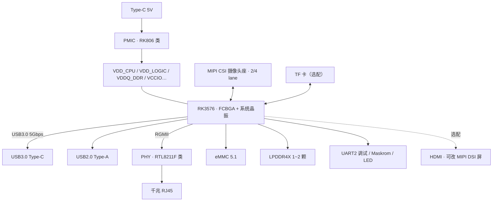

# 第 21 课 · 项目实战 · 6 层板 · RK3576 AI 主板

> **所属阶段**：阶段四 · 多层板与专项进阶
> **前置课程**：第 20 课 · 项目实战 · 4 层板 H3 机顶盒
> **本课难度**：⭐⭐⭐⭐

---

## 🎯 本课目标

> **项目状态与使用边界**：本课是设计学习与参考工程分析材料；示意参数不是已验证的目标板约束。动手前须落实具体芯片与参考设计版本、完整原理图/BOM、封装、存储和启动资料，以及板厂工艺。相关参数按对应手册、计算和验证结果确定；资料不齐时先做分析练习，不按经验表直接投板。

1. 完成瑞芯微 RK3576 人工智能主板整板方案理解与原理图移植：SOC + LPDDR4X + eMMC + 千兆 PHY + USB3.0 + MIPI 摄像头 + Type-C + PMIC
2. 掌握 6 层高速板叠层设计：信号/地/信号/地/电源/信号结构的理由与每层分工、阻抗控制目标
3. 完成 LPDDR4X 分组等长布线（字节组 byte lane / CA 组），掌握蛇形绕线不毁阻抗的规范
4. 掌握高速差分对（USB3.0 / HDMI / MIPI / 千兆 MDI）的系统化处理：阻抗、对内等长、对称换层、伴随地孔
5. **建立盲孔（blind via）/ 埋孔（buried via）概念**：知道何时需要、层对怎么定、成本怎么算，并能在密集区正确使用
6. 完成 6 层板 DRC、等长核对、控阻下单与 SMT 贴片文件输出

> **做完第 20 课的你现在具备了**：BGA 扇出能力、4 层叠层与电源平面分割经验、DDR3 等长与 3W 规则意识。**本课新增挑战**：信号速率全面升级——LPDDR4X、USB3.0（5Gbps）、千兆网口、MIPI CSI 全是高速信号，布线从「连得对」进入「走得稳」；6 层叠层要自己规划信号层与参考层的配对；过孔家族迎来新成员：盲孔与埋孔。

---

## 📖 正文

### 21.1 项目方案与系统框图

**项目定位**：一块可跑 AI 推理的边缘计算主板，板尺寸约 120mm × 90mm。主控瑞芯微 RK3576（4×Cortex-A72 + 4×Cortex-A53 异构八核 + 6TOPS NPU），FCBGA 封装（球距为 0.5~0.65mm 级，**具体以官方数据手册封装章节为准**）。

**系统框图**：



**模块清单表**：

| # | 模块 | 选型建议 | 数量 | 说明 |
|:--:|:--|:--|:--:|:--|
| 1 | 主控 | RK3576（FCBGA） | 1 | 高速信号源，布线难度主体 |
| 2 | 内存 | LPDDR4X 颗粒（16bit 通道 ×2 组成 32bit） | 1~2 | 2~8GB，**排布与通道划分以官方参考设计为准** |
| 3 | 存储 | eMMC 5.1（8bit） | 1 | 32GB 级 |
| 4 | 网口 | RTL8211F 类千兆 PHY + RJ45（内置变压器） | 1 | RGMII 到 SOC、MDI 到 RJ45 |
| 5 | USB | USB3.0 Type-C（OTG，5Gbps）+ USB2.0 Type-A | 2 | 速率与接口规范见 21.4 |
| 6 | 摄像头 | MIPI CSI 2/4-lane BTB/FPC 座 | 1 | 差分对 + I2C + 时钟 |
| 7 | 电源 | RK806 类 PMIC（或官方推荐分立方案） | 1 | 多轨时序由 PMIC 保证 |
| 8 | 时钟 | 系统晶振（**频率与负载电容以参考设计为准**） | 1 | 紧贴 SOC，包地 |
| 9 | 调试 | UART2 排针 + Maskrom 键 + Recovery | — | 瑞芯微平台标准调试件 |
| 10 | TF 卡（选配） | 自弹卡座 | 1 | 烧录备用 |

**高速信号预算表**（开工前盘点，决定叠层与规则投入）：

| 信号类别 | 数量 | 速率/等级 | 布线资源分配 |
|:--|:--:|:--|:--|
| LPDDR4X 数据/CA | 数十根 | 高速、需等长 | L1 + L3 主力，紧贴颗粒区 |
| USB3.0 差分对 | 2 对 | 5Gbps | L1 或 L3，全程控阻 |
| MIPI CSI 差分 | 2~5 对 | Gbps 级 | L1 或 L3 |
| HDMI（选配） | 4 对 | 高速 | L1 或 L3 |
| RGMII | 13 根左右 | 百 MHz 级 | L1 并行组 |
| 千兆 MDI | 4 对 | 125MHz 基带 | L1 短线到变压器 |
| 其余 GPIO/低速 | 若干 | 低速 | L6 + 表面空闲区 |

> 盘点的意义：确认「两层高速信号层（L1/L3）+ 一层慢速层（L6）」的 6 层方案够用；如果接口再增加（比如要加 PCIe），就要重新考虑层数或盲埋孔——**叠层是资源，先算账再开工**。

**电源树概览**（轨名、电压、时序**以 RK3576 Hardware Design Guide 电源树为准**，下表为典型形态）：

| 电源轨 | 典型电压 | 电流量级 | PCB 载体 |
|:--|:--:|:--:|:--|
| VDD_CPU（大核，DVFS） | ~0.8V | 3~5A 峰值 | L5 大岛 + 过孔阵 |
| VDD_GPU / NPU | ~0.8V | 2~4A | L5 岛 |
| VDD_LOGIC | ~0.85V | 1~2A | L5 岛 |
| VDDQ_DDR（LPDDR4X） | 0.6V | 1.5~3A | **独立岛**，贴 LPDDR 摆放 |
| VDD2 / VDD1（LPDDR4X 颗粒本体） | 1.1V / 1.8V | 0.5~1A | 颗粒必需电源轨，勿漏（以官方电源树为准） |
| VCCIO / 1.8V / 3.3V | 1.8V / 3.3V | 0.5~2A | 岛 + 粗线 |

**资料获取指引**：RK3576 Datasheet 与 Hardware Design Guide 从瑞芯微官网及 FriendlyElec（NanoPi R76S/M5）、Radxa（ROCK 4D）、ArmSoM（Sige5）等板卡厂商渠道获取；瑞芯微官方 EVB 原理图随官方资料包发布，是本课最重要的对照物；立创开源硬件平台搜「RK3576」可找到社区开源工程。

### 21.2 叠层设计

6 层板的关键决策：**哪些层走信号、哪些层做平面**。经典结构「信号/地/信号/地/电源/信号」：

| 层号 | 名称 | 用途 | 厚度参考 |
|:--:|:--|:--|:--|
| L1 | TOP | 元件 + BGA 外环出线 + 高速微带线（microstrip） | 1oz 铜 |
| — | 半固化片 | L1–L2 介质 | ~0.10mm |
| L2 | GND02 | **完整地平面** | 35µm |
| — | 芯板 | L2–L3 介质 | ~0.25mm |
| L3 | ART03 | **高速信号主力层（带状线 stripline）**：DDR、USB3、MIPI | 35µm |
| — | 半固化片 | L3–L4 介质 | ~0.20mm |
| L4 | GND04 | **完整地平面** | 35µm |
| — | 芯板（厚） | L4–L5 介质 | ~0.70mm |
| L5 | PWR05 | 电源平面（按轨分割） | 35µm |
| — | 半固化片 | L5–L6 介质 | ~0.10mm |
| L6 | BOTTOM | 元件 + 慢速信号 + 铺铜 | 1oz 铜 |

**为什么这样排**：
1. **每个信号层都紧邻平面**：L1 参考 L2，L3 夹在 L2/L4 两地之间（对称带状线，EMI 最好），L6 参考 L5；
2. **高速信号全集中 L1/L3**：L3 两边都是地，是全板「黄金层」，留给 DDR 与 USB3/MIPI；
3. **L4–L5 用厚介质**：电源平面离地远牺牲了一些平面耦合，换来加工稳定与成本可控（这是 6 层经济叠层的取舍）；
4. **L6 只走慢信号**：它参考的是被分割的 L5 电源平面，这是本结构的短板，要主动规避；
5. 反面教材：不要用「L3/L4 双信号层相邻」的叠层（两层信号紧贴，层间串扰严重），除非两层走线严格正交。

**阻抗控制目标**（线宽最终**以板厂阻抗模板返工值**为准）：

| 信号 | 目标阻抗 | 走线层 | 参考线宽（经验） |
|:--|:--:|:--:|:--|
| 单端 50Ω | 50Ω ±10% | L1 / L3 | L1 约 0.17~0.20mm；L3 更细 |
| USB3.0 差分 | 90Ω 差分 | L1 / L3 | 依板厂模板 |
| HDMI / MIPI CSI 差分 | 100Ω 差分 | L1 / L3 | 依板厂模板 |
| 千兆 MDI 差分 | 100Ω 差分 | L1 | 依板厂模板 |
| RGMII（单端） | 50Ω（尽量） | L1 | 布线短即可 |

> 下单时勾选「阻抗控制」并填上目标阻抗，板厂会按实际叠层返回每层应采用的线宽/间距——**控阻板的线宽以厂返值为准，不要自己算完就锁死**。

### 21.3 布局规划

**布局分区图**：

```svg
<svg xmlns="http://www.w3.org/2000/svg" viewBox="0 0 575 335" width="575" height="335" role="img"><rect class="fp-board" x="6" y="6" width="560" height="320" rx="8"/><text x="20" y="26" text-anchor="start" font-size="10" class="fp-strong">电源区</text><rect class="fp-part" x="24" y="36" width="130" height="44" rx="5"/><text x="89.0" y="62.0" text-anchor="middle" font-size="11">PMIC + 电感群</text><text x="160" y="60" text-anchor="start" font-size="10" class="fp-note">Type-C 5V 入口</text><rect class="fp-part" x="320" y="36" width="80" height="44" rx="5"/><text x="360.0" y="62.0" text-anchor="middle" font-size="11">eMMC</text><rect class="fp-part" x="416" y="36" width="100" height="44" rx="5"/><text x="466.0" y="62.0" text-anchor="middle" font-size="11">LPDDR4X</text><line class="wv-dash" x1="16" y1="94" x2="556" y2="94" stroke="var(--line)"/><rect class="fp-part" x="24" y="108" width="100" height="40" rx="5"/><text x="74.0" y="126.0" text-anchor="middle" font-size="9">USB3 Type-C</text><text x="74.0" y="138.0" text-anchor="middle" font-size="9">（贴左板边）</text><rect class="fp-part" x="140" y="108" width="100" height="40" rx="5"/><text x="190.0" y="126.0" text-anchor="middle" font-size="9">MIPI 摄像头座</text><text x="190.0" y="138.0" text-anchor="middle" font-size="9">（贴边·出线朝外）</text><rect class="fp-core" x="256" y="104" width="130" height="76" rx="5"/><text x="321.0" y="132.0" text-anchor="middle" font-size="11">RK3576</text><text x="321.0" y="146.0" text-anchor="middle" font-size="11">FCBGA</text><text x="321.0" y="160.0" text-anchor="middle" font-size="11">+ 系统晶振</text><rect class="fp-part" x="404" y="104" width="100" height="44" rx="5"/><text x="454.0" y="130.0" text-anchor="middle" font-size="11">LPDDR4X</text><rect class="fp-part" x="404" y="158" width="100" height="30" rx="5"/><text x="454.0" y="177.0" text-anchor="middle" font-size="11">HDMI（选配）</text><rect class="fp-part" x="24" y="162" width="100" height="36" rx="5"/><text x="74.0" y="184.0" text-anchor="middle" font-size="11">TF 卡座</text><text x="140" y="182" text-anchor="start" font-size="9" class="fp-note">RGMII ↓</text><rect class="fp-part" x="190" y="162" width="120" height="36" rx="5"/><text x="250.0" y="184.0" text-anchor="middle" font-size="11">PHY · RTL8211F</text><rect class="fp-part" x="324" y="208" width="150" height="36" rx="5"/><text x="399.0" y="230.0" text-anchor="middle" font-size="11">RJ45（右下角贴边）</text><line class="wv-dash" x1="16" y1="258" x2="556" y2="258" stroke="var(--line)"/><rect class="fp-part" x="24" y="270" width="160" height="34" rx="5"/><text x="104.0" y="291.0" text-anchor="middle" font-size="9">UART2 / Maskrom 调试区</text></svg>
```

**摆放理由**：
- **LPDDR4X 紧贴 RK3576**（间距 ≤20mm 级），且颗粒通道划分方向对准 SOC 的内存引脚扇出方向——LPDDR4X 靠「短」而不是靠「绕」，距离就是信号质量；
- eMMC、PMIC、PHY、MIPI 各占 SOC 一侧，沿用第 20 课「每方向一个出口」的 BGA 布局哲学；
- USB3.0 Type-C 与 MIPI 座贴同一板边且远离 RJ45（千兆变压器是噪声源）；
- PMIC 放 SOC 电源焊盘最近的一角，缩短大电流路径；电感群下方各层禁走线；
- 系统晶振 ≤10mm 贴脚、包地；UART2/Maskrom 放板边便于夹具。

**飞线引导**：BGA 板 + 高速项目的布局要**按总线逐组验证**——切到 LPDDR 相关飞线看是否短且对称 → 切 RGMII → 切 USB3 差分对 → 最后整板检查。每一组都问三个问题：够短吗？对称吗？出线方向顺吗？

**布局验收清单**（布局冻结前逐项打勾）：
- [ ] LPDDR4X 距 RK3576 ≤20mm 级，通道方向与扇出环对准
- [ ] DDR 区、USB3、MIPI、RGMII 各自占用的「出口方向」不互相挤压
- [ ] 系统晶振贴脚 ≤10mm、包地区完整
- [ ] PMIC 距 SOC 电源焊盘最近的一角，大电流路径不绕弯
- [ ] USB3 Type-C、MIPI 座与 RJ45 变压器分边布置
- [ ] 天线/高频敏感区与 DCDC 电感群对角布置
- [ ] UART2/Maskrom/测试点可达，不被屏蔽件与高件遮挡
- [ ] 分组飞线抽查：每组「短/对称/顺」三问全部通过

### 21.4 布线与重点难点

**布线顺序**：① SOC 扇出（沿用第 20 课六步法，必要时引入盲孔）→ ② LPDDR4X 分组布线与等长 → ③ USB3.0 / MIPI / HDMI 差分对 → ④ RGMII → ⑤ 电源岛与主干 → ⑥ 其余信号 → ⑦ 铺铜缝合。

**难点一：LPDDR4X 分组等长**（点对点拓扑，短与等长并重）：

| 组名 | 包含信号 | 误差要求（经验值） | 备注 |
|:--|:--|:--:|:--|
| 通道 A 字节组 0 | DQ0~7 + DQSA±（+DM） | 组内 ≤ ±25mil | DQS 差分对内 ≤5mil |
| 通道 A 字节组 1 | DQ8~15 + DQSB±（+DM） | 组内 ≤ ±25mil | 同上 |
| 通道 A CA 组 | 命令/地址/控制 | 组内 ≤ ±50~100mil | 以官方指南为准 |
| 通道 A CK± | 时钟差分 | 对内 ≤5mil，与 CA 组间相对控制 | — |
| 通道 B 各组 | 同上镜像 | 同上 | 若为双通道颗粒 |
| 组间关系 | DQS↔CK、通道 A↔B | ≤ ±100mil 级 | — |

> **最终以 RK3576 Hardware Design Guide / Datasheet 的等长表为准**——瑞芯微指南通常给出更精确的分组与误差（含参考基准线），拿到后覆盖本表。

**蛇形绕线三纪律（不毁阻抗）**：
1. 蛇形间距 ≥ 2 倍线宽，振幅别贪大——间距太密等于自耦天线；
2. 补偿段放在走线**中段**，远离焊盘入口/出口与过孔区；
3. 组内先布最长线定标，其余线向它看齐；差分对内的小误差用**端部小鼓包（bump）**补偿，不用长蛇形。

**LPDDR4X 走线层分配策略**：
- 数据组走 L1（SOC 出线直接到颗粒，少换层）；CA 组与远端信号借 L3 展开；
- 换层规则：每组换层点集中、组内所有线**换层次数一致**（都 1 次或都 0 次）；
- 善用字节组内 DQ 引脚交换让布线自然顺畅，但 **DQS、时钟、CA 类引脚不可交换**，交换前查 RK3576 复用表；
- 颗粒的电源与参考地过孔在布线前先打好，避免数据线被「后来者」挤弯。

**难点二：高速差分对系统化处理**

| 接口 | 阻抗 | 对内等长 | 关键注意 |
|:--|:--:|:--:|:--|
| USB3.0 TX/RX（两对） | 90Ω | ≤5mil（尽量 3mil） | TX 对上 AC 耦合电容按规范放发送/连接器侧，两电容并排对称 |
| MIPI CSI（时钟对 + 数据对） | 100Ω | 对内 ≤5mil | 通道间对间 ≥3W；连接器下方不走线 |
| HDMI TMDS（选配） | 100Ω | 对内 ≤5mil，对间 ≤15mil | 远离板边 ≥20mil |
| 千兆 MDI 4 对 | 100Ω | 对内 ≤10mil，对间等长尽量 | 变压器至 PHY 短且对称 |

差分对八条军规：
1. 两线同层、同路径、同参考层，全程耦合；
2. 换层成对换，两线过孔数相等、位置对称；
3. 换层处就近打一个伴随地孔（给回流电流开门）；
4. 整对下方参考平面完整，绝不跨分割；
5. 对内等长误差端部小鼓包解决，禁止一边长绕；
6. 拐角用 45° 或圆弧，避免直角；
7. 对与对、对与单端线间距 ≥3W；
8. 远离板边 ≥20mil，远离晶振、DCDC 与时钟线。

**难点三：RGMII**：TXC/RXC 时钟与数据线按「一组」并行，长度相对均匀（避免某根特别长），PHY 侧按手册配 RTL8211F 的延时与配置脚上下拉——RGMII 的时序靠布线**相对长度** + PHY 内部延时配置共同保证，细节数据以 RK3576 指南与 PHY 手册为准。

**难点四：电源通道**：VDD_CPU 峰值 3~5A，PMIC 输出→L5 大岛→SOC 电源焊盘过孔阵（过孔数量依孔壁镀铜、长度、压降、温升与电流分配核算）；VDDQ_DDR 0.6V 独立岛贴 LPDDR，禁止与数字 1.8V 共岛混流。

### 21.5 铺铜、地平面与电源处理

1. **L2/L4 双完整地平面**是本板信号质量的根基，任何分割都要过「高速线参考完整性」审查；
2. L5 电源平面按 21.1 表分岛；岛界避开 L3 高速线与 L1 高速线的投影区；岛间隙 ≥20mil；
3. TOP/BOTTOM 铺铜缝合：BGA 区、DDR 区、差分对换层处每 3~5mm 一个地孔；连接器、屏蔽件金属壳就近接地；
4. 去耦网络：SOC 每电源焊盘环 2~3 颗 0201/0402 100nF + PMIC 输出 22~47µF；LPDDR 每颗电源脚配 100nF；
5. 晶振/时钟区包地成「岛」，出口只留走线缝；MIPI/USB3 座外壳经 ESD 器件接地；
6. 板边 5mm 禁走高速线，板边一圈地孔（间隔 5~8mm）压 EMC。

### 21.6 DRC 检查与生产文件输出

- **DRC**：全局 4.5/4.5mil、BGA 区按球距 3.5~4/3.5~4mil；错误与飞线双清零；
- **专项核对**（高速板三件套）：① 等长报告导出，对照器件手册、参考设计与本项目约束逐组核对；21.4 表中的示例值不能直接当验收标准；② 差分对阻抗层核对（是否都在计划层、线宽是否板厂返值）；③ 盲埋孔层对核对（若使用，见 21.7）；
- **Gerber**：铜层 ×6 + 阻焊 ×2 + 丝印 ×2 + 钻孔（通孔/盲埋孔分开列表）+ 板边；CAM 预览逐层检查；
- **下单参数要点**：6 层 / 1.6mm；勾选**阻抗控制**并附目标阻抗表；BGA 区最小线宽如实填写；沉金；若用盲埋孔，在备注写明层对（如「激光盲孔 1-2」）；BOM + CPL 提交 SMT 贴片（RK3576 与 LPDDR4X 必须贴片）；
- 付款前最后一眼：叠层顺序、板厚、孔径档位、表面处理、阻抗选项——高速板返单损失远大于 2 层板，宁可多检查五分钟。

**回板验收与上电验证**（贴片完成板回来后）：
1. 目检阻容等外露焊点；按质量要求结合 X 光、电气测试和其他方法检查 BGA。X 光不能保证识别所有空焊；
2. 上电前万用表：各电源轨对地阻抗无异常短路；
3. **用带限流的可调电源上电**，观察电流台阶：PMIC 逐轨使能时电流逐级抬升属正常，直接顶到限流值立刻断电；
4. 量各轨电压与电源树标称值比对（±5% 内）；
5. 接 UART2（瑞芯微平台调试串口波特率常为 1500000）抓启动日志：能看到 U-Boot/SPL 输出即说明 CPU/DDR/电源基本盘正常；
6. 烧录测试镜像（RKDevTool / maskrom 流程按官方文档），跑内存与 NPU 冒烟测试。

### 21.7 本课核心技能专项：盲埋孔与高速差分

**A. 盲孔与埋孔：概念、层对与成本**

- **盲孔（blind via）**：从表层出发、只连通到某个内层、不穿透整板。典型：1-2 激光盲孔（孔径 0.1mm），用于 0.5mm 球距 BGA 扇出——表层焊盘直接进盲孔，不占用内层通道；
- **埋孔（buried via）**：完全埋在内部、外表看不见。典型：2-5 埋孔，用于 DDR 区把过孔「藏」进内层，给表层腾出布线空间；
- **层对（layer pair）**：盲埋孔必须成对设计并符合压合次序，例如 6 层板常见「1-2 盲孔 + 2-5 埋孔 + 5-6 盲孔」的组合；**层对一旦定下，过孔跨层关系不能随意改**；
- **成本逻辑**：每增加一种盲埋孔层对 = 增加一次压合 + 对位工序，打样费显著上升。教学建议：**第一版全用通孔完成设计**（0.65mm 球距可行），跑通流程后再练习一版带 1-2 激光盲孔的方案，对比两者的扇出密度与报价差异；

| 过孔方案 | 相对成本 | 典型用途 |
|:--|:--:|:--|
| 全通孔（0.15/0.30mm） | 1× | 0.65mm 球距 BGA、常规密度 |
| 1-2 激光盲孔 + 通孔 | 1.5~2× | 0.5mm 球距出线、表层解堵 |
| 埋孔（如 2-5）+ 通孔 | 2×+ | DDR 区内层腾空间 |
| 多阶 HDI（1-2-3 堆叠等） | 3×+ | 手机/高端模块，量产专属 |
- **DRC 要点**：在规则里为每种过孔指定起止层，让工具自动查「跨层盲孔接不到目标层」这类错误；下单备注必须写层对。

**B. 背钻（back drilling）简介**：高速过孔打通后残留的「残桩（stub）」在高频下相当于天线，背钻工艺把无用段钻掉。10Gbps 级接口（USB3.1 Gen2、PCIe3）常用，本课知道概念即可。

**C. 高速差分检查清单（贴在工位上）**

1. 阻抗：是否用板厂返值线宽？层是否与阻抗计算层一致？
2. 对内等长：是否 ≤5mil？补偿是否在端部？
3. 对称性：两线过孔数、换层点、参考层是否完全一致？
4. 回流：换层处有没有伴随地孔？下方平面是否完整？
5. 间距：对内间距恒定？对间 ≥3W？与单端线呢？
6. 路径：无跨分割、无板边、无穿座、无直角？
7. 器件：AC 电容/ESD 是否成对对称摆放、靠近规范要求的一侧？
8. 长度：整对总长是否在系统预算内（越短越好）？

**本课术语速查**：

| 术语 | 英文 | 一句话解释 |
|:--|:--|:--|
| 盲孔 | blind via | 连通表层与内层、不穿透的孔 |
| 埋孔 | buried via | 完全在内部的过孔 |
| 层对 | layer pair | 盲埋孔的起止层组合，受压合工艺约束 |
| 背钻 | back drilling | 钻掉过孔残桩的高速工艺 |
| 残桩 | stub | 过孔多余段，高频恶化信号 |
| 微带线 | microstrip | 表层暴露在空气中的走线 |
| 带状线 | stripline | 夹在两平面之间的内层走线 |
| 字节组 | byte lane | 8bit 数据 + 对应 DQS 的等长单元 |
| 差分对 | differential pair | 等长等距成对走线的传输结构 |
| 电源管理芯片 | PMIC | 集成多路转换与时序的电源芯片 |

### 21.8 参考开源工程（对照学习）

| 工程 | 获取 | 对照看点 |
|:---|:---|:---|
| BeagleBone Black | [github.com/beagleboard/beaglebone-black](https://github.com/beagleboard/beaglebone-black)（OrCAD 源文件） | 6 层工业级经典：叠层分工、DDR3 等长实测、PMU 时序、工业级 ESD/测试点细节 |
| 树莓派 CM4IO / CM5IO | [官方设计文件库](https://pip.raspberrypi.com/categories/1098-design-files)（KiCad 源文件） | 4 层底板规范与大厂文档习惯，6 层设计同样可借鉴其接口处理 |
| 立创开源 RK 系列 | [oshwhub.com](https://oshwhub.com) 搜"RK3588"（如 tb_rk3588 底板） | 国产平台完整硬件开源，核心板+底板架构与 PMIC 用法（RK3576 工程尚少，先借鉴 RK3588 工程） |

> 📖 系统的解读方法见第 17 课"经典开源工程解读实战"。

---

## 🔧 动手练习

| # | 练习内容 | 完成标准 |
|:--:|:--|:--|
| 1 | 方案与原理图：对照 RK3576 EVB 移植整板原理图 | ERC 无错，电源轨与官方电源树一一对应 |
| 2 | 叠层与阻抗：按 21.2 建 6 层板并申请板厂阻抗返值 | 每层用途明确，线宽采用返值 |
| 3 | 布局：按 21.3 分区完成，重点调 LPDDR4X 摆位 | LPDDR 距 SOC ≤20mm 级、通道方向对准扇出 |
| 4 | SOC 扇出与出线（全通孔版） | 扇出统一、DRC 零错、高速信号走黄金层 L1/L3 |
| 5 | LPDDR4X 布线与等长 | 按所选 SoC、颗粒及设计指南建立规则，保存等长报告与依据 |
| 6 | 差分对布线：USB3/MIPI/HDMI/MDI | 过差分八条军规逐条自查 |
| 7 | 电源平面与大电流通道 | 核算过孔的压降、温升与电流分配，核查高速线参考平面 |
| 8 | 生产文件与下单 | DRC/等长/层对三项核对完成，按 21.6 下单 |
| 9 | （选做）盲孔版：改 1-2 激光盲孔扇出方案 | 层对正确、对比通孔版密度与报价差异 |

## ✅ 自测清单

- [ ] 能默写 6 层「信号/地/信号/地/电源/信号」叠层并说出 L3 为什么是黄金层吗？
- [ ] 本叠层中 L6 的短板是什么？怎么规避？
- [ ] LPDDR4X 的布局策略与 DDR3（第 20 课）最大的不同是什么？
- [ ] 字节组等长的经验值是多少？权威依据去哪找？
- [ ] 蛇形绕线三纪律是什么？
- [ ] 差分对八条军规能背出几条？全过一遍要多久？
- [ ] 盲孔、埋孔、背钻分别是什么？各解决什么问题？
- [ ] 层对是什么？为什么不能随意跨层？
- [ ] 控阻下单的正确流程是什么（自己算 vs 板厂返值）？
- [ ] 大电流电源轨的过孔数量怎么估算？
- [ ] USB3.0 的 AC 耦合电容放哪侧、怎么摆？
- [ ] 高速板交产前的「三项核对」是哪三项？

## ⚠️ 新手常见坑

1. **等长绕线毁阻抗**：蛇形间距压到 1 倍线宽、振幅拉满——长度达标、阻抗和串扰双崩，示波器上眼图闭合。牢记三纪律。
2. **差分对两线过孔数不一致**：一根换层两次一根直走，对内时序歪掉——换层必须成对、对称。
3. **盲孔想直接连 L3**：1-2 盲孔只到 L2，跨层连接被工艺否决——设计前先定层对，DRC 开盲埋孔层检查。
4. **LPDDR4X 颗粒摆太远再靠绕线救**：LPDDR4X 速率下「短」优先于「等长」，布局阶段偷懒布线阶段还不了债。
5. **0.6V VDDQ 与别的轨共岛**：LPDDR4X 的 0.6V 噪声容限极小，共岛混流后内存训练（training）随机失败。
6. **Type-C 只当 5V 电源口没管 CC**：USB3 功能型 Type-C 的 CC 上下拉、VBUS 放电等按规范处理，别照搬第 14 课纯供电思路。

## 📚 延伸学习

- **RK3576 Hardware Design Guide / Datasheet**：瑞芯微官网及 FriendlyElec、Radxa 等渠道；重点读电源树、LPDDR4X 布线与等长表、USB3/MIPI 章节——**本课所有经验值的最终依据**。
- **瑞芯微 RK3576 官方 EVB 原理图**：随官方资料包发布，原理图移植的直接母本。
- **颗粒厂商 LPDDR4X 设计指南**：三星 / SK 海力士 / 美光官网的应用笔记（搜 LPDDR4X design guide）。
- **USB 3.0 布线应用笔记**：Intel/USB-IF 及各大 PHY 厂商的 layout guideline（搜 USB3 routing guideline）。
- **立创开源硬件平台**：搜「RK3576」「RK3588」（3576 工程较少，RK3588 工程可借鉴叠层与 DDR 区处理）。
- **FriendlyElec / Radxa RK3576 开发板资料页**：量产板的布局照片与手册，训练「看别人板子学布局」的眼力。
