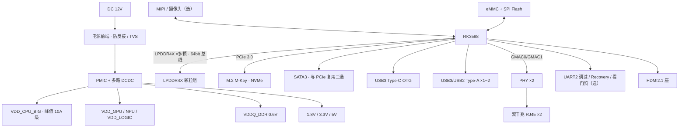

# 第 22 课 · 项目实战 · 8 层板 · RK3588 工业主板（选学）

> **所属阶段**：阶段四 · 多层板与专项进阶
> **前置课程**：第 21 课 · 项目实战 · 6 层板 RK3576 AI 主板
> **本课难度**：⭐⭐⭐⭐⭐

---

## 🎯 本课目标

> **项目状态与使用边界**：本课是设计学习与参考工程分析材料；示意参数不是已验证的目标板约束。动手前须落实具体芯片与参考设计版本、完整原理图/BOM、封装、存储和启动资料，以及板厂工艺。相关参数按对应手册、计算和验证结果确定；资料不齐时先做分析练习，不按经验表直接投板。

1. 完成瑞芯微 RK3588 工业主板整板方案理解与原理图移植：SOC + 多颗 LPDDR4X + eMMC + 双千兆 + PCIe(M.2) + SATA + USB3 + HDMI2.1
2. 掌握 8 层板叠层设计：双信号内层 + 双电源平面（平面对）结构，理解每个取舍
3. 掌握**多电源平面分割方法**：按电压域分岛、岛间间距、信号跨分割的检查与桥接，建立电源完整性（PI）意识
4. 完成 RK3588 散热设计：散热焊盘过孔阵列（thermal via）、塞孔电镀（POFV）、底面导热路径、2oz 铜厚决策
5. 落实工业级要求：宽温选型（-40~+85℃）、EMC 加严（接口防护、共模电感、机壳地策略）、安装孔与固定
6. 输出 8 层控阻板全套生产文件，理解与消费级板在下单、贴片上的差异

> **做完第 21 课的你现在具备了**：高速叠层规划、LPDDR4X 等长、差分对军规、盲埋孔概念。**本课新增挑战**：RK3588 是 10W 级 SoC、几十条电源轨、双面 DDR 环绕——**电源完整性与热设计第一次成为主角**；再加上工业级的宽温、EMC、机械安装约束，这是阶段四的毕业考。作为选学课，它不拦你的进度，但做完它，你的简历厚度会与众不同。

---

## 📖 正文

### 22.1 项目方案与系统框图

**项目定位**：一块工控/边缘计算主板，板尺寸约 160mm × 120mm，目标环境 -40~+85℃、金属机壳内安装。主控 RK3588（4×Cortex-A76 + 4×Cortex-A55，6TOPS NPU，FCBGA-1088 封装（23×23mm），球距 0.65mm（0.4mm 球距的是 RK3588S），**以官方数据手册封装章节为准**）。

**系统框图**：



**模块清单表**：

| # | 模块 | 选型建议 | 数量 | 说明 |
|:--:|:--|:--|:--:|:--|
| 1 | 主控 | RK3588（FCBGA） | 1 | 全板复杂度来源：电源轨多、IO 多 |
| 2 | 内存 | LPDDR4X 颗粒组（64bit 总线） | 2~4 | 多颗粒环绕/同侧双排，**以参考设计为准** |
| 3 | 存储 | eMMC 5.1 + SPI NOR（引导/备份） | 1+1 | 工业板常双启动介质 |
| 4 | 双千兆 | RTL8211F 类 PHY ×2 + RJ45（内置变压器） | 2 | 一路可换官方支持的备选 PHY |
| 5 | PCIe | M.2 M-Key 插座（NVMe SSD） | 1 | 通道数按官方 PHY 复用方案分配 |
| 6 | SATA | SATA3 数据座（+供电） | 1 | **与 PCIe 复用 PIPE PHY，方案期必须二选一定死** |
| 7 | USB | USB3 Type-C（OTG）+ Type-A ×1~2 | 2~3 | USB3 差分 90Ω |
| 8 | 显示 | HDMI2.1 Type-A + ESD | 1 | 高速差分，远离电源 |
| 9 | 电源 | 12V 前端 + RK806 类 PMIC + 分立 DCDC | 1 | 大电流轨用外置 DCDC |
| 10 | 工业 IO | CAN/RS485（选配）、GPIO 端子 | 选 | 有则按隔离方案设计 |
| 11 | 机械 | 安装孔 ×4（Φ3.2~3.5） | 4 | 见 22.3 |

**工业级要求差异表**（相对消费级板，方案阶段就要全队对齐）：

| 维度 | 消费级 | 工业级（本课） |
|:--|:--|:--|
| 工作温度 | 0~70℃ | **-40~+85℃** |
| MLCC 电容 | 常规 X5R | **X7R 及以上**（低温容值不掉光） |
| 电解/储能 | 液态电解 | 固态/聚合物或宽温钽（按预算） |
| 元件等级 | 商业级 | **工业级（I 级）物料，选型时核对温度参数** |
| EMC | 满足基本标准 | **加严**：接口 ESD/共模全面防护、机壳地策略 |
| 机械 | 自由 | **安装孔、固定件、重量、风道都要设计** |
| 寿命 | 2~3 年 | 5~10 年，降额设计（电容电压/纹波电流降额） |

**12V 电源前端设计要点**（工业板入口电路，消费级板没有的功课）：
- 防反接：理想二极管芯片或 PMOS 方案（压降低、不发热），工业现场接反电源是常态；
- 浪涌防护：TVS（如 SMAJ/SMBJ 系列 15V 级钳位）+ 保险丝，抗感性负载切换单峰；
- 共模抑制：入口共模电感 + π 型滤波（两个陶瓷/电解 + 电感），压 EMI 传导；
- 电压余量：12V 输入轨上所有器件耐压 ≥25V（含 TVS 钳位后的残压），电容按 2 倍降额；
- 布局：防护链沿入线方向一字排开（连接器→保险丝→TVS→共模→DCDC），**回流路径不允许防护器件「跨过」前级**。

**资料获取指引**：RK3588 Datasheet / Hardware Design Guide / TRM（技术参考手册）从瑞芯微官网与 Firefly 等方案商渠道获取；Firefly ITX-3588J、Orange Pi 5 等开发板公开原理图是最好的移植母本；立创开源硬件平台搜「RK3588」有社区工程可对照。

### 22.2 叠层设计

**主推结构：信号 / 地 / 信号 / 电源 / 电源 / 信号 / 地 / 信号**（双信号内层 + 平面对）：

| 层号 | 名称 | 用途 | 厚度参考 |
|:--:|:--|:--|:--|
| L1 | TOP | 元件 + BGA 外环 + 高速微带线 | **2oz（70µm）**，兼顾载流与散热 |
| — | 半固化片 | L1–L2 介质 | ~0.10mm |
| L2 | GND02 | 完整地平面 | 35µm |
| — | 芯板 | L2–L3 介质 | ~0.20mm |
| L3 | ART03 | 高速带状线层 1（DDR / PCIe / USB3 / HDMI） | 35µm |
| — | 半固化片 | L3–L4 介质 | ~0.30mm |
| L4 | PWR04 | 电源平面 1（大电流轨：VDD_CPU 等） | 2oz |
| — | 芯板（薄） | **L4–L5 介质 ~0.10mm** | 平面对关键 |
| L5 | PWR05 | 电源平面 2（轨域 + 数字轨岛） | 2oz |
| — | 半固化片 | L5–L6 介质 | ~0.30mm |
| L6 | ART06 | 高速带状线层 2（DDR 环第二层） | 35µm |
| — | 芯板 | L6–L7 介质 | ~0.20mm |
| L7 | GND07 | 完整地平面 | 35µm |
| — | 半固化片 | L7–L8 介质 | ~0.10mm |
| L8 | BOTTOM | 元件（PMIC、连接器）+ 慢信号 + **导热铺铜** | 2oz |

**设计理由与取舍**：
1. **每个信号层都紧邻平面**：L1→L2，L3→L2/L4，L6→L5/L7，L8→L7；四个走线层、两个完整地，高速容量翻倍（多颗 LPDDR4X 需要两层信号内层分担）；
2. **L4/L5 用 0.1mm 薄芯板紧贴**：两电源平面间形成的电容连接在不同电源轨之间，不能直接当作每条轨到地的去耦电容。应按各轨的交流阻抗、平面重叠、回流路径及频率建立 PDN 模型，并与板厂确定叠层；
3. **大电流轨集中 L4、域电源放 L5**：厚铜（2oz）平面载流，轨间耦合与回流需结合实际电源网络分析；
4. **L6 是双参考带状线**（L5/L7 皆可作参考）；L5 跨分割仍可能影响部分回流，两侧平面都要检查。
5. 备选结构「TOP/GND/SIG/GND/PWR/SIG/GND/BOTTOM」（多地结构：3 地 1 电源；具体 EMI、SI 和 PI 表现须按信号路径、供电需求及工艺评估）。应比较多个叠层方案，并依据板厂与器件约束决定。
6. 阻抗目标同第 21 课（50Ω 单端 / 90~100Ω 差分 / PCIe 85~100Ω 以指南为准）；板厚可放宽到 2.0mm 增强平整度与机械强度。

**两种 8 层结构对比**（选型依据，面试可讲）：

| 结构 | 层序 | 优势 | 劣势 | 适用 |
|:--|:--|:--|:--|:--|
| 平面对结构（本课） | SIG/GND/SIG/PWR/PWR/SIG/GND/SIG | 电源轨多、电流大；轨间耦合需单独评估 | L6 参考分割层；EMI 略弱 | 多电源大电流 SoC（RK3588 类） |
| 多地结构 | SIG/GND/SIG/GND/PWR/SIG/GND/SIG | 每个信号层都靠地，EMI/SI 最优 | 电源平面少一个，多电源轨大电流更难分割 | 接口板/射频板/EMC 苛刻场合 |

### 22.3 布局规划

**布局分区图**（RK3588 居中，DDR 环绕，接口沿边，电源集中一角）：

```svg
<svg xmlns="http://www.w3.org/2000/svg" viewBox="0 0 595 345" width="595" height="345" role="img"><rect class="fp-board" x="6" y="6" width="580" height="330" rx="8"/><text x="20" y="26" text-anchor="start" font-size="10" class="fp-strong">电源区</text><rect class="fp-part" x="24" y="36" width="160" height="44" rx="5"/><text x="104.0" y="56.0" text-anchor="middle" font-size="9">电源前端</text><text x="104.0" y="68.0" text-anchor="middle" font-size="9">12V 防反接/TVS</text><rect class="fp-part" x="198" y="36" width="130" height="44" rx="5"/><text x="263.0" y="62.0" text-anchor="middle" font-size="11">PMIC + DCDC 群</text><text x="340" y="60" text-anchor="start" font-size="10" class="fp-note">DC 底 ×1</text><rect class="fp-part" x="430" y="36" width="120" height="44" rx="5"/><text x="490.0" y="62.0" text-anchor="middle" font-size="11">LPDDR4X 颗粒组</text><line class="wv-dash" x1="16" y1="94" x2="576" y2="94" stroke="var(--line)"/><rect class="fp-part" x="24" y="108" width="100" height="40" rx="5"/><text x="74.0" y="126.0" text-anchor="middle" font-size="9">USB3 Type-C</text><text x="74.0" y="138.0" text-anchor="middle" font-size="9">OTG</text><rect class="fp-part" x="138" y="108" width="90" height="40" rx="5"/><text x="183.0" y="126.0" text-anchor="middle" font-size="9">HDMI2.1 座</text><text x="183.0" y="138.0" text-anchor="middle" font-size="9">（与 C 同板边）</text><rect class="fp-part" x="24" y="162" width="80" height="40" rx="5"/><text x="64.0" y="186.0" text-anchor="middle" font-size="11">SATA 座</text><rect class="fp-part" x="116" y="162" width="110" height="40" rx="5"/><text x="171.0" y="186.0" text-anchor="middle" font-size="9">USB3 Type-A ×2</text><rect class="fp-core" x="240" y="108" width="150" height="94" rx="5"/><text x="315.0" y="151.5" text-anchor="middle" font-size="12">RK3588</text><text x="315.0" y="166.5" text-anchor="middle" font-size="12">散热器安装区</text><rect class="fp-part" x="404" y="108" width="140" height="44" rx="5"/><text x="474.0" y="134.0" text-anchor="middle" font-size="11">LPDDR4X 颗粒组</text><rect class="fp-part" x="404" y="162" width="140" height="44" rx="5"/><text x="474.0" y="182.0" text-anchor="middle" font-size="9">M.2 M-Key</text><text x="474.0" y="194.0" text-anchor="middle" font-size="9">（PCIe NVMe）</text><line class="wv-dash" x1="16" y1="216" x2="576" y2="216" stroke="var(--line)"/><rect class="fp-part" x="24" y="230" width="190" height="36" rx="5"/><text x="119.0" y="252.0" text-anchor="middle" font-size="9">PHY ×2 ── RJ45 ×2（板边一字排开）</text><rect class="fp-part" x="228" y="230" width="130" height="36" rx="5"/><text x="293.0" y="252.0" text-anchor="middle" font-size="9">CAN / RS485（选配）</text><rect class="fp-part" x="372" y="230" width="120" height="36" rx="5"/><text x="432.0" y="252.0" text-anchor="middle" font-size="11">UART2 调试区</text><circle class="fp-note" cx="18" cy="18" r="5" fill="none" stroke="currentColor"/><circle class="fp-note" cx="568" cy="18" r="5" fill="none" stroke="currentColor"/><circle class="fp-note" cx="18" cy="318" r="5" fill="none" stroke="currentColor"/><circle class="fp-note" cx="568" cy="318" r="5" fill="none" stroke="currentColor"/><text x="456" y="250" text-anchor="start" font-size="9" class="fp-note">安装孔（四角）</text></svg>
```

**摆放理由**：
- **DDR 环绕策略**：多颗 LPDDR4X 分两组置于 SOC 上下（或同侧双排），每组对准对应通道的扇出方向；等长按「组内短、组间匀」原则，这是 6 层课技能在更大总线宽度上的重复；
- **M.2 插座与 SATA 远离 DDR**：PCIe/SATA 与 DDR 抢层资源，分边后各走各的信号内层（L3 走 DDR，L6 走 PCIe/SATA，或反之，先规划后动手）；
- **双 RJ45 与 PHY 一字排开贴板边**：网口变压器是强噪声源，贴边 + 远离 HDMI 与 USB3；
- **电源区独占一角**：12V 入口→前端防护→PMIC/DCDC 群→平面灌入，大电流路径一条线不绕弯；电感下方各层禁走线；
- **安装孔四角**：孔中心距板边 ≥5mm，孔周 Φ6mm 内**所有层禁铜禁件**；孔是否接 GND 按机壳方案定（需要机壳屏蔽/接地则焊盘接 GND，怕地环路则隔离并留放电间隙）；
- **RK3588 顶面预留散热器空间**：安装孔位与散热器螺柱干涉检查（画 1:1 顶视图核对）。

**飞线引导**：沿用「按总线逐组验证」，本板组多（DDR×2 组、PCIe、SATA、双 RGMII、USB3×2、HDMI），每组单独过一遍「短/对称/顺」三问。

**布局验收清单**（布局冻结前逐项打勾）：
- [ ] LPDDR4X 环绕 RK3588，两组颗粒的通道方向与扇出环对准
- [ ] DDR 与 PCIe/SATA 分边，各自独占一个信号内层资源
- [ ] 双 RJ45 + PHY 一字贴边，远离 HDMI/USB3 与电源
- [ ] 电源前端→PMIC/DCDC 群→SOC 一条直线，无绕行
- [ ] 四角安装孔禁铜禁件区完整，散热器螺柱与高件 1:1 核对无干涉
- [ ] RK3588 顶面散热器空间完整（风道方向与连接器布局不冲突）
- [ ] 所有接口防护器件（TVS/共模）位于接口与芯片之间，顺序正确
- [ ] 分组飞线抽查全部通过「短/对称/顺」三问

### 22.4 布线与重点难点

**布线顺序**：① SOC 扇出（0.65mm 球距按第 20 课工艺表选常规细通孔方案即可；想拔高再练 1-2 阶盲孔 + POFV）→ ② LPDDR4X 两组布线等长 → ③ PCIe / SATA / USB3 / HDMI 差分对 → ④ 双 RGMII → ⑤ 电源平面与大电流通道 → ⑥ 其余 → ⑦ 铺铜缝合。

**难点一：多颗 LPDDR4X 等长**：分组方法与经验值同第 21 课表（字节组组内 ±25mil 级、CA 组 ±50~100mil 级、对内 ≤5mil），**以 RK3588 Hardware Design Guide 为准**；新增要求：两组颗粒之间的走线层分配（L3/L6）与换层点要对称，避免一组全 L3、一组全 L6 造成系统性偏差。

**难点二：高速接口差分规则表**：

| 接口 | 阻抗 | 对内等长 | 对间等长 | 注意 |
|:--|:--:|:--:|:--:|:--|
| PCIe 3.0（M.2） | 85~100Ω（以 RK 指南为准） | ≤5mil | 各 lane 间按指南 | AC 耦合电容位置按规范；换层对称 |
| SATA 3.0 | 100Ω | ≤3mil | — | 尽量短、少打孔 |
| USB3.0 | 90Ω | ≤5mil | — | 差分八条军规（第 21 课） |
| HDMI2.1 | 100Ω | ≤3~5mil（取严） | ≤15mil | 高速率对对内更敏感 |
| 千兆 MDI ×4 对/口 | 100Ω | ≤10mil | 对间尽量 | 两口等长互不迁就 |

**难点三：电源通道规划**（本板第一矛盾）：

| 电源轨 | 典型电压 | 电流量级 | 平面/路径安排 |
|:--|:--:|:--:|:--|
| 12V 输入 | 12V | 2~3A | 外层 ≥60mil + 多孔，先防护后分路 |
| VDD_CPU_BIG | ~0.8V（DVFS） | **峰值 8~10A** | L4 大岛 + 按热和压降预算设计的过孔阵 |
| VDD_GPU/NPU | ~0.8V | 3~5A | L4 岛 |
| VDD_LOGIC | ~0.85V | 2~3A | L5 岛 |
| VDDQ_DDR | 0.6V | 2~4A | L5 独立岛贴 DDR 环 |
| VDD2 / VDD1（LPDDR4X 颗粒本体） | 1.1V / 1.8V | 1~2A | 颗粒必需电源轨，勿漏（以官方电源树为准） |
| 1.8V / 3.3V / 5V | — | 0.5~3A | L5 岛 + 粗线，按域就近 |

（轨名/电压/电流以 RK3588 硬件设计指南电源树为准。）过孔阵列需结合孔壁镀铜、孔长、温升、压降和并联电流分配核算；孔径本身不能决定每孔电流。

### 22.5 铺铜、地平面与电源处理

1. L2/L7 双完整地平面永不分割；平面层出现「借用」需求时优先改信号层走线；
2. L4/L5 电源平面分割详见 22.7 专项；岛间间隙 ≥20~40mil（电压差大取大）；
3. RK3588 散热焊盘下散热过孔阵列（见 22.7）**必须塞孔电镀（POFV）**，否则回流焊吸锡空焊；
4. 去耦网络分层：每电源焊盘环 2~3 颗 100nF（0201）+ 每域 1 颗 10µF 级 + DCDC 输出 47µF 级；工业板再加纹波电流与电压降额核查；
5. 接口地策略：RJ45/HDMI/USB 金属壳经 TVS/RC 接机壳地；机壳地与信号地在入口处一点相连或经 0Ω + 高压电容并联（按 EMC 测试结果调整）；
6. 板边一圈地孔（5~8mm 间距）+ 板边 5mm 禁高速线；晶振与时钟区独立包地岛；
7. BOTTOM 铺铜除走线外兼任「导热扩展面」，与顶面散热焊盘区通过散热过孔阵连接成一条热路。

### 22.6 DRC 检查与生产文件输出

- **DRC**：全局 4.5/4.5mil、BGA 区 3.5/3.5mil、盲孔/POFV 规则单独建类；错误与飞线双清零；
- **专项核对四件套**（高速+大电流板标配）：① 等长报告逐组打勾；② 差分阻抗与层核对；③ 盲埋孔层对与 POFV 孔清单；④ 电源平面载流路径（瓶颈宽度、过孔数）复查；
- **Gerber**：铜层 ×8 + 阻焊 ×2 + 丝印 ×2 + 钻孔（通孔/盲孔分列）+ 板边 + 网表（比对短路/开路）；
- **下单参数要点**：8 层 / 1.6~2.0mm；外层 2oz；勾选阻抗控制并附表；POFV（树脂塞孔+电镀封帽）选项必须勾；沉金；如有盲孔写明层对；备注最小线宽/孔径；
- **SMT 贴片**：BOM + CPL + 坐标原点说明；RK3588 与 LPDDR4X 必须贴片，且选支持 0.65mm 级 BGA 的产线；首件检查（首件确认）要求 X-Ray 检查 BGA 焊点；
- **工业附加项**：装配图（散热器、安装孔位、力矩要求）、EMC 预测试计划（辐射/静电/浪涌项目清单）写进项目文档——工业板交付物不只是 Gerber。

**首件检查清单**（SMT 回板第一片，先查后通电）：
- [ ] 按工艺要求进行 X 光检查，关注桥连、孔中吸锡及可观察的焊点异常；结合电气测试与其他检查，X 光不能排除所有空焊
- [ ] 目检 0201/0402 无立碑、极性件方向全对
- [ ] 电源轨对地阻抗逐轨记录（与正常板互比，建基线）
- [ ] 限流电源上电，观察 PMIC 逐轨使能电流台阶
- [ ] 各轨电压实测记录，与电源树标称比对（±5%）
- [ ] UART2 抓启动日志，确认 SPL/U-Boot 正常输出
- [ ] 满载 30 分钟热成像，记录 RK3588 壳温、PMIC、电感、RJ45 变压器温升

### 22.7 本课核心技能专项：多电源平面分割与散热设计

**A. 多电源平面分割六原则**

1. **先定信号参考层，再画平面分割**：L3/L6 走线方案先冻结，L4/L5 的岛界绕开高速线投影——顺序反了必然返工；
2. **一个电压一个连续岛**：岛内禁止出现同轨孤岛；跨距离供电用粗线/铜皮「搭桥」，桥宽按电流（≥0.5mm/1A 量级）；
3. **优先避免信号跨参考平面分割**：不能避开时需分析参考层与返回电流，按具体电源域和芯片指南设计过渡；不要机械地用固定电容跨接不同电源轨；
4. **大电流轨占 L4（贴近平面对）**，小电流域电源占 L5：评估每条电源轨到地的完整供电网络，并核查两轨之间的耦合；
5. **进出平面靠过孔阵，不靠单孔**：孔数按电流分布、压降、温升和工艺条件核算；
6. **画完必查**：把 L4/L5 叠亮（高亮叠加显示），检查岛间隙、孤岛、以及每条高速线下方的平面连续性——三个检查一次做完。

**电源完整性（PI）意识入门**：PI 的核心问题是「芯片瞬间取电流时，供电网络（PDN）电压跌多少」。设计抓手按性价比排序：① 完整参考地与经过分析的供电路径；② 分级去耦（体电容 + 100nF 环）；③ 大电流路径短而粗、过孔阵列；④ 必要时在电源脚附近加 0201 小封装电容提高高频响应。目标阻抗（target impedance）等量化方法在第 19 课专项课展开，本课先建立「低阻抗、短路径、分级去耦」的手感。

**B. RK3588 散热设计五步法**

1. **算热预算**：满载 ~10W 级（以官方热设计文档为准），确定散热器 + PCB 双路径导热；
2. **散热过孔阵列（thermal via farm）**：RK3588 底部散热焊盘下打阵列——0.3mm 孔、1.0~1.2mm 网格、数量按焊盘面积铺满（数十个），**全部 POFV 塞孔电镀**，直连 L2/L7 地平面；
3. **顶面散热器**：封装顶面涂导热硅脂贴散热器，散热器螺柱与安装孔配合（布局已预留）；风冷加风扇座，留 PWM/转速线；
4. **底面导热扩展**：L8 对应区域 2oz 大面积铺铜开阻焊窗，贴导热垫压到金属机壳/结构件——过孔阵把热带到底面，底面把热摊开；
5. **验证**：热成像/热电偶测满载壳温与关键元件温升，对照结温预算（Tj = Ta + P×θ，θ 取热阻链路合成值）回推是否达标，不达标加风量或加大散热器。

**热预算算例**（方法比数字重要）：
- 假设 RK3588 满载功耗 P=10W，目标环境 Ta=85℃（工业上限），芯片允许结温 Tj≤100℃；
- 允许温升 ΔT = 100−85 = 15℃，要求整个热阻链路 θ总 ≤ ΔT/P = 15/10 = 1.5℃/W；
- 散热器（θ=1.0℃/W）+ 导热界面材料（θ=0.3℃/W）+ 封装到壳（θ=0.2℃/W）合成约 1.5℃/W——恰好压线，需加风冷或加大散热器；
- 结论写进设计文档：这就是「散热设计是算出来的，不是贴个散热片就完事」。

**C. 散热过孔施工参数速查**：

| 参数 | 推荐值 | 说明 |
|:--|:--|:--|
| 孔径 | 0.3mm | 兼顾塞孔工艺与热阻 |
| 网格间距 | 1.0~1.2mm | 覆盖整个散热焊盘 |
| 数量 | 数十个（按焊盘面积铺满） | 越多并联热阻越低 |
| 工艺 | **POFV 树脂塞孔+电镀封帽** | 不塞孔必空焊 |
| 连接 | 全部连通 L2/L7 地平面 | 地平面兼做横向散热片 |
| 底面对应区 | 2oz 铺铜 + 开阻焊窗贴导热垫 | 第二条热路 |

**D. EMC 加严清单（工业板逐项过）**

- 每个对外接口：ESD/TVS 阵列（HDMI 每对、USB D±/VBUS、RJ45 变压器前）、共模电感（USB/HDMI/千兆可选）；
- 防护器件顺序：**先接口后防护再到芯片**（TVS 靠连接器，共模电感在内侧），别放反；
- 机壳地策略与安装孔接地方案（22.3）全板统一，避免地环路；
- 12V 入口：防反接（理想二极管/PMOS）+ TVS 浪涌 + 共模电感 + π 滤波；
- 晶振/时钟包地、板边地孔墙、DCDC 的 SW 节点铺铜克制 + 输出 π 滤波；
- 保留 EMC 预测试迭代预算：首版留 0Ω/磁珠/电容焊盘位，测试不过好改板。

**本课术语速查**：

| 术语 | 英文 | 一句话解释 |
|:--|:--|:--|
| 电源完整性 | PI（Power Integrity） | 供电网络在动态电流下的电压稳定性 |
| 供电网络 | PDN | 从电源到芯片焊盘的完整供电通路 |
| 目标阻抗 | target impedance | PI 量化设计指标（第 19 课展开） |
| 平面电容 | planar capacitance | 相邻平面对形成的固有电容 |
| 桥接电容 | stitching capacitor | 跨分割处给回流电流通路的电容 |
| 散热过孔 | thermal via | 传导热量到其他层/面的过孔阵列 |
| 塞孔电镀 | POFV | 树脂塞孔加电镀封帽，可焊可散热 |
| 热阻 | thermal resistance（θja/θjc） | 结到环境/壳的热阻力参数 |
| 爬电距离 / 电气间隙 | creepage / clearance | 高压安全的空间距离要求 |
| 静电放电 / 电磁兼容 | ESD / EMC | 静电防护与电磁兼容统称 |
| 共模电感 | common mode choke | 抑制共模噪声的磁件 |
| 降额设计 | derating | 元件参数留余量提升寿命 |

### 22.8 参考开源工程（对照学习）

| 工程 | 获取 | 对照看点 |
|:---|:---|:---|
| tb_rk3588 底板 | [oshwhub.com](https://oshwhub.com) 搜"rk3588"（完整硬件开源） | **同芯片平台**：PMIC 多路供电、Type-C/PCIe/双千兆接口、核心板+底板拆分 |
| BeagleBone Black | [github.com/beagleboard/beaglebone-black](https://github.com/beagleboard/beaglebone-black) | 多层工业板分水岭细节：全板 ESD 覆盖、测试点密度、连接器加固、OSHWA 开源认证 |
| 立创开源平台高收藏工程 | [oshwhub.com/explore](https://oshwhub.com/explore) | 按收藏排序找同类大板，重点看别人的 BGA 扇出与电源平面分割 |

> 📖 系统的解读方法见第 17 课"经典开源工程解读实战"。

---

## 🔧 动手练习

| # | 练习内容 | 完成标准 |
|:--:|:--|:--|
| 1 | 方案与原理图：对照 Firefly/Orange Pi 5 移植整板 | ERC 无错，电源树、PHY 复用（PCIe/SATA）分配明确成文 |
| 2 | 叠层与阻抗：按 22.2 建 8 层板并锁定信号层分工 | L4-L5 平面对结构成立，阻抗用板厂返值 |
| 3 | 布局：DDR 环 + 接口沿边 + 电源一角 + 安装孔 | 四角安装孔全层禁铜区；散热器空间 1:1 核对无干涉 |
| 4 | RK3588 扇出（盲孔/细通孔方案） | DRC 零错，高速信号层分配（L3/L6）对称 |
| 5 | LPDDR4X 两组布线与等长 | 等长报告达 22.4 要求，绕线守三纪律 |
| 6 | 高速差分：PCIe/SATA/USB3/HDMI | 差分军规 + 对内对间等长全部达标 |
| 7 | 电源平面分割与过孔阵 | 六原则逐条自查，根据工艺、压降与热预算核算孔数 |
| 8 | 散热设计：过孔阵 + 底面导热 + 散热器选型 | POFV 孔清单进下单备注，热预算计算书成文 |
| 9 | EMC 防护布局：接口防护 + 机壳地策略 | 防护顺序正确，全板机壳地方案图成文 |
| 10 | 生产文件与下单 | 四件套核对完成，装配图/EMC 计划随文件交付 |

## ✅ 自测清单

- [ ] 能默画 8 层主推叠层并解释 L4-L5 薄芯板平面对的作用吗？
- [ ] 备选叠层（多地结构）什么时候才值得选？
- [ ] 电源平面分割六原则能复述几条？
- [ ] 信号实在要跨分割，补救措施是什么？它为什么只是补救？
- [ ] PI 的核心问题一句话是什么？本课做了哪四件事降低 PDN 阻抗？
- [ ] 散热过孔阵列的孔径、网格、数量、工艺要求分别是什么？
- [ ] 为什么散热过孔必须 POFV？不塞孔会发生什么？
- [ ] 10A 电源轨需要多少过孔？依据是什么？
- [ ] 工业宽温对 MLCC 选型意味着什么？X5R 在 -40℃ 会怎样？
- [ ] TVS 与共模电感在接口链路上的先后顺序？
- [ ] 安装孔区域各层怎么处理？接地与否怎么决策？
- [ ] 工业板比消费级板多交付哪些文档？

## ⚠️ 新手常见坑

1. **分割先行、信号遭殃**：先把 L4/L5 割得漂漂亮亮再布线，结果高速线大面积跨分割——一定先冻结信号层方案再画岛界。
2. **散热过孔没塞孔**：焊盘内过孔可能吸走焊料并影响焊点；是否采用填孔、电镀覆盖等工艺，应依封装、焊盘设计及板厂和组装厂要求确认。
3. **平面孤岛与瓶颈**：某轨被其他岛挤成哑铃形，细腰处 20mil 宽——10A 电流把铜当保险丝烧。叠亮 L4/L5 检查每岛形状。
4. **防护器件放反序**：TVS 放芯片侧、共模电感贴连接器，浪涌直接打进芯片——记住「先接口、后防护、再芯片」。
5. **宽温选型漏网**：原理图 Symbol 看着一样，BOM 里混进商业级物料或 X5R，低温下容值掉光、电源纹波暴雷——选型表加「温度等级」列逐行核对。
6. **安装孔与铜皮/器件打架**：孔边禁铜区不足、散热器螺柱压到连接器——机械干涉是工业板返板的高频原因，1:1 顶视图必须画。

## 📚 延伸学习

- **RK3588 Hardware Design Guide / Datasheet / TRM**：瑞芯微官网及方案商渠道；电源树、LPDDR4X 等长、PCIe/USB3/HDMI2.1 章节是本课所有规则的一手依据。
- **Firefly ITX-3588J、Orange Pi 5 官方资料**：公开原理图与硬件手册，量产工业板布局照片值得逐块研读。
- **PCI-SIG / SATA-IO / HDMI 相关芯片厂布线应用笔记**：高速接口阻抗与时序的一手规范解读。
- **热设计入门**：芯片热阻（θja/θjc）应用笔记（各大半导体官网热设计章节），学 Tj 估算方法。
- **IPC-2221**：线宽载流、爬电与间隙等设计标准的原始出处。
- **立创开源硬件平台**：搜「RK3588」，对照社区工程与官方参考设计的平面分割差异，思考为什么。
- **继续复习**：结合第 19 课专项技能强化（EMC/SI/PI/DFM），把本课中的 PI/EMC 内容落实为可核对的设计依据。
