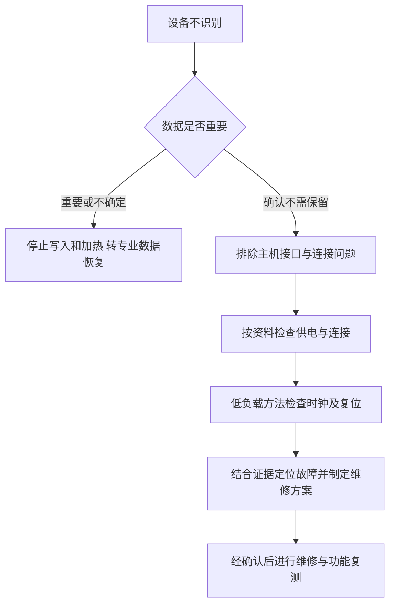
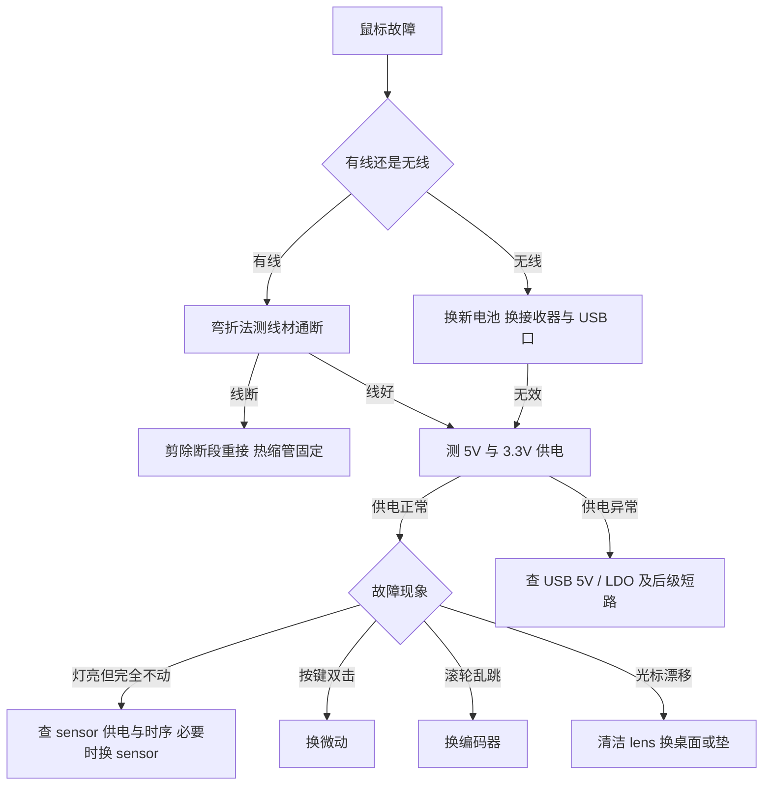
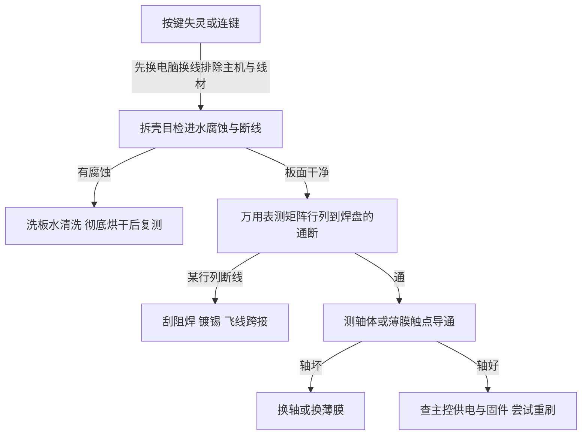
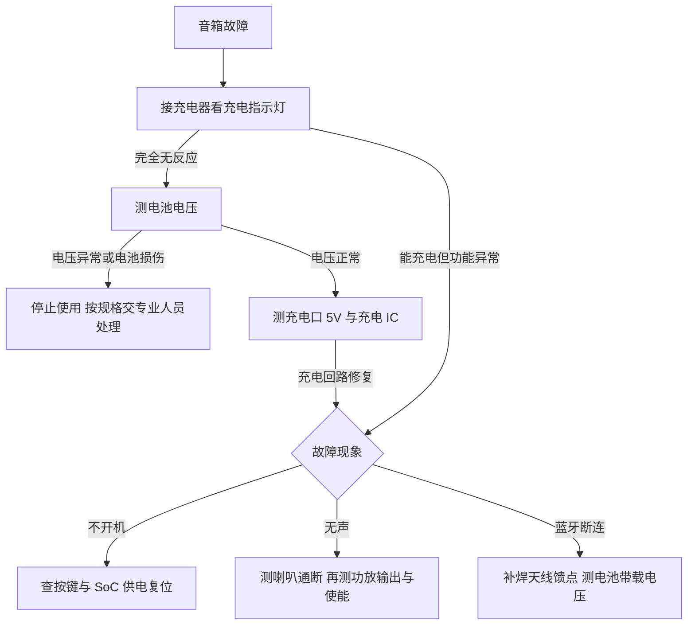

# 第 23 课 · 消费电子维修实战

> **所属阶段**：阶段五 · 选修与职业发展
> **前置课程**：第 15 课 · 工程实践补充（建议先完成第 08 课焊接与第 16 课测试）
> **本课难度**：⭐⭐⭐

## 🎯 本课目标

- 说清维修与设计在能力模型上的异同，能用第 24 课的岗位视角评估维修岗是否适合自己
- 掌握维修通用六步法，把第 15 课 Bring-Up 的分区定位思路迁移到故障板上
- 独立排查 U 盘/读卡器、鼠标、键盘、蓝牙音箱四类高频设备的典型故障
- 能规范执行"先测对地阻抗、再限流上电"的安全上电流程
- 会更换微动、编码器、轴体等易损件，会用飞线修补断线 PCB
- 建立"数据无价、安全第一"的边界意识，知道哪些活不该接

## 📖 正文

### 23.1 维修是一门什么生意、什么能力

**先说透设计与维修的区别**：设计是"从零画"，拿着需求从原理图开始搭；维修是"从故障反推"，拿着一块曾经好用的板子，从症状出发倒推哪一个环节断了。设计的产出是图纸和 BOM，维修的产出是一块恢复功能的板子，外加一张客户认可的收费单。

| 维度 | 设计岗 | 维修岗 |
| --- | --- | --- |
| 输入 | 需求文档、规格书 | 故障现象、客户口述 |
| 思维方式 | 正向：功能 → 电路 → 板卡 | 逆向：症状 → 分区 → 元件 |
| 日常工具 | EDA 软件、仿真器 | 万用表、示波器、可调电源、热风枪 |
| 评判标准 | 一次做对、量产稳定 | 定位快、修复率高、不修坏 |
| 最大风险 | 设计缺陷量产翻车 | 把客户设备修出新故障 |
| 成长路径 | 助理 → 独立 → 主管 | 学徒 → 独立接单 → 开店或转型 |

**和 Bring-Up 是一个血脉**。第 15 课的 Bring-Up 七步法，是把一块"从没活过"的新板第一次带活；维修是把一块"死掉了"的旧板救活。两者共享同一个内核：先确认供电，再确认时钟与复位，最后才查功能链路；都靠仪器三件套（万用表、示波器、可调电源）逐级测量、逐级排除。所以学完 Bring-Up 再学维修，真正要补的不是方法论，而是"故障特征库"——什么症状对应什么坏法。

**维修岗画像**（对照第 24 课的三类岗位框架，这里补上它没讲的维修岗）：厂商售后/产线返修工程师、连锁快修店技师、FAE 或技术支持中的返修分析角色。技能是"读图 + 仪器 + 焊接 + 沟通"四合一，学历门槛相对宽松，但对动手稳定性要求极高——设计画错一根线可以改图重来，维修手一抖就是当场报废。

**维修的三种业态**（先看清这门生意长什么样）：

1. **门店快修**：电脑城/商圈档口，拼"快"——换屏、换电池、换尾插，标准化程度高，备件库存决定周转；
2. **线上寄修**：平台接单、客户寄修，拼"信任"——拆装全程视频留证、报价截图留痕，口碑就是复购；
3. **企业返修/产线维修**：厂商内部岗位，拼"规范"——按 SOP 与失效分析流程走，每单产出维修报告，是跳向测试与 FAE 的最佳跳板（第 24 课）。

**想以副业起步，大致路径是**：先修自己和同学的旧设备攒案例（零成本）→ 网上收"坏件批"练常见故障（低成本）→ 接身边熟人的单并留好评（低风险）→ 再考虑平台寄修（真单量）。每一步都比下一步便宜，顺序别反过来。

**对学生和爱好者的价值**：维修是成本最低、反馈最快的综合练习场。一个坏 U 盘就是"接口 + 电源 + 存储"的综合题，一个坏音箱就是"电池 + 充电 + 音频"的综合题；练手件论个买，修好还能当翻新件出掉。更值钱的是反哺设计：修过几十台设备后你会天然知道哪里容易坏，画板时会主动留测试点、给连接器加固定孔、让发热元件远离电解电容——这是没摸过故障板的设计师给不了的直觉。

把这节课的能力模型先立起来：**看得懂板（读图）、测得出数（仪器）、找得到点（定位）、修得回来（焊接）、讲得明白（沟通）**。本课的四个案例，练的都是这五件事。

**为什么从这四类产品学起**：U 盘是"两三颗芯片 + 一个接口"的最小系统，练电源与接口；鼠标是机电结合体，练换件与手感；键盘练矩阵思维与断线修补；音箱带一块锂电池，练安全意识。四类覆盖"供电、接口、机电、电池"四种基本功，练手件随处可得、结构简单到拆得明白——比一上来就修手机平板友好得多。

本课同时是第 08 课（焊接返修）与第 16 课（硬件测试）的合练场：换微动练烙铁，补 FLASH 练热风枪，回归测试练测量与记录——边学边修，进步最快。

**学法建议**：四个案例不必按顺序全修一遍——挑手边真有的坏件下手，六步法完整走一遍，胜过把本课读三遍（经验之谈）。

### 23.2 维修通用六步法

第 15 课的七步法服务于"新板首次通电"，维修场景把它升级为六步法：**问诊 → 外观检查 → 上电测量 → 分区定位 → 修复 → 回归测试**。每一步都有"过/不过"判据，判据不过关就不进下一步——维修最忌讳"感觉像这里坏了"就动烙铁。

一句口诀记住六步法：**先问后看、先测后通、先电后信、先焊后验**——问诊外观不动电，阻抗电流再上电，电源先于信号查，焊完必须整测。

与第 15 课 Bring-Up 七步法的对应关系：七步法的目检 ↔ 外观检查；断电测对地阻抗 + 限流上电 ↔ 上电测量；测电压轨、查时钟复位、最小系统验证、逐个外设点亮 ↔ 分区定位与回归测试。维修六步法多出来的"问诊"与更完整的"回归交付"两环，正是维修作为"服务业"独有的部分。

| 步骤 | 核心动作 | 新手常犯的错 |
| --- | --- | --- |
| 一、问诊 | 问现象、问时间线、问历史 | 没问进水摔落就拆机 |
| 二、外观检查 | 找烧焦、鼓包、进水、摔痕 | 只看板子正面不翻面 |
| 三、上电测量 | 先测对地阻抗，再限流上电 | 跳过阻抗直接满压上电 |
| 四、分区定位 | 电源 → 时钟 → 复位 → 功能 | 东一枪西一枪乱测 |
| 五、修复 | 补焊、换件、飞线 | 还没定位准就动烙铁 |
| 六、回归测试 | 整机全功能过一遍 | 只验报修的那一项 |

**第一步：问诊。** 维修的问诊和医生问病史是同一个逻辑，要问三件事：

1. **现象**：完全不动、时好时坏还是功能异常？必现还是偶发？持续多久了？
2. **时间线**：出问题前发生了什么——摔过？进过水？换过充电器？系统升级过？
3. **历史与诉求**：之前有人拆过修过吗？客户要的是"设备能用"还是"里面的数据"？这两者的处理路径完全不同。

问诊结论记在维修单上，拆机前给整机拍照留证——既是排障线索，也是责任界定依据。

**问完要复现**。在客户指导下让故障在自己面前发生一次，确认"确实坏了、坏成什么样"。偶发故障先用"应力法"逼它现形——轻压板面、弯折边框、局部加热或冷冻（经验手段），把间歇故障变成必现故障再动手定位。

一张合格的维修单至少包含这些字段：

- 设备型号与序列号、外观照片编号；
- 故障现象（客户原话 + 你的复现结果）；
- 时间线与诱因（摔/水/升级/换件）；
- 是否被人拆修过、谁拆的；
- 客户诉求（修设备 / 救数据 / 两者都要）；
- 报价与免责条款的确认记录。

**第二步：外观检查。** 通电之前，先用眼睛、鼻子和手：

- 看：烧焦（元件变色、板面发黑）、鼓包（电解电容顶部隆起、电池鼓胀）、进水（水渍边界、焊点上的白绿色腐蚀物）、摔痕（外壳棱角磕伤、BGA 元件位移开裂）。
- 闻：电解液泄漏和烧糊的味道很有辨识度，闻过一次就忘不掉。
- 摸（断电状态）：轻晃大体积元件，感受虚焊特有的松动。

外观检查经常能直接"秒杀"故障——一颗鼓包的电解电容、一片烧黑的充电 IC，五分钟的目检抵一小时测量。

工具加持：放大镜或体视显微镜 + 强光侧照手电，能把目检效率翻倍；预算有限时，手机微距镜头是不错的平替（经验做法）。翻面别偷懒，进水痕迹、元件位移这类证据经常藏在板子背面。

**拆机纪律**：拆前拍照、螺丝分格、排线先断电再拔；撬壳用塑料撬片别用刀片；外壳与键帽装回前先"试装对位"。拆得慢没关系，装不回去才是灾难。

**第三步：上电测量——先阻抗，后电流，最后电压。** 这是第 15 课与第 16 课测量纪律在维修场景的强化版：

1. **测对地阻抗**：万用表打二极管档，表笔方向固定（行业常见做法是红表笔接地、黑表笔测各电源轨，属经验习惯，关键是每次保持一致），逐一测各电源轨对地读数。记录表档、极性、测点与读数变化，并与同型号良板或资料对照；低阻、表笔极性和电容充电均会影响读数，不能仅凭固定电压判断短路。
2. **限流上电**：确认无短路后用可调电源供电，电压对准额定值，依据设备正常功耗、启动浪涌和电源说明设置适当限流并观察电流。达到限流可能是启动浪涌、限流设置过低或故障，应断电分析后再判断。
3. **测各档电压**：电流正常后再逐级测 LDO/DC-DC 输出，按第 10 课的电源链逐级核对：输入保护 → 电源变换 → 负载点。

上电后电流读数本身就是诊断信息，记住三种典型形态：

- **电流为零**：供电没进来或保护断开——回头查输入路径与保险、保护电路；
- **电流顶到限流值**：停止测试，检查限流设定、启动条件及可能的过流，再逐段排查；
- **电流偏大且不启动**：可能存在异常负载；断电并结合温度测量工具、分段隔离及电路资料查找原因，发热点不必然是根因。

**上电前顺手两测**：输入保险是否导通、TVS/ESD 保护管两端是否短路。这两类元件是替全板挡枪的，损坏频率高、换起来也便宜，把它们当成上电前的固定安检（经验做法）。

顺手复习第 15 课的仪器分工：万用表管"有没有"（电压、通断、阻抗），示波器管"长什么样"（波形、纹波、时序），可调电源管"给多少"（电压、限流）。维修中三者轮流上，谁也替代不了谁。

**建立自己的"正常值库"**：对地阻抗的正常范围因设备而异，别指望背一张万能表。正确做法是平时遇到好板就顺手测各电源轨并记录，同型号修多了，"一眼看出不对"的直觉其实就是库里有了对照组（经验方法）。

**第四步：分区定位。** 电源好才谈别的，顺序固定为"电源 → 时钟 → 复位 → 功能链路"：

- 电源：各轨电压是否在标称范围、纹波是否异常；
- 时钟：主时钟是否起振（示波器看波形最直观，万用表频率档可凑合）；
- 复位：复位脚电平是否正常释放；
- 功能链路：最后才沿"症状对应的信号路径"逐点测，例如 USB 不认盘就顺着供电与 D+/D- 差分线走（第 11 课）。

定位功能链路用"信号路径法"：把症状对应的信号从输入到输出列成一条链，例如蓝牙无声就是"射频 → 解码 → DAC → 功放 → 喇叭"，沿链逐点测"信号有没有、对不对"，断在哪一环，故障就在哪一环。第 12 课的音频链路、第 11 课的 USB 链路，都可以直接拿来当模板。

时钟与复位的快测：晶振静态电压不能可靠证明起振。优先从芯片可配置的时钟输出或功能表现判断；直接探测晶体节点可能因探头电容改变或停止振荡，需按芯片指南使用适当的低电容探头；复位脚多数低电平有效，开机瞬间能看到"低 → 高"的跳变才算正常释放。这两项不过关，主控再好也是块砖。

**第五步：修复。** 手段就三种，全部依赖第 08 课的焊接功底：

- **补焊**：虚焊、腐蚀、应力开裂的焊点，加助焊剂重新加热成型；
- **换件**：同型号优先；确需替代时核对封装、耐压、逻辑电平三大项；
- **飞线**：PCB 断线的跨接补救，线尽量短而粗、贴板固定、避开活动件与高频线。

修复顺序遵循"先低成本后高成本"：补焊零成本先试，换件其次，飞线作为最后手段（经验原则）。每完成一次修复操作就复测一次，别攒到最后一起验——出了新问题，你不知道是哪一步引入的。

**第六步：回归测试。** 按第 16 课的测试思路把整机功能过一遍，不只验证报修项——动过电源要测全负载，修过接口要测所有外设。测完与客户当面确认交接，说明保修范围与免责条款。

**修完不等于结束**。每单一复盘：根因是什么、哪一步判据帮到了你、哪一步绕了弯路、下次同型故障能省几步。复盘笔记攒起来，就是你在维修这行最值钱的"故障特征库"。

### 23.3 案例一：U 盘与读卡器

**架构**：U 盘就是"主控 + 晶振 + FLASH"三件套，外加一颗 3.3V 小 LDO：

```
USB 座 ──5V──> LDO ──3.3V──> 主控 <──12MHz── 晶振
   │                              │
   └──── D+ / D- ───────────────> │
                                  └──8/16bit──> NAND FLASH
```

- 供电：5V VBUS 经小 LDO（常见 662K 一类 SOT-23 封装）降到 3.3V，主控与 FLASH 都由它供电；
- 主控：一颗芯片集成 USB PHY、MCU 和 NAND 控制器，第 11 课讲的 USB 协议就在这颗芯片里落地；
- 晶振：12MHz 是最常见规格（经验值，也有免晶振靠内部 RC 的方案）；
- FLASH：NAND 颗粒，无引脚或 BGA 封装，焊点疲劳是高发故障点。

读卡器架构类似，只是把 NAND 换成卡座——卡座的机械磨损又是一个独立故障源。

读卡器还有两个独有排查点：一是卡座里的"插卡检测"开关坏了，设备会永远认为没插卡；二是多卡槽机型的卡座到主控走线长，卡座虚焊比主控故障常见得多——先补卡座，再查主控。

**USB 引脚确认**：USB-A 常见触点包含 VBUS、D−、D+、GND；编号方向取决于插头还是插座、正面还是焊接面。先查该连接器图纸并确认观察方向，再结合断电测量与板上走线验证；金属外壳不一定与信号地直接相通，不能据此单独判定引脚。

**常见故障速查表**：

| 常见故障 | 高频原因 | 排查动作 |
| --- | --- | --- |
| 完全不认盘 | USB 头触点磨损/假焊、LDO 无输出 | 先换线换口；测 USB 头电压并补焊；测 3.3V |
| 识别但容量为 0、要求格式化 | FLASH 引脚虚焊、主控与 FLASH 通信异常 | 数据有价值时停止写入或热处理并转专业恢复；无数据诉求时先确认故障再制定维修方案 |
| 插上即掉盘、读写中断 | 供电不稳、LDO 带载差、焊点热胀冷缩 | 检查供电、接触及主机日志；有数据需求时停止写入和热处理 |
| 发热异常 | 过载、供电异常或器件损坏等 | 断电后结合功耗、温度、分段检查及资料确认原因 |
| 只认某一台电脑 | D+/D- 接触不良、线材质量差 | 补焊 USB 头；换短而粗的好线 |
| 读卡器某卡槽不认卡 | 卡座触点氧化变形 | 目检并清洗触点，变形则换卡座 |

**排查路径**（按顺序执行，前一级不过关不做后一级）：

1. **换线换口**：换一根短粗好线和另一个 USB 口，排除主机与线材因素——先排除主机接口和连接问题。
2. **测 VBUS 5V**：插电后测 USB 头 VBUS 是否有 5V；不到位先排查主机端与连接器接触；确认故障后再决定是否返修。
3. **测 LDO 3.3V**：5V 正常就测 LDO 输出；无输出或明显偏低时，区分"LDO 本身坏"还是"后级短路拉低"——断电测量并结合输入输出、分段隔离和器件手册判断，单次二极管档读数无法独立定位。
4. **测晶振起振**：先确认该设备使用何种时钟及其供电；优先利用可用的时钟输出或合适的低负载测量方法。普通探头与万用表频率档可能加载振荡器，不能以一次读数判定晶振故障。
5. **检查主控温度**：通电约 30 秒（经验值）使用适合的温度测量工具检查；温度异常需要进一步结合供电、负载与资料判断，不能直接认定芯片击穿。
6. **进一步定位**：供电与时钟正常仍不认盘，并不能确定 FLASH 焊点故障。数据重要时停止热风、写入或量产工具操作，交专业数据恢复；不需要保留数据时，也应先定位并按器件工艺处理。

**热返修边界**：先确认故障位置、数据诉求、器件温度限制和返修工艺。贸然加热可能损伤芯片、焊盘和数据，不作为“无法识别”后的默认步骤。

**发热三连想**：通电就热，看电源（短路漏电）；用一阵才热，看负载（某芯片击穿或软件死循环拉满负载）；充电才热，看充电回路（充电 IC 或电池内阻偏大）。发热时机不同，排查方向完全不同。

**假设案例（用于分析思路，非实测记录）**：一只 U 盘插入十秒主控就烫手，电脑提示"USB 设备功率超限"。问诊得知它插过客户自己装机的前置 USB 口，怀疑接口接错了线、5V 针上窜入了 12V。断电测得二极管档读数接近 0V，并结合良板对照与分段检查，怀疑短路；拆下 LDO 后再测板上 3.3V 轨，二极管档读数恢复到与同型号良板相近，提示故障可能位于拆下的 LDO；还应对拆下器件进一步检测。选择电压、引脚、稳定性与额定值均匹配的 LDO 更换后，假设该盘正常识别、数据完好。这一单的教训：**过流类故障先怀疑电源件；"拆下再测"是分辨"坏在前面还是坏在后面"的基本功**。

**修 U 盘的备件从哪来**：坏件批里的同型号坏盘是最好的元件供体——拆下好的 LDO、晶振、USB 头留作备件；主控与 FLASH 讲究批次与固件配套，跨板移植成功率低，不建议新手尝试。




**关于量产工具**：各主控原厂（慧荣、群联、联盛等）都有自己的"量产/开卡工具"，能重扫 FLASH 坏块、重写映射表，把"半死"的盘救回出厂状态。但注意——**量产操作会清空盘上全部数据**，它救的是"盘"，不是"数据"。

**"救盘"还是"救数据"，先问再修**：客户需要或可能需要数据，停止写入和加热，转介专业数据恢复；确认无需保留数据后，才可评估维修及量产操作，明确风险并取得客户同意。问清这一条，整单的操作边界就定了。

> ⚠️ **数据恢复警示**：客户说"盘里有重要资料"时，正确的做法是立即停止一切折腾，转介专业数据恢复机构。FLASH 搬板、主控配对这类操作对配件批次和手法要求极高，自己试错的每一步都在加大数据永久丢失的概率。维修人员的职业边界感，就从这一条开始建立。

### 23.4 案例二：鼠标

**架构**：有线鼠标是"光学 sensor + MCU + 微动 + 滚轮编码器 + 线材"五件套，无线鼠标把线材换成 2.4G 接收器（本质是专用 USB 收发器，呼应第 11 课）或蓝牙：

- 光学 sensor：CMOS 拍摄桌面纹理 + DSP 计算位移，属于第 12 课讲过的传感器件，位移数据交给 MCU；
- MCU：汇总位移与按键状态，打包成 USB 报文上传；
- 微动：左中右三颗机械开关，标称寿命几百万到上千万次（厂商标称值），是全鼠标最易磨损的元件；
- 滚轮编码器：机械触点式旋转编码器，滚动一格输出一串脉冲，触点磨损后脉冲乱序；
- 供电：USB 5V 直取，板上常再降 3.3V/1.8V 给 sensor 与 MCU——第 10 课电源链的最小实例。

**无线鼠标的两个独有排查点**：

- **配对与信道**：2.4G 接收器与鼠标出厂配对，丢配对的表现是"接收器插上没反应"，按厂商流程重配即可；多套无线设备同频干扰会造成光标跳动，让客户换信道或用延长线把接收器挪到桌面附近；
- **电量与休眠**：电量低时 MCU 主动降频、射频功率下降，典型表现是"断连越来越频繁"——别急着拆板，先换新电池复测。

**常见故障速查表**：

| 常见故障 | 高频原因 | 排查动作 |
| --- | --- | --- |
| 完全不动、灯不亮 | 线断、USB 头假焊、LDO 坏 | 弯折法找断点；测 5V 与 3.3V 供电 |
| 时好时坏、动一下线就恢复 | 线材根部断股 | 沿线弯折定位，剪除断段重接 |
| 左键双击、单击变双击 | 微动触点氧化弹跳 | 换同型微动 |
| 滚轮乱跳、方向反转 | 编码器触点磨损 | 换同规格编码器 |
| 光标漂移跳动 | lens 脏、桌面/垫不适配、sensor 老化 | 清洁 lens 与垫面；无效换 sensor |
| 无线鼠标频繁掉线 | 电池电压不足、2.4G 同频干扰 | 换新电池；接收器换到主机前置口 |

**双击的根因**：微动内部簧片氧化磨损，接触电阻忽大忽小，MCU 把一次按压读成多次——可能由微动磨损导致，也可能涉及设置或软件消抖，应先排除软件与连接问题，再按检测结果更换。也正因此，换微动是鼠标维修里回报率最高的操作。

**微动更换实操**（第 08 课焊接技能的直接应用）：

1. 拆壳：注意脚贴和标签下面常藏螺丝（经验套路），卡扣沿缝撬别硬掰；
2. 记录型号与朝向：常见欧姆龙 D2FC 系列及各类国产替代，手感与寿命差异很大；
3. 拆旧件：烙铁调到 350℃ 左右（经验值），两脚同时加锡熔化后整体取下；
4. 清孔：吸锡带清理焊盘，露出通孔；
5. 焊新件：微动贴平 PCB，凸点朝向与原装一致，快速焊接避免外壳受热变形；
6. 验证：万用表通断档测"按下导通、松开断开"，装壳试按手感。

**编码器更换**：先拔下滚轮轴记好方向；编码器购买时对照脚位、轴径、总高选同款（拆下实物比着买最稳），焊拆手法与微动相同，触点略多，耐心逐脚加热。

编码器好坏的快判：万用表蜂鸣档搭在信号脚与公共脚之间，慢转滚轮应能听到断续蜂鸣；一直响或一直不响，就是触点磨穿或脏污（经验方法）。

**sensor 的处理原则**：光学 sensor 与固件、lens 配套，拆换成功率低、性价比差。优先做三件事——清洁 lens 表面、换桌面或垫面、确认 sensor 的 1.8V/3.3V 供电正常；供电正常仍漂移，再考虑换 sensor 或礼貌劝退。另外，接收器丢失的 2.4G 鼠标基本等于半废，部分厂商提供补发或重配服务，接单前先查型号政策再报价。

**微动手感与寿命**：同型号微动也有批次与手感之分，玩家圈常按"白点/蓝点"区分按压力度；换微动时左右键尽量用同型号同批次，避免左右手感不一致（经验做法）。

**线材断点查找**：断点绝大多数集中在鼠标出线根部与 USB 头根部两个应力集中点（经验值：约九成）。方法是"弯折法 + 通断档"：万用表表笔固定在电缆两端，沿线路逐段弯折，读数闪断的位置就是断点；剪掉断段、四根线（5V、D-、D+、GND，记好线色）错开接头重焊，热缩管固定。接好后用手反复弯折接头处做疲劳复检（经验做法），过关再装壳。



### 23.5 案例三：键盘

**矩阵扫描原理**（呼应第 04 课的按键与去抖）：键盘不可能给每个键单独拉一根线，而是把按键排在导线交叉点上——N 行 × M 列的矩阵，只需 N+M 根线就能覆盖几十个键。MCU 轮流驱动行线、读取列线，交叉点上的按键按下就把对应行列接通。机械触点闭合瞬间会弹跳约 5~20ms（经验值，第 04 课取同一区间），必须软件连续采样确认有效——这正是第 04 课去抖思想的产品级应用。支持全键无冲的高端键盘会在每键串一支二极管，防止多键同按时行列串扰误判。

理解了矩阵，故障地图会自动浮现：**单键失灵**多为该键的开关或焊点问题；**一整排或一片键失灵**则指向某条行线/列线断线、或排线压伤——故障的"形状"本身就在告诉你坏在哪一层。

**三种键盘结构对比**：

| 结构 | 触点形态 | 典型故障 | 可修性 |
| --- | --- | --- | --- |
| 机械轴 | 每键一个独立开关焊在 PCB 上 | 单键失灵、轴体氧化 | 最好，可换单轴 |
| 薄膜 | 三层塑料膜印刷线路的交叉触点 | 一片键失灵、膜线路断裂 | 一般，通常整膜更换 |
| 剪刀脚 | 薄膜 + 塑料支架（笔记本键盘） | 支柱断裂、键帽脱落 | 结构件好换，电路难修 |

**常见故障速查表**：

| 常见故障 | 高频原因 | 排查动作 |
| --- | --- | --- |
| 单键失灵 | 轴体触点氧化、焊点虚焊 | 万用表测轴体导通；补焊或换轴 |
| 一整排/一片键失灵 | 矩阵某行或某列断线、排线压痕 | 测矩阵行列通断，飞线跨接断点 |
| 连键/串键 | 进水漏电、行列间短路腐蚀 | 洗板水清洗烘干复测；刮除腐蚀补线 |
| 背光不亮 | LED 虚焊、背光驱动管坏 | 补焊 LED；测背光驱动电压 |
| 全键盘无反应 | 线断、主控供电坏、固件崩 | 换线；测供电；尝试重刷固件 |
| 按一次出一串字符 | 进水短路使 MCU 误判行列 | 彻底清洗干燥；腐蚀段刮线补线 |

**轴体更换**：热插拔键盘用拔轴器直接取换（注意热插拔座自身也会虚焊）；焊接轴用第 08 课手法——吸锡带清孔或两脚交替加热拔出，新轴插到底先焊一脚调平再焊另一脚。换轴前先用万用表二极管档确认旧轴"压下导通、松开断开"，别把好轴换了。热插拔键盘若出现某键时灵时不灵，先怀疑热插拔座虚焊，补焊座子比换轴更对症。

**薄膜键盘的修补**：膜线路断裂用导电银漆笔沿断线补画（经验做法，薄涂多层比一次厚涂可靠），补完测通断再覆胶保护；触点氧化用无水酒精轻擦，禁用砂纸——磨掉镀层只会更糟。

**键盘进水的处理**：立即断电、拔掉连接；有可安全拆卸电池的设备应断开电池。不要立即上电或充电。清洁、拆卸和干燥方法须依据设备结构和厂商要求，含电池、屏幕或特殊材料的设备应交专业人员处理；仅靠等待固定时间不能确认内部已干燥。

**背光链路排查**：背光多为 LED 串 + 驱动管。全灭先测背光供电与驱动使能，再测 LED 串两端电压；某一段不亮可能涉及 LED、连接或驱动故障，应断电并使用适配的限流测试工具定位，不要直接逐颗补焊。

**固件层的最后一线**：电路全测正常但电脑仍报"设备无法识别"，仍可能涉及固件、时钟、连接器或未发现的硬件故障；先依据测量结果定位，确认固件、适用工具和数据风险后才考虑重刷。刷固件本身有变砖风险，报价时就要讲清（经验提醒）。

**PCB 修补**：键盘进水后焊盘与走线腐蚀是主流故障。手法：刮开阻焊层露出健康铜面 → 镀锡 → 用细漆包线（0.1mm 级，经验值）飞线跨过腐蚀段 → 点 UV 胶或阻焊油固定。键盘走线细密，飞线尽量贴板、避开轴体活动区。

**测矩阵的具体手法**：万用表通断档，一支表笔固定在主控的某根行线测试点，另一支逐个扫过按键焊盘；正常情况下按下对应键会导通。部分键盘因防冲二极管方向决定表笔极性，扫一遍不通就调换表笔再试（经验技巧）。扫完一行换下一行，断点自然浮出。

**排线与断针**：键区与主控之间常用 FPC 软排线，反复弯折会在金手指附近折断导体，表现为一片键失灵。轻则用橡皮擦清洁金手指后重新插紧（排线锁扣务必压到位），重则换排线或补焊连接器焊脚。



### 23.6 案例四：蓝牙音箱

**架构**：电池 + 充电管理 + 蓝牙 SoC + 功放 + 喇叭，相当于第 10 课电源链和第 12 课音频链拼成的最小系统：

- 电池：聚合物软包或 18650，标称 3.7V，配保护板；
- 充电管理：线性充电 IC（TP4056 一类最常见），5V 输入恒流恒压充至约 4.2V；
- 蓝牙 SoC：射频 + MCU + 音频解码一颗搞定，外接 PCB 天线或弹片天线；
- 功放：D 类功放（PAM8403 一类常见），电池直供或经升压 5V 后推 4Ω/8Ω 喇叭（第 12 课的音频输出链路）。

**两个必懂概念**：

- **保护板**：电芯上的小 PCB，管过充、过放、过流、短路四项保护。过放后保护板会"锁死"断开输出，典型表现是"测电池有电压但设备不开机"——应依照电芯与保护电路资料由专业人员判断；未知、损伤或深度放电电池不应自行激活；
- **带载电压**：静态电压正常不代表带载正常，老化电池一上负载电压就跳水。测音箱要测"播放状态"的电池电压，别只看静态值。

**心里要有电流数量级**（经验值）：蓝牙音箱待机整机电流通常在几到几十 mA，正常音量播放可到几百 mA，充电再叠加几百 mA 到 1A 级。上电先看量级——量级对了再抠细节，量级不对先回头找大问题。

**常见故障速查表**：

| 常见故障 | 高频原因 | 排查动作 |
| --- | --- | --- |
| 完全不开机、充电无指示 | 电池过放锁死、保护板断路 | 测量并查电芯及保护电路规格；未知或损伤电池停止使用并交专业人员处理 |
| 不充电、插充电器无反应 | 充电 IC 坏、充电口虚焊 | 测充电口 5V；测充电 IC 输入输出 |
| 充满很快就没电 | 电池老化容量衰减、虚标电芯 | 测实际放电时间；换正规同尺寸电池 |
| 完全无声 | 喇叭线圈断、功放无输出、静音脚电平错误 | 测喇叭通断；测功放输出与使能脚 |
| 单边无声 | 一侧喇叭线脱焊、触座氧化 | 补焊/清洁喇叭触点 |
| 蓝牙搜不到或频繁断连 | 天线馈点脱焊、电池低电压 | 补焊天线馈点；测电池带载电压 |

**排查路径**：

1. **测电池电压**：记录电芯与保护板两侧的电压，按具体电芯和保护器件规格判断；未知、损伤或疑似深度放电电池停止使用并交专业人员处理，不自行激活；
2. **测充电回路**：插上充电器测充电口 5V 是否到位（不到位补焊充电口——Micro-USB/Type-C 口虚焊是常见病），再测充电 IC 的 BAT 脚电压与充电电流，电流为零要么 IC 坏、要么电池保护板断开；
3. **测功放与使能**：确认 SoC 供电正常后测功放使能脚电平与输出——D 类功放有输出时，喇叭线上能测到明显的 PWM 波形（示波器看得最清楚）；
4. **测喇叭**：断电用电阻档测喇叭两端，4Ω 喇叭读数 3～4Ω、8Ω 读数 7～8Ω 属正常（经验值）；读数无穷大即线圈断线或焊点、触座开路。

**充电口虚焊为何高发**：插拔应力直接传到焊点，Micro-USB/Type-C 座的固定脚一旦开裂就会"时充时不充"。补焊时把数据脚和固定脚一起补才耐用（经验做法）。

**蓝牙断连的射频侧排查**：天线馈点是重灾区——弹簧顶针或焊点脱焊会让发射功率骤降，表现为"近距离正常、隔人就断"。目检馈点、补焊，再在不同距离下测连接稳定性（经验方法）；软件侧先让客户清除配对记录重配，排除手机端缓存问题。

**喇叭异响的快速判断**：音量一大就"沙沙"或"噗噗"，多为纸盆破损或音圈蹭磁隙——轻按纸盆听有无摩擦声（经验手法）；网罩吸了铁屑也会造成怪声，先清理再判坏。进过水的喇叭常是纸盆变形、音圈锈蚀蹭磁隙，表现为音量小、声音发闷，直接换同尺寸同阻抗喇叭最省事。

**回归测试用统一音源**：修完音箱用同一首熟悉的测试曲试听——曲子里要同时有低频、人声和大动态段落，别随手换歌，耳朵也需要对照组（经验做法）。

**电池安全**（本案例的安全红线）：

- 鼓包电池 = 内部已产气，**不戳破、不通电、不加热**，端子贴胶绝缘，放防火袋或铁盒，尽快交电池回收点；
- 换电池选正规渠道、同尺寸同电压、带保护板的电芯；警惕虚标电池——同体积标称容量高得离谱的大概率虚标（经验判断），别按标签算续航；
- 焊接电池引线先焊好线再接电池，或直接选带引线插头的成品电芯；长时间充电测试放在防火垫上，人走断电；
- 长期存放的电芯保持约一半电量（3.8V 左右，经验值），满电长期存放会加速老化。



### 23.7 维修的生意经

**定价思路**：常见结构是"检测费 + 配件费 + 工时费"。检测费覆盖拆机诊断成本，接单时先讲清"拆机不修也收检测费"；修复报价 = 配件成本 + 工时 + 风险溢价（修不好、修坏的概率要自己扛）；修不好只收检测费不收修费。涉及数据的单子单独谈，并且**不承诺数据恢复结果**。

**客户沟通三句话原则**（经验总结）：接单时讲"先检测、检测费多少、修不修你定"；报价时讲"换什么件、总价多少、多久取"；交付时讲"修了什么、保修多久、注意什么"。维修纠纷九成出在没提前讲清，而不是技术本身。报价单上把"检测费、配件费、工时费"三项列成明细，客户看得懂，纠纷自然少。

**配件渠道**（经验做法）：淘宝拆机件——原装微动、原厂电芯等，便宜但品质波动大，挑销量与口碑；通用兼容件——国产轴体、通用充电模块、标准规格件；"坏件批"——论个/论斤收的坏 U 盘与坏鼠标是练手最佳货源。电子件优先选支持退换的店，买前核对规格尺寸。

**哪些能修、哪些不值当修**：

- 值得修：故障点明确且件可换（微动、轴体、线材、电池、喇叭、卡座），设备残值明显高于维修成本；
- 不值当修：主控/SoC 引脚撕裂、多层板内层断线、全机深度进水腐蚀、屏幕总成价格接近设备残值。学会礼貌拒单，同样是专业度的一部分。

**练习件与真实单的分界**：自己买的坏件可以随便拆、随便试；客户设备的第一原则是"别把小病修成大病"。没把握的单子宁可退回，也别拿客户的设备练手——口碑一旦坏了，这门生意就到头了。

**备货思路**（经验）：按"高频低值"备——微动、编码器、常用 LDO、USB 线、热缩管、充电口座；按单采购"低频高值"——电池、屏幕、总成。备件周转的快慢，直接决定这门生意的现金流。

**接单渠道**：起步靠熟人圈口碑，进阶靠二手交易平台的维修服务入口，稳定后可接企业小批量返修外包。渠道决定单量结构——熟人的单子杂而小，企业单稳定但要求报告与流程规范。

**职业路径**（接第 24 课）：维修 → 售后技术/测试工程师（第 16 课的测量能力直接复用）→ FAE（现场应用工程师，最看重"快速定位 + 客户沟通"）→ 硬件设计。面试里"我修过多少台设备、修复率多少"是动手能力与故障定位思维最硬的证据。

### 23.8 安全与边界

**锂电池安全**：充满电的软包电池短路电流可达几十安（经验值），表笔笔尖并到 B+/B- 就是一个打火器。测电池电压用细针尖定点、单手操作；拆电池先断开一根线并绝缘处理，再断另一根——两把剪刀同时剪正负两根线是经典事故；胶粘电池的拆卸遵循设备和电芯制造商方法；对鼓包、受损或难以安全拆卸的电池，交由专业人员处理。

**市电设备**：修直接插市电的设备（适配器、桌面音箱），条件允许务必经**隔离变压器**供电后再测量；隔离不能消除触电风险，仪器接地及设备故障也可能改变回路。初学者不进行市电设备带电检修；断电后电容仍可能有危险电压，须由受训人员按设备规程验证放电状态。

**隐私与数据**：客户的 U 盘、硬盘、手机一律不翻看不拷贝；需要数据操作的环节（如重装、迁移）在维修单上单独授权；换下来的旧存储件归还客户或当面销毁；涉及换存储件的单子，旧件务必当面处理，避免"数据二手流出"的嫌疑。

**带电作业的红线**：只有必须实时观测波形时才值得带电测量。此时单手操作、探头先固定再开机、手腕不搭板沿；其余一切操作（焊接、换件、飞线）一律断电进行。

**业务边界**：不接解锁定制机、绕过账号锁这类单子；收件时登记序列号并拍照，交付时逐项对照——既是流程，也是自保。

**维修台的基础安全配置**（照清单配齐，不涉及品牌）：

- 防火硅胶垫 + 护目镜（热风枪与焊锡飞溅）；
- 电池防火袋或金属盒，暂存待处理电芯；
- "离台先拔烙铁"的肌肉记忆，烙铁必须回架再转身；
- 拆下的螺丝按位置分格收纳——"装完多出三颗螺丝"是维修圈流传最广的事故段子；
- 电池冒烟、起火或异常发热时远离并撤离，及时报警，遵照当地消防部门指引；锂电池可能复燃。

维修是拿别人的设备练自己的手艺。**手稳、嘴稳、账清**这六个字，比任何一台仪器都重要。

## 🔧 动手练习

| # | 练习任务 | 考核点 |
| --- | --- | --- |
| 1 | 找一个坏 U 盘，按六步法完整体检并填写维修单 | 问诊完整，每一步有记录与结论 |
| 2 | 用二极管档测三个正常 U 盘的 3.3V 对地阻抗，建立正常值笔记 | 表笔方向一致，数据可复现 |
| 3 | 拆一只废鼠标，画出"sensor—MCU—微动—编码器"信号框图 | 元件认得全，信号方向画对 |
| 4 | 给一只双击鼠标换微动，记录烙铁温度与手法 | 焊点光亮，按压手感与通断正常 |
| 5 | 用通断档沿一根旧 USB 线找断点并规范重接 | 断点定位准，四线对色正确 |
| 6 | 找一把旧键盘，用万用表描出 3×3 局部矩阵 | 能讲清行列扫描与去抖逻辑 |
| 7 | 测一台蓝牙音箱电池的静态/充电/播放三种电压并记录 | 会安全测电池，数据成表 |
| 8 | 根据低压设备启动电流和说明设置限流并观察 | 记录限流值、启动过程与电压电流；结合其他证据分析异常 |

## ✅ 自测清单

- [ ] 能说出设计与维修在输入、思维方式、评判标准上的三点差异
- [ ] 能背出六步法顺序，并说出每步的"过/不过"判据
- [ ] 知道为什么必须"先测对地阻抗再上电"，短路板直接满压上电的后果是什么
- [ ] 能画出 U 盘三件套架构图，并按顺序说出不认盘的排查路径
- [ ] 知道量产工具救"盘"不救"数据"，重要数据应转介专业机构
- [ ] 能独立完成微动更换全流程，并用万用表验证按压通断
- [ ] 能用弯折法 + 通断档定位线材断点并规范重接
- [ ] 能讲清矩阵扫描为什么只需 N+M 根线，以及去抖的必要性
- [ ] 会判断键盘"单键失灵"与"一排键失灵"分别指向什么层面的故障
- [ ] 能按顺序排查蓝牙音箱不开机：电池 → 充电 → 使能 → 喇叭
- [ ] 知道鼓包电池的处置流程：不戳破、绝缘、防火存放、送回收
- [ ] 知道修市电设备为什么用隔离变压器，没有条件时该怎么办
- [ ] 能说出至少两类"不值当修"的情况和礼貌的拒单话术
- [ ] 能说出维修岗向测试、FAE、设计迁移的路径逻辑

## ⚠️ 新手常见坑

1. **带电动烙铁、带电搭表笔**：通电状态下补焊或测量，表笔一滑就把 5V 短到地，火花一起板子可能当场报废。需要通电测的点先固定好表笔，焊接一律断电做。
2. **不测对地阻抗直接满压上电**：对地短路的板子直接接 5V，电流不受控，烧穿的往往不是原故障点而是电源走线。先断电检查并结合电路资料判断，再按启动条件设置限流上电；表档读数不能单独作为短路结论。
3. **锂电池测量短路**：粗表笔尖同时碰到 B+/B- 就是打火器，轻则烧表重则起火。用针尖定点、贴胶带隔开邻脚、单手操作，换电池时严禁同时剪两根线。
4. **量产工具随手点**：客户盘一插，"低格/开卡"一点，数据全清。工具界面看着像格式化，后果是灾难级的——动手前必须先确认数据诉求。
5. **热风枪不设防**：吹 FLASH/编码器时不盖铝箔、不做预热，隔壁塑料连接器和外壳一起遭殃，电路修好了结构拆坏了。风温从低档起步（经验做法），周边用铝箔遮挡。
6. **洗完板不烘干就上电**：洗板水或酒精残留在缝隙里造成漏电，测出一堆假故障。清洗后按清洗剂、器件和设备要求充分干燥，确认无残留后再测，避免被"幽灵故障"带偏方向。

## 📚 延伸学习

以下关键词自行搜索拓展（不指定具体链接，价格请以当下市场为准）：

- U 盘维修入门：`U盘 不认盘 维修`、`U盘 量产工具 开卡`
- 鼠标/键盘维修：`鼠标 微动 更换 教程`、`键盘 矩阵 扫描 原理`、`机械键盘 换轴 教程`
- 音箱与电池：`蓝牙音箱 不开机 维修`、`TP4056 充电电路 原理`、`聚合物锂电池 安全 存放`
- 通用功力：`万用表 二极管档 对地阻值 判断短路`、`可调电源 限流 上电 方法`、`隔离变压器 维修 作用`、`洗板水 使用与烘干`
- 职业向：`FAE 岗位 要求`、`售后维修工程师 面试`
